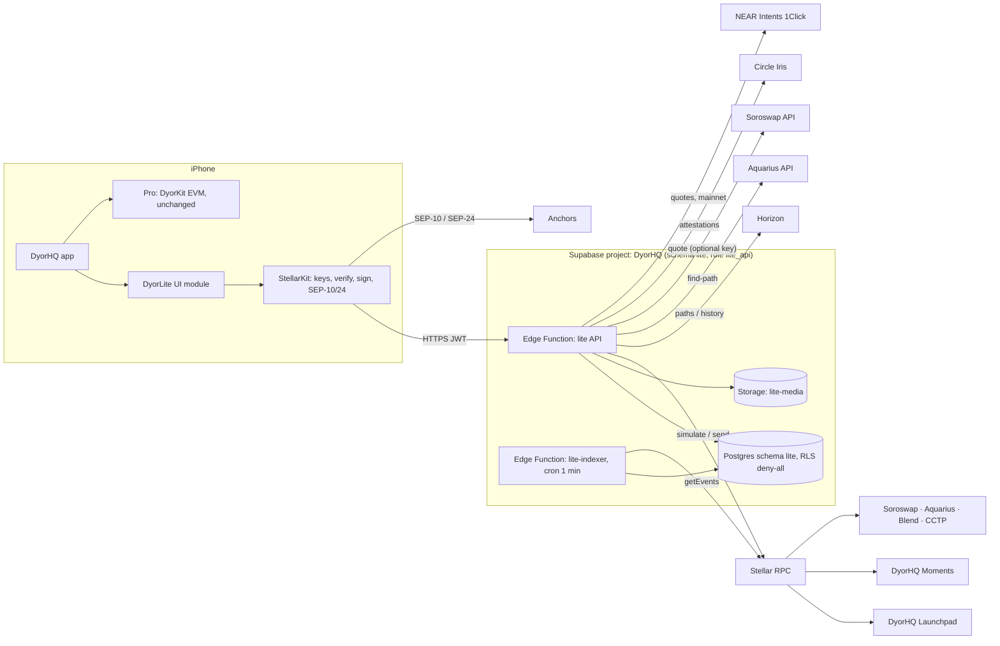
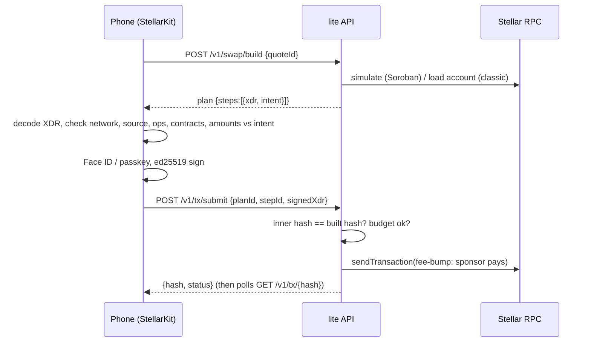

# DyorHQ Multichain: Stellar Lite + Monad Pro

Status: design v1, 2026-10-11. Scope: Stellar **testnet**, internal testers only, until the Metropolis hackathon
ends and access is granted on purpose. Owner: Jay. Repo: `DyorHQ/multichain-stellar` (private).

## 1. Kill Critics: can DyorHQ go multichain on Stellar?

**Verdict: yes.** Wallet, swap, yield, launchpad, collectibles, cash in/out and a Monad bridge all have working
primitives on Stellar today. Three features change shape, and four facts set hard limits. Everything below was
checked against live endpoints or primary docs on 2026-10-11.

| Feature on Monad (Pro) | On Stellar (Lite) | Status | What decides it |
|---|---|---|---|
| Wallet (passkey, email, import, watch) | Same accounts, a Stellar key derived from the same secret | Ready | SEP-5 (`m/44'/148'/0'`) from the same 24 words; HKDF for email accounts; fee-bump + sponsored reserves so users never hold XLM for fees |
| Apple / Google sign-in (Privy) | Phase 2 | Gap | Privy supports Stellar only through its server API (`raw_sign`), not the iOS SDK |
| Swap (aggregated) | Best of SDEX, Soroswap, Aquarius | Ready | Horizon path finding and Aquarius `find-path` need no key; Soroswap's API needs one (router is called directly without it) |
| Perps (Perpl) | **Yield** (Blend v2 lending) | Ready | No Stellar perps venue with Perpl's depth. Blend v2 pools are live on testnet (XLM, USDC, wETH, wBTC) |
| Launchpad | Soroban bonding curve that graduates into Soroswap with locked LP | Ready (our contracts) | Same economics as Monad: 1B supply, 1% fee, 10x launch-to-graduation FDV, anti-snipe schedule |
| Moments | In-app collectible editions (SEP-50 NFTs, OpenZeppelin base) | Changed | **OpenSea does not support Stellar.** No marketplace indexes Soroban NFTs, so Lite Moments stay in-app; Moments with coins stay on Monad |
| Bridge | Monad ↔ Stellar USDC | Ready on mainnet, testnet via CCTP | NEAR Intents 1Click moved 10 USDC Monad → Stellar in ~35 s (mainnet only). CCTP v2 runs on both testnets (Stellar domain 27, Monad 15) |
| Cash in/out | SEP-24 anchors | Ready | testanchor.stellar.org (testnet). MoneyGram needs allowlisting; Africa: Link (NGN), ClickPesa (KES); no GHS rail found |

**The critic's best shots, answered**

1. *"Two chains doubles the surface and halves the focus."* Lite is not a port. It is a different product for a
   different user: save, earn, swap, launch, collect, cash out. Monad Pro keeps perps, memecoins and Moments coins.
   One toggle, one account, two interfaces. The Monad app is not touched before the Oct 13 submission.
2. *"Stellar users don't want memecoins."* Then the launchpad is the cheapest experiment we will ever run: the same
   curve math as Monad, ~1,000 lines of Rust, no new liquidity venue. If it doesn't move, Lite still stands on
   earn + swap + cash.
3. *"Self-custody on Stellar means XLM reserves and trustlines: Web2 users will bounce."* DyorHQ sponsors the
   account reserve and trustlines (CAP-33) and pays every fee (fee-bump, CAP-15). A new user holds 0 XLM and never
   sees the word "trustline".
4. *"Testnet USDC is fragmented."* True: three "USDC" contracts on testnet (Circle's, Blend's, Soroswap's). Lite
   uses Circle's (`GBBD47IF…`, the one testanchor and CCTP use) as *the* USDC, and labels Blend's as a test asset.
   Mainnet has one USDC (Circle, `GA5ZSEJY…`) used by Blend, Soroswap, Aquarius and the anchors.
5. *"Horizon is being retired."* RPC is the primary data plane. Horizon is used only where RPC has no replacement
   (path finding, classic history), behind one adapter, so the swap can move to Stellar RPC + an indexer later.
6. *"Testnet resets."* Next reset 2026-12-16. Deployment is one script (`backend/scripts/deploy-contracts.ts`);
   the indexer drops testnet rows on a network-ID change.

## 2. Product shape

```
┌──────────────── DyorHQ (one app, one account) ────────────────┐
│  Home's balance card:  [ ◉ Monad ⌄ ]  ⇄  [ ◉ Stellar ⌄ ]        │
│                                                                 │
│  Monad (unchanged)            Stellar (new, testnet)            │
│  Home · Launch · Trade ·      Home · Earn · Launch · Moments    │
│  Moments                      (Bridge, Deposit, Withdraw, Swap  │
│  perps, memecoins,            and Add cash are actions on Home) │
│  Moments coins                                                  │
└─────────────────────────────────────────────────────────────────┘
```

The app shows its network, not a mode (DECISIONS #18). The network chip exists only in the internal build (the
`STELLAR_LITE` compile flag, internal TestFlight group only) with the app's `stellarLite` remote flag on. Switching
then needs the Lite API's own flag (`lite.enabled`) and an active row for the account's Stellar address in
`lite.testers`, joined with a single-use invite during Setup. App Store and external testers' builds don't contain the
Stellar code at all: only the generated internal project links the packages, because a compile flag can't unlink a
package (INTEGRATION-ios.md §0).

## 3. System architecture



**Principles**

1. *The server builds, the phone verifies, the phone signs, the server relays.* Every transaction the user signs was
   built by the API, decoded and checked on the device against the intent the user confirmed, signed with a key
   that never leaves the device, then wrapped in a fee-bump by the sponsor and submitted.
2. *The sponsor only pays for what it built.* `/tx/submit` fee-bumps a transaction only if its hash equals a step of
   a plan this server built for this user in the last 10 minutes, within the user's daily budget.
3. *Contracts hold the rules, the backend holds no user funds.* The sponsor holds testnet XLM for fees and reserves;
   nothing else is custodial.
4. *Contained blast radius.* Lite shares the DyorHQ Supabase project (`fmnjqrguvopusfufmirs`, DECISIONS #17) but
   keeps its own schema, functions, cron job, Vault entries and bucket, and its functions connect as `lite_api`, a
   role that can reach only `lite.*`. The repo is separate.

### 3.1 Transaction pipeline



A plan can have several steps (for example *enable USDC*, then *swap*: a Soroban transaction allows one operation,
so a missing trustline is its own sponsored step). Steps run in order; a failed step stops the plan and reports what
was and wasn't sent, the same contract the Pro app's `TransactionRun` keeps.

### 3.2 Keys: one secret, two chains

| Sign-in method (Pro) | Stellar key in Lite | Restorable elsewhere |
|---|---|---|
| Passkey (Mera, PRF → 24 words) | SEP-5 `m/44'/148'/0'` from the same 24 words, derived inside the passkey session | Yes: the 24 words in any SEP-5 wallet (Freighter, LOBSTR, xBull) |
| Imported recovery phrase | SEP-5 from that phrase | Yes |
| Email & password (v2) | HKDF-SHA256(seed ‖ pepper, salt `dyorhq/email-wallet/v2`, info `stellar-ed25519`) | Through DyorHQ; Settings → Export Stellar key |
| Imported private key | HKDF-SHA256(key, salt `dyorhq/stellar/v1`, info `ed25519-from-secp256k1`) | Settings → Export Stellar key |
| Apple / Google (Privy) | Phase 2: Privy server wallet, `raw_sign` through the API | n/a |
| Watch-only | A G-address, read-only | n/a |

Keys live in the Keychain (`WhenUnlockedThisDeviceOnly`), signing is gated by App Lock or the passkey, and the
Stellar secret is never sent anywhere. The official SEP-5 test vector is a unit test (`StellarCoreTests`).

## 4. Smart contracts (Soroban, Rust, `soroban-sdk` 26.1, OpenZeppelin `stellar-tokens` 0.7.2)

`soroban-sdk` is pinned to 26.1.x because OpenZeppelin's audited token library requires it; contracts built on an
older SDK run unchanged on protocol 29.

### 4.1 `launchpad` (one contract, every launch)

- `launch(creator, name, symbol, uri, quote, creator_fee_bps, initial_buy, min_tokens_out)` deploys a
  `launch-token` with a deterministic salt, mints the fixed supply (1,000,000,000 with 7 decimals) to the launchpad
  and opens a constant-product curve with a phantom quote reserve. An initial buy by the creator in the same
  transaction is exempt from the snipe tax.
- `buy(buyer, token, quote_in, min_tokens_out)` and `sell(seller, token, tokens_in, min_quote_out)`; views
  `quote_buy`, `quote_sell`, `curve(token)`, `launch(token)`.
- **Economics (mirrors Monad):** fee 1% on every curve trade, split 50% protocol / 50% creator, plus an optional
  creator fee (0–10%, default 0). Anti-snipe tax by ledger offset from launch: 98%, 25%, 3%, 0.3%, then 0 (about
  20 seconds on Stellar's ~5 s ledgers). Graduation threshold = phantom × (√10 − 1), so graduation FDV is 10× launch
  FDV and about 31.6% of the supply remains in the curve.
- **Graduation** (`graduate(token)`, permissionless once the threshold is reached): creates the Soroswap pair if
  needed, transfers the raised quote and the price-continuous token amount (`raised × token_reserve /
  virtual_quote_reserve`) straight to the pair, calls `deposit(launchpad)` and burns the remaining tokens. The LP
  tokens stay in the launchpad forever: there is no function that moves them (the LP lock). The pair's 0.3% LP fee
  accrues to that locked position.
- **Why the token is curve-only until graduation:** a `launch-token` transfer must have the launchpad on one side
  until graduation. Nobody can seed a Soroswap pool at a skewed price before graduation, the classic launchpad
  attack. Direct `deposit` (not the router) means a dust-donated or `sync`ed empty pair cannot block graduation.
- Fees accrue inside the contract and are pulled: `claim_creator_fees(token)`, `claim_protocol_fees(quote)` (to
  the immutable treasury). Admin can only set per-quote economics and enable/disable new launches; it can never
  touch a live curve, user funds or locked LP.

### 4.2 `launch-token`

OpenZeppelin `FungibleToken` with `Base` storage and the burnable extension, metadata set at construction,
`transfer` / `transfer_from` overridden with the pre-graduation lock, `unlock()` callable once by the launchpad.

### 4.3 `moments` (one SEP-50 collection: "DyorHQ Moments")

- `publish(creator, uri, price, quote, max_editions, window_secs) -> moment_id` (window 1 hour to 30 days, the
  Monad bounds; `max_editions` 0 = open edition).
- `collect(collector, moment_id, quantity, max_total) -> first_token_id`: pays `price × quantity` from the collector,
  95% to the creator and 5% to the treasury (`platform_bps` = 500, a policy cap of 10%), mints editions
  sequentially to the collector.
- SEP-50 interface through OpenZeppelin `NonFungibleToken` (`balance`, `owner_of`, `transfer`, `transfer_from`,
  `approve`, `approve_for_all`, `get_approved`, `is_approved_for_all`, `name`, `symbol`, `token_uri`).
  `token_uri(id)` returns its Moment's metadata URI. Royalties: OpenZeppelin royalty extension, 5% to the creator,
  recorded for future marketplaces.

### 4.4 External contracts used (testnet)

| Contract | Address |
|---|---|
| XLM (SAC) | `CDLZFC3SYJYDZT7K67VZ75HPJVIEUVNIXF47ZG2FB2RMQQVU2HHGCYSC` |
| USDC, Circle test (SAC of `USDC:GBBD47IF…LLFLA5`) | `CBIELTK6YBZJU5UP2WWQEUCYKLPU6AUNZ2BQ4WWFEIE3USCIHMXQDAMA` |
| USDC, Blend test (SAC of `USDC:GATALTGT…GF5V56`) | `CAQCFVLOBK5GIULPNZRGATJJMIZL5BSP7X5YJVMGCPTUEPFM4AVSRCJU` |
| Soroswap router / factory | `CCJUD55A…E7BRD` / `CDP3HMUH…RRJTBY` |
| Aquarius router | `CBCFTQSP…AM5A6GD` |
| Blend v2 TestnetV2 pool | `CCEBVDYM32YNYCVNRXQKDFFPISJJCV557CDZEIRBEE4NCV4KHPQ44HGF` |
| CCTP TokenMessengerMinter / MessageTransmitter / CctpForwarder | `CDNG7HXA…LRTHP` / `CBJ6MTCK…QAVVJY` / `CA66Q2WF…JK4T4VSZ` |

Full addresses live in `backend/supabase/functions/_shared/networks.ts`, the single source the app reads through
`GET /v1/config`. The app also pins them at build time in `StellarCore/Network/PinnedContracts+Testnet.swift`, which
`backend/scripts/gen-pinned.ts` generates from the deployment.

**Our deployment (testnet, 2026-10-13, keys held by the owner; replaces the 2026-10-11 build-session deployment):**

| Contract | Address |
|---|---|
| Launchpad | `CDZD53SNMXM4H7GUHHCCMCCS3W3VRNSG63NXB4OPVK7OELYYIGKC5I6I` |
| Moments | `CCWP4LEV74P26RQ44EG4BBC2BD66YMDTFTR4UNCEINOSXEMG2GQA2YIR` |
| Launch-token WASM | `c7916839…c84a2c` |

### 4.5 Who pays rent

Soroban archives any entry whose TTL runs out.

- **Instance and WASM:** extending an instance also extends its WASM. On testnet, keeping a 50 KB contract alive
  costs about 70 XLM a month. So contracts never extend their own instance inside a user's call. The `lite-indexer`
  keeper extends the instances, the WASMs and every launch token's instance from the sponsor account, when fewer than
  10 days remain.
- **User data:** users pay only for their own small entries (balances, a launch's curve, a Moment), at 30 days.

What a call costs on testnet, all paid by the sponsor:

| Call | Fee |
|---|---|
| A launch | about 2 XLM |
| A swap or trade | 0.01–0.2 XLM |
| A trustline | 0.00002 XLM, plus a 0.5 XLM sponsored reserve |

## 5. Backend

Supabase project DyorHQ (`fmnjqrguvopusfufmirs`), shared with the Pro app (DECISIONS #17). There are two Edge
Functions in Deno, built on `npm:@stellar/stellar-sdk` 16.3 (the LTS line, the same major Blend's SDK uses) and
`npm:@blend-capital/blend-sdk` 3.3.

**`lite`** is the API (router below). It holds `SPONSOR_SECRET` (the testnet sponsor and fee account) and
`LITE_JWT_SECRET`. Every Soroban build is simulated with headroom (+25% instructions, +20% bytes, +30% resource fee),
because state moves between simulation and execution.

**`lite-indexer`** runs every minute through `pg_cron` + `pg_net`. Each run does five things:

1. Pages `getEvents` for the launchpad and Moments contracts from the last cursor until the cursor reaches the latest
   ledger. RPC keeps about 7 days; if the cursor is older, the run restarts from the retention window.
2. Upserts launches, trades, Moments and collects.
3. Settles pending transactions.
4. Graduates completed curves (the keeper).
5. Advances CCTP transfers once Circle attests, and keeps contracts alive (§4.5).

All client traffic goes through `lite`. Tables have RLS enabled with **no** policies for `anon` or `authenticated`,
so PostgREST exposes nothing; the functions connect as `lite_api` (`LITE_DB_URL`), which has one policy per table and
no access outside `lite`. Public data (launch lists, Moments) is still served only by the API.

### 5.1 Database schema (`lite` schema)

| Table | Purpose | Key columns |
|---|---|---|
| `invites` | Single-use tester invites | `id`, `code_hash` (sha256), `label`, `max_uses`, `uses`, `expires_at` |
| `testers` | The allowlist | `address` (G…), `invite_id`, `label`, `created_at`, `revoked_at` |
| `auth_nonces` | Sign-in challenges | `nonce`, `address`, `expires_at`, `used_at` |
| `plans` | What the server built | `id`, `address`, `kind`, `steps` (jsonb: step id, built hash, xdr, intent), `expires_at` |
| `tx_log` | Every sponsored submission | `hash`, `inner_hash`, `address`, `plan_id`, `step_id`, `kind`, `status`, `fee_charged`, `ledger`, `error` |
| `sponsor_usage` | Per-user daily fee budget | (`address`, `day`), `fee_stroops`, `tx_count`, `reserves_sponsored` |
| `swap_quotes` | Quotes the build step redeems | `id`, `address`, `request`, `best`, `alternatives`, `expires_at` |
| `launches` | Indexed launches + curve state | `token`, `creator`, `name`, `symbol`, `uri`, `quote`, reserves, `completed`, `graduated`, `pair`, `last_price`, `volume`, `trades` |
| `launch_trades` | Curve and pool trades | `event_id`, `token`, `trader`, `side`, `quote_amount`, `token_amount`, `fee`, `price`, `ledger`, `ts` |
| `moments` | Indexed Moments | `id`, `creator`, `uri`, `title`, `media_url`, `price`, `quote`, `max_editions`, `minted`, `deadline` |
| `moment_collects` | Collects | `event_id`, `moment_id`, `collector`, `quantity`, `first_token_id`, `paid`, `ledger`, `ts` |
| `bridge_transfers` | CCTP / 1Click transfers | `id`, `address`, `direction`, `route`, `amount`, `source_tx`, `message`, `attestation`, `dest_tx`, `status` |
| `anchor_transfers` | SEP-24 deposits and withdrawals | `id`, `address`, `anchor`, `kind`, `asset`, `amount`, `anchor_tx_id`, `status` |
| `indexer_cursors` | Indexer progress | `name`, `ledger`, `cursor`, `network_id` |
| `app_config` | Remote flags | `key`, `value` (`lite.enabled`, `min_build`) |

SQL function `lite.candles(token, interval)` buckets `launch_trades` with `date_bin` for charts.

### 5.2 API endpoints (`/functions/v1/lite/v1/…`)

Auth: `Authorization: Bearer <lite JWT>` on every route except `auth/*` and `config`. A JWT is issued only to an
active tester. Rate limits per address and per IP.

| Method | Path | Does |
|---|---|---|
| POST | `/auth/challenge` | `{address}` → a single-use nonce and the exact message to sign |
| POST | `/auth/verify` | `{address, nonce, signature, inviteCode?}` → ed25519 check, invite binding, JWT (12 h) |
| GET | `/config` | Network, passphrase, RPC/Horizon URLs, asset registry, contract IDs, feature flags |
| GET | `/account` | Exists?, balances (classic + Soroban tokens), sponsored reserves |
| POST | `/account/activate` | Testnet: Friendbot, then a plan for the sponsored USDC trustline. Mainnet: a plan for a sponsored account (0 XLM) + USDC |
| POST | `/account/trust` | `{asset}` → plan: sponsored trustline |
| POST | `/account/faucet` | Testnet only: 10,000 test XLM, once a day |
| POST | `/send` | `{asset, to, amount, memo?, memoType?}` → plan (classic payment, account creation, or Soroban token transfer) |
| POST | `/plans/{plan}/steps/{step}/build` | Builds a later step once the previous one confirmed (fresh sequence and simulation) |
| POST | `/tx/submit` | `{planId, stepId, signedXdr}` → hash must match the built step, fee-bump, send, `{hash, status}` |
| GET | `/tx/{hash}` | Status from RPC, cached in `tx_log` |
| POST | `/swap/quote` | `{sell, buy, amount, slippageBps}` → best route + alternatives (SDEX, Soroswap, Aquarius) |
| POST | `/swap/build` | `{quoteId}` → plan (trustline step if needed + swap) |
| GET | `/earn/markets` | Blend reserves: supply APY, utilization, totals |
| GET | `/earn/positions` | The user's supplied amounts per pool and asset |
| POST | `/earn/build` | `{action: deposit|withdraw, pool, asset, amount}` → plan |
| GET | `/launches` | `?sort=new|hot|graduated` |
| GET | `/launches/{token}` | Detail, curve state, trades, `?candles=1m|5m|1h` |
| POST | `/launches/{token}/quote` | `{side, amount}` → curve quote for this buyer (snipe tax included) |
| POST | `/launches/build` | `{action: create|buy|sell|graduate|claim, …}` → plan |
| POST | `/media/upload-url` | `{contentType, bytes}` → signed upload URL + public URL (images ≤ 5 MB) |
| GET | `/moments` | Feed |
| GET | `/moments/{id}` | Detail + collectors |
| GET | `/moments/owned` | The user's editions (ownership checked live) |
| POST | `/moments/metadata` | `{title, description, mediaUrl, mediaType}` → metadata JSON written by the API → URI |
| POST | `/moments/build` | `{action: publish|collect, …}` → plan |
| POST | `/bridge/quote` | `{direction, amount}` → route (CCTP testnet / 1Click mainnet), fee, time |
| POST | `/bridge/start` | Monad → Stellar: EVM steps for the account's Monad wallet to sign. Stellar → Monad: a plan (approve, then `deposit_for_burn`) |
| POST | `/bridge/{id}/source` | `{txHash}`: the burn's hash (Iris indexes Stellar burns by the fee-bump hash) |
| POST | `/bridge/{id}/claimed` | `{txHash}`: the Monad claim was sent |
| GET | `/bridge/{id}` | Status. Monad → Stellar: the API relays `mint_and_forward`. Stellar → Monad: a `receiveMessage` claim step |
| GET | `/cash/anchors` | SEP-24 anchors for the network and country |
| POST | `/cash/track` | `{anchor, kind, anchorTxId}` → recorded for Activity |
| GET | `/activity` | Merged: sponsored txs, curve trades, collects, bridges, anchor transfers |
| GET | `/prices` | Reference USD prices (mainnet XLM/USDC book), curve prices for launches |

## 6. iOS

Three Swift packages and one harness app inside this repo. The DyorHQ app links the two packages only in a generated
internal project, where Stellar is a network next to Monad, picked from a chip on Home (`docs/INTEGRATION-ios.md`,
`docs/DESIGN-network-switch.md`). The App Store project stays build 23.

**`StellarKit`** is a Swift package with no UI and three targets. It doesn't use the Soneso SDK (see DECISIONS #8).

- **`StellarCore`** (pure Swift + swift-crypto, builds and tests on Linux and iOS):
  - StrKey.
  - A strict XDR decoder for the operations Lite signs; anything else fails to decode and is never signed.
  - `TxVerifier`, the same rules as the server's `verify.ts`, held to it by 39 shared vectors.
  - SEP-5, BIP-39, SEP-53 and HKDF derivations; ed25519 signing; SAC ids.
- **`LiteClient`**:
  - `LiteAPI`, a typed actor for every endpoint.
  - `PlanRunner`: verify each step against its intent and the pinned contracts, *and* the plan's total outflow
    against the amounts the user confirmed; then sign, submit and confirm.
  - `ContractInspector`, which recognises launch tokens by their on-chain WASM hash.
  - `AnchorClient`: SEP-1, SEP-10 challenge validation and SEP-24.
- **`StellarKit`**: Keychain storage (`WhenUnlockedThisDeviceOnly`) for seeds that can't be re-derived at signing
  time, and the Lite session token.

**`DyorLite`** (SwiftUI, iOS 17) is the Lite interface. It runs from a `LiteKeyProvider`, which comes in three kinds:

- the passkey or phrase account, through SEP-5;
- the email or imported account, through a stored seed behind Face ID;
- watch-only.

It also takes an optional `LiteMonadBridge`, the account's Monad wallet, which signs the Monad side. The host app draws
part of the Stellar screens through `LiteChrome`: its Home header, the network chip and the locked card's unlock.
`LiteStyle` passes its colours, so DyorHQ's Brand purple is the only accent.

**`LiteHarness`** (XcodeGen app) runs Lite alone for internal testing with its own test phrase.

**`ios/Integration/`** holds the app side as a patch of IOS-app's `lite/network-switch` branch, for re-applying it to
another base (see its README).

### 6.1 UI structure

```
NetworkRoot (app): the account's network, remembered per account; a new account starts on Monad
├── Monad: build 23's MainTabView (Home · Launch · Trade · Moments); Home's balance card starts with the chip
└── Stellar: LiteRootView (Home · Earn · Launch · Moments), in DyorHQ's tokens (LiteStyle.dyorHQ)
    ├── Home
    │   ├── The app's HomeHeader (menu · search · bell · avatar); search finds assets and launches
    │   ├── BalanceCard: network chip "◉ Stellar [Testnet] ⌄", total in USD at reference prices
    │   ├── Actions: Bridge · Deposit · Withdraw · Swap · Add cash
    │   ├── My Holdings (XLM, USDC, launch tokens, Earn positions)
    │   └── Activity
    ├── Earn
    │   ├── Earning summary
    │   ├── Markets (Blend reserves: supply APY, Testnet badge)
    │   └── Market sheet: Deposit / Withdraw → ConfirmSheet
    ├── Launch
    │   ├── New · Hot · Graduated
    │   ├── LaunchDetail (price, curve progress, trades, Buy / Sell)
    │   └── CreateLaunch (name, ticker, image, quote, initial buy) → ConfirmSheet
    ├── Moments
    │   ├── Discover (grid) · My collection
    │   ├── MomentDetail (media, editions left, time left, Collect)
    │   └── PublishMoment (photo/video, title, price, editions, window)
    └── Sheets: SwapSheet · SendSheet (Withdraw) · ReceiveSheet (Deposit, QR) · CashSheet (SEP-24) · BridgeSheet ·
        ConfirmSheet (steps in words built on the phone, "Network fee: Paid by DyorHQ", one confirmation)

Network sheet (app): Select → Confirm (first switch to Stellar only) → Setup checklist (unlock, invite, sign in,
account setup); Monad is one tap back, with no prompt
Profile (app): Network section (the chip, the chain, Stellar account → LiteAccountView); Wallet follows the network
```

## 7. Environments

| | Testnet (now) | Mainnet (after Metropolis, behind a new decision) |
|---|---|---|
| Stellar RPC | `https://soroban-testnet.stellar.org` | A provider (Validation Cloud, Ankr, QuickNode, Blockdaemon) |
| Horizon | `https://horizon-testnet.stellar.org` | `https://horizon.stellar.org` (path finding only) |
| Bridge | CCTP v2 testnet (Monad testnet 10143 ↔ Stellar testnet) | NEAR Intents 1Click; CCTP v2 |
| Anchors | testanchor.stellar.org | MoneyGram Ramps (allowlist), Link, ClickPesa |
| Sponsor | Friendbot-funded account | Funded hot account + daily budget + alerts |
| Supabase | DyorHQ project, schema `lite` | Revisit (DECISIONS #17): the sponsor then holds real XLM |

Testnet needs no RPC account or key: SDF's public RPC, Horizon and Friendbot are free. The backend uses RPC and Horizon;
the phone only reads RPC (`getLedgerEntries`) to check a launch token's code before it signs. It takes the URL from
`/v1/config`, which returns `STELLAR_RPC_URL` when that is set. So on mainnet, a provider URL with a key in it would
reach every phone: use a keyless endpoint for the phone, or proxy its one read through the API.

## 8. Security model

| Threat | Control |
|---|---|
| A compromised API serves a malicious transaction | On-device `TxVerifier` checks every operation against the confirmed intent and the contract allowlist pinned in the binary; anything unexpected blocks signing |
| Sponsor drained by spam | Fee-bump only for server-built plans (hash match), per-user daily budget, tester allowlist, rate limits, max fee per transaction |
| Replayed sign-in | Single-use nonces with 5-minute expiry, bound to the address; the signed message names the domain and network |
| Pre-graduation pool manipulation | `launch-token` transfer lock; graduation deposits directly into the pair |
| Admin abuse | Admin can't move curve funds, LP or fees; treasury is immutable per deployment |
| Key exfiltration | Keychain `WhenUnlockedThisDeviceOnly`, privacy cover, App Lock / passkey before signing, no key in logs or backend |
| Leaks into public repos | This repo is private; CLAUDE.md rules apply (no secrets, no internal findings in public repos) |
| A bug in Lite's SQL reaches the Pro app's data (shared project) | Lite's functions connect as `lite_api`, which can reach only `lite.*`. Not covered: a compromised Lite function or npm dependency still sees the project-wide secrets (DECISIONS #17) |

## 9. Testing and verification

What ran, and the evidence, are in [VERIFICATION.md](VERIFICATION.md).

- **Contracts:** 31 tests. They include graduation against the real Soroswap factory, pair and router WASM fetched
  from testnet. `deploy-contracts.ts` deploys and smoke-tests on testnet.
- **Backend:**
  - 18 Deno unit tests (verifier, auth, CCTP encoders, router).
  - Migrations plus SQL tests on Postgres 16 (RLS closed to anon and authenticated, the budget function, candles).
  - `backend/tests/e2e/lite_e2e.ts` runs the whole journey on testnet as the phone would.
- **iOS:**
  - StellarKit's 11 tests on Linux and macOS: the official SEP-5 vector, 39 verifier vectors shared with the server,
    and a live testnet journey in Swift.
  - DyorLite and the harness build in Xcode, and DyorLite's tests run on the iOS Simulator, locally and in CI on
    macOS (`.github/workflows/ios.yml`).

## 10. Roadmap

1. **Now → Metropolis (internal):** testnet, internal TestFlight group, invite-only. Harden from tester feedback.
2. **Mainnet beta:** provider RPC, 1Click bridge, MoneyGram + one Africa anchor, DeFindex vaults next to Blend, Privy
   Stellar wallets for Apple/Google accounts, contract audit before real money.
3. **Grow:** OpenZeppelin smart accounts with passkeys (secp256r1, protocol 21+) so Lite needs no seed at all; Lite
   as the default for new Web2 users with Pro one tap away; more chains through the same `Chain` boundary.
