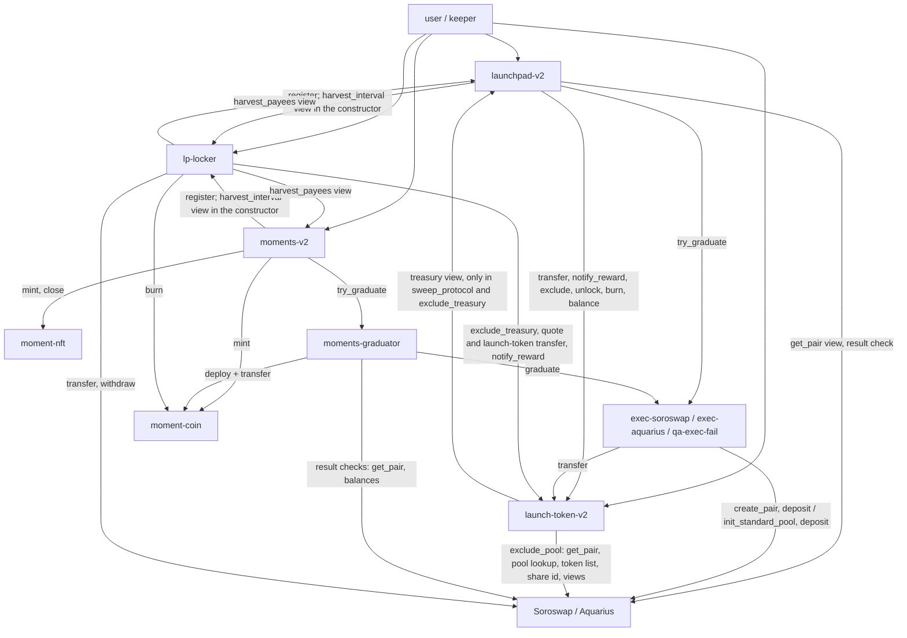

# Stellar contracts v2: specification (launchpad, launch token, Moments), revised

**Status:** final, verified 2026-10-14 (owner decisions O1–O6, lead L2–L16). This revision applies the owner's decisions O1–O6 and the lead's decisions L2–L16 (quoted in §23.1; L1 is superseded by O6), the owner's app-location direction of 2026-10-14 (§1 item 6, §21), answers every problem raised by the two reviews (§24.1), resolves the 18 round-1 findings of the auditor and economist verification (§24.2) and the 13 LOW findings of the final verification (§24.3). It is still a read-only phase: nothing was edited outside this spec and its package file, nothing was committed, deployed or written to a database, and no secret file was opened.

**Scope: testnet only (O4).** Mainnet-only choices are listed in §23.2. They block nothing in this spec.

**Author role:** lead smart-contract architect.

**Input:** on 2026-10-14 the owner decided that the Stellar launchpad and Moments contracts must change so their features match Monad's. Today Stellar has:
- no launch fee;
- Soroswap as the only graduation venue;
- no holder fee sharing;
- no refund mode;
- Moments that are editions without a coin.

**Naming in this revision.** "O1"–"O6" and "L1"–"L16" always mean the decisions quoted in §23.1. "F1"–"F18" are the round-1 findings (§24.2), and "V1"–"V13" the final verification's findings (§24.3). The feature rows of §0 are numbered P1–P18 (launchpad) and X1–X11 (Moments). The first draft numbered the launchpad rows L1–L16; they were renamed so they can't be confused with the lead decisions.

**Citation keys**

| Key | Meaning |
|---|---|
| `S:` | `~/Hackathon-b17/multichain-stellar` (private, `main` 58f3f65). `S:app/` is the copy of the app (a git subtree snapshot of IOS-app) that the owner's 2026-10-14 direction adds to this repository; it doesn't exist at 58f3f65 (§1 item 6, §21). |
| `M:` | `~/Hackathon` (IOS-app, `release/23` d387a64) |
| `MS:` | `~/Hackathon-moments/docs/moments-spec.md`. This is the frozen Monad Moments spec. Its text has drifted from the code, so this spec ports from code (Inv1 §16). |
| `sdk:` | soroban-sdk 26.1.1, local crate |
| `host:` | soroban-env-host 26.1.4, local crate |
| `oz:` | OpenZeppelin stellar-tokens 0.7.2, local crate |
| Inv0 / Inv1 / Inv2 | The three read-only inventories of 2026-10-14 (Monad launchpad, Monad Moments, Soroban research). Live chain values come from them. |
| A1–A16, B1–B13 | Reviewer problems: A = `critiques[0]`, B = `critiques[1]` of the design JSON (§24.1) |
| F1–F18 | Round-1 findings of the auditor and economist verification, 2026-10-14 (§24.2) |
| V1–V13 | LOW findings of the final auditor and economist verification, 2026-10-14 (§24.3) |

The local crates are under `~/.cargo/registry/src/index.crates.io-1949cf8c6b5b557f/`. Every line citation that this revision added or changed was re-read against the code on 2026-10-14, and every `M:contracts` citation was re-read again for the final verification (V13).

Items marked **[D]** are lead defaults that no decision covers. Each one says why it was chosen.

---

## 0. Summary: Monad feature → Stellar v2

The curve maths, the 1B supply, the 1% curve fee split 50/50, the creator fee of at most 10% and the √10 graduation rule do not change. Stellar already mirrors Monad there (S:contracts/launchpad/src/curve.rs:1-110 mirrors M:contracts/src/libraries/CurveMath.sol:9-34). The one change to the curve is the clamp of the last buy, which now follows Monad exactly (A12; §5.5).

### Launchpad

| # | Feature | Monad (live) | Stellar today (v1) | Stellar v2 | Deviation and why |
|---|---|---|---|---|---|
| P1 | Launch fee | 5 MON, native, credited to FeeEscrow for the protocol recipient (M:contracts/src/LaunchpadFactory.sol:60,349,441) | none (S:contracts/launchpad/src/lib.rs:332-436) | A flat fee in XLM for every quote asset: **10 XLM, on testnet and mainnet** (O6). It moves creator → launchpad, is **booked on the launch**, and anyone sweeps it to the treasury with `claim_protocol_fees` (O6, §5.5). | Amount is in XLM. Booking matches Monad's escrow credit. Nothing is pushed to the treasury inside `launch`, so a missing or merged treasury account can't block launches (B10). |
| P2 | Terms binding | `expectedEconomics` hash (LaunchpadFactory.sol:305-315) | none (`set_quote`/`set_fees` act at once, lib.rs:285-308) | `expected: LaunchTerms` passed **by value** and compared field by field. It includes the venue, the fallback, the durations, the locker and the token WASM hash. | By value, so the phone's strict XDR decoder can show and bind every term without hashing on the phone |
| P3 | Venues | Uniswap v4 (default) or Monday; Monday-only quote assets; v4 fallback (LaunchpadFactory.sol:347-348,475-557) | Soroswap only (lib.rs:42-54,490-529) | **Soroswap**: default and fallback. **Aquarius, 0.3% tier** (`fee_fraction` 30): the creator's choice on testnet, only if CT-03 says go. A venue table where a new venue needs a 48 h timelock. A per-quote venue allowlist; a quote whose allowlist excludes the fallback is **venue-locked**, the Monday-only analogue (§5.3) (L2). | Phoenix is not offered: its pools are whitelist-only and it has no testnet (§15). Aquarius on mainnet is deferred (§23.2). |
| P4 | Graduation trigger | Inside the completing buy, try/catch with 2M gas (LaunchpadFactory.sol:449-457) | Manual `graduate`; the backend keeper calls it (S:backend/supabase/functions/lite-indexer/index.ts:177-196) | Permissionless `graduate`, run by DyorHQ's keeper in the following ledgers (L3). Recoverable venue failures are caught with `try_` and recorded. Anything else aborts the keeper's transaction, and `mark_stuck` covers it. | Soroban can't cap a sub-call's budget, and it can't catch budget or footprint exhaustion (host:src/host/error.rs:148-167; host:src/host.rs:2612-2660). An attempt inside the trade could make the completing buy impossible. |
| P5 | Stuck and fallback | `stuckSince`; `graduateFallback` retries the creator's venue with reserved gas, then v4; Monday-only quotes wait 1 d or need `allowV4Fallback` (LaunchpadFactory.sol:475-557) | none | `stuck_since` (reset on success); `mark_stuck` after the grace; `graduate_fallback` tries **only** the fallback venue, and only from `stuck_since + fallback_delay` (1 h). In that hour the keeper keeps retrying the creator's venue with `graduate`. Venue-locked quotes also wait `locked_fallback` (1 d) or need `allow_fallback`. | Monad retries the creator's venue inside `graduateFallback` with a reserved budget (LaunchpadFactory.sol:475-490). Soroban can't reserve budget, so the primary retry (`graduate`) and the fallback are separate calls. The `fallback_delay` window replaces the in-call retry: one transient primary failure no longer opens the fallback to anyone at once (§20.6, A7, B3, F14). |
| P6 | Refund mode | Owner `rescue` 7 d after stuck; fee-free sells back along the curve (LaunchpadFactory.sol:561-569; M:contracts/src/BondingCurve.sol:140-158,176-182) | none: a completed curve closes sells (lib.rs:450-452) | `rescue`: by the admin 7 d after stuck, by **anyone** 30 d after stuck. Then **pro-rata refunds**: a holder burns tokens and receives `tokens × real_quote / circulating supply`, with no fees, in any order. The token unlocks (O2, L6). | Pro-rata instead of reverse-curve sells (O2): nobody races for the first sells, and nobody who knows when `rescue` lands can front-run it. The 30-day public rescue removes the dependence on the admin (B8). |
| P7 | Holder fee sharing | Opt-in; reward-per-share in a separate contract, precision 1e36; with no eligible supply the reward goes to the protocol (M:contracts/src/HolderFeeSharing.sol:9-208) | none | Opt-in per launch; the app defaults to on, as on Monad (M:ios/DyorHQ/Launchpad/LaunchpadView.swift:1246) (L5). The accounting lives inside launch-token-v2, with two reward assets: the quote, and after graduation the launch token itself (the holders' half of the harvested token side, L13). Anyone can exclude another DEX pool of the token once it is verified against the Soroswap factory or the Aquarius router's pool lookup. The candidate must be a Wasm contract whose own token list (and, for Aquarius, share token) matches, and it must hold at least a floor of launch tokens or of unclaimed rewards. Rewards already stranded there go to the treasury (L5, F2). Other contracts that hold the token (lending markets, vaults, other DEXes) are not excluded and keep accruing rewards they may never claim (§25 R17). The launchpad, the locker, this launch's executors, the token itself and **the treasury** never earn rewards: the treasury receives the protocol's half of the harvested token side, so it is excluded before any harvest or sweep pays it launch tokens (§6.2, V2). | In-token accounting is a cost and simplicity choice (one fewer cross-contract call per transfer). Re-entry does not force it: a separate contract could work if the token passed the balances as arguments (A14). P = 1e18 instead of 1e36 because U256 intermediates must end in i128. The minimum eligible supply is 1 token instead of 0 because the token has 7 decimals. Monad's holders share only quote-denominated fees (M:contracts/src/MemeHook.sol:241); v2 also pays them the token side's creator-or-holders half, as L13 decides. Monad doesn't exclude its protocol fee recipient (M:contracts/src/LaunchpadFactory.sol:379-390); v2 does, because v2 pays the treasury in launch tokens on every harvest (V2). |
| P8 | Fees after graduation | v4 hook: 1% of the quote leg (0.5% protocol, 0.5% creator or holders), plus the creator tax on all pool volume; the v4 pool's LP fee is 0 (M:contracts/src/MemeHook.sol:117-294; M:contracts/src/GraduationExecutor.sol:59; M:contracts/script/Deploy.s.sol:69). Monday: 1% LP fee to DyorHQ. | none | `lp-locker` harvests the **fee growth of the permanently locked LP** (O1). **Both sides** are split 50/50 by the launch's own pinned `Launch.protocol_share_bps`, never the live `Config` value, as Monad pins it per pool (M:contracts/src/LaunchpadFactory.sol:539; MemeHook.sol:233-234) (V1): the quote side and the launch-token side each go 50% to the protocol (the treasury) and 50% to the creator-or-holders share (the creator-fee recipient, or with sharing on the holders, as quote rewards and launch-token rewards) (O1, L13, F1). The creator fee stops at graduation (O1). Harvest guard: √k growth, `harvest_interval` (1 h) and 0.5% of the position per round (L12). | No Stellar DEX has swap hooks, and a fee-on-transfer tax would break Soroswap router quotes and aggregator routing (A3). The rate is the venue's LP fee earned by the locked LP's share of the pool. On a 0.3% pool that is 0.15% protocol + 0.15% creator-or-holders of the locked share's volume, each half paid half in quote and half in launch tokens, against Monad's 0.5% + 0.5% + tax (§14.4, A2). The token side follows Monad's split of token-denominated hook fees by `protocolShareBps` (MemeHook.sol:221-262). Monad pays that side's non-protocol part to the creator even with sharing on (:241); v2 pays it to the holders when sharing is on (L13). The treasury holds the launch tokens it receives; nothing sells them (**[D]**, §5.5, V2). |
| P9 | Creator fee recipient | Settable and transferable; 3 + 3 d takeover that the recipient can veto (LaunchpadFactory.sol:573-617). Curve fees are credited at accrual to the recipient of that moment (BondingCurve.sol:292-319). | Fixed to the creator (lib.rs:532-545) | Same rules. On any change, the curve fees accrued so far stay with the old recipient (`CreatorOwed`) (L14). **Declared exception:** LP fee growth not yet harvested at the change is paid to the recipient current at the next harvests. It is normally at most one interval of fees, but more when the locked share's hourly volume exceeds about 1.7 × the position's value; the change plans show that residual and offer to wait (§5.5, F3, V7). | The exception matches Monad, whose hook pays unswept pool fees to the recipient current at sweep time (MemeHook.sol:100-101,247,261; LaunchpadFactory.sol:606-614) |
| P10 | Fee delivery | Push, with an escrow fallback (M:contracts/src/FeeEscrow.sol:6-97) | Pull (lib.rs:531-559) | Trades book fees on the launch. Anyone can pay out, always to the rightful recipient. The locker pushes and keeps an owed balance as the fallback. | A trade never sends money to a third party, so a recipient without a trustline can't brick it |
| P11 | Anti-snipe | By second, keyed on the recipient; up to 32 exempt plus the deployer and the initial recipient (BondingCurve.sol:221-226) | By ledger, creator only (lib.rs:658-674) | By ledger timestamp in **5-second (one-ledger) steps** (L11); same schedule and exemptions | Ledgers close every 5 s, so 1-second steps would collapse to "the launch ledger only" |
| P12 | Token | ERC-20, open transfers | SEP-41, transfer-locked until graduation; only the launchpad is exempt (S:contracts/launch-token/src/lib.rs:84-107) | SEP-41 with the sharing hook. Until unlock, a transfer needs `from ∈ {launchpad, this launch's two executors}` or `to == launchpad` (L4). It unlocks at graduation, or at rescue (L6). The token's own address holds the launch-token rewards, and nobody can transfer, burn or approve from it; only `claim` and `sweep_protocol` move it. | The lock keeps the token side unsquattable (S:docs/DECISIONS.md #5). Executors accept only launchpad-v2 and moments-graduator as callers (L4, A1, B1). Monad has no lock. |
| P13 | Excess supply at graduation | About 10% held forever in LaunchLocker | Burned (lib.rs:518-520) | Burned (L7). Supply after graduation is about 900M; the app computes FDV from `total_supply`. | Same economic effect as Monad's permanent lock |
| P14 | Treasury | Settable at once (`setFeePolicy`, LaunchpadFactory.sol:236-241). Curve fees are credited to the recipient of the moment of the trade (BondingCurve.sol:291-319); hook fees to the recipient at sweep time (MemeHook.sol:237-238). | Fixed at deploy (lib.rs:68-69) | Settable through a 48 h timelock; the guardian can cancel (L8). Booked protocol and launch fees go to the treasury current **at sweep time** (§5.5, [D], F3). | Timelock and guardian added. Sweep-time payment differs from Monad's curve credit: a treasury change is mostly a key rotation, and fees must not go to a retired or compromised key. |
| P15 | Guardian | none on the launchpad (Moments has one; a lost Moments guardian key can't be replaced, M:contracts/src/moments/MomentsFactory.sol:142-152) | none | A guardian key that can **only** cancel pending treasury and venue changes, hand its role on in two steps (propose, accept) or renounce it. The admin can replace it through the 48 h timelock, and the guardian can't cancel that (L8, F16). | Mirrors the Moments guardian's powers (B11b). The admin replacement is a recovery path for a lost guardian key, which Monad lacks. |
| P16 | Custody | 2-of-3 Safe | single G key | Testnet: the owner's own admin, guardian and treasury keys (O5) | Mainnet custody is deferred (§23.2) |
| P17 | Addresses and upgrades | CREATE2 salt from deployer + `params.salt` (LaunchpadFactory.sol:360); no upgrades | salt from a global index + creator (lib.rs:372-381); no upgrades | Salt from **creator + nonce**; no counters; records keyed by the token address (L15). No upgrades. | Keeps concurrent launches independent under fixed footprints and parallel apply (§3.5, B6) |
| P18 | Quote assets | Any ERC-20 the owner enables; a fee-on-transfer asset is refused by a balance-delta check on every pull (`UnsupportedQuoteToken`, M:contracts/src/BondingCurve.sol:277-288) | Any address the admin sets (lib.rs:284-294) | **Stellar Asset Contracts only**: `set_quote` refuses an asset whose executable isn't `StellarAsset` (sdk:src/address.rs:226-230,332), and the constructor checks the XLM SAC the same way (F17) | A SAC moves exactly the amount transferred, so no per-trade delta check is needed. Issuer powers of a classic asset (freeze, clawback) stay with its issuer (§25 R19). |

### Moments

| # | Feature | Monad (cohort 4, live) | Stellar today (v1) | Stellar v2 | Deviation and why |
|---|---|---|---|---|---|
| X1 | Coin | Per-Moment ERC-20, 100M, 18 dp (M:contracts/src/moments/MomentCoin.sol:11-36) | none (S:docs/DECISIONS.md #3) | Per-Moment SEP-41, 100M, **7 dp**, deployed **at graduation** at an address predicted from the Moment's NFT address | USDC on Stellar has 7 dp, which removes the 6↔18 scaling. Most Moments never graduate, so deploying at graduation saves the cost. |
| X2 | Collect | 20/5/75 with a reserve; terminal clamp (M:contracts/src/moments/MomentCollect.sol:124-172) | 95/5 pushed at collect (S:contracts/moments/src/lib.rs:239-246) | 20/5/75, terminal clamp, pull ledgers | none |
| X3 | Policy, timelock, guardian, terms | 48 h + 7 d window; dual pause; termsHash (M:contracts/src/moments/MomentsFactory.sol:24-40,176-237) | Immediate `set_policy` (moments lib.rs:153-164) | Same as Monad; terms passed by value; durations in the terms | none |
| X4 | NFT | Per-Moment ERC-721; rank = token id; `close()`; on-chain JSON | One SEP-50 collection, global ids | **One SEP-50 contract per Moment**; the edition number is the token id, from 1; `close`; royalties; provenance fields on chain. The NFT address is the Moment's id (L9, L15). Metadata JSON is off-chain (the URI). | **[D]** The JSON is not built on chain (cost) |
| X5 | Graduation | **Inside the terminal collect**, try/catch with 3M gas (MomentCollect.sol:163-184); v4 pool with a 0.5% LP fee (M:contracts/src/moments/MomentGraduation.sol:30-33,80-136) | none | **The keeper graduates in the following ledgers** (L3); anyone may call `graduate`. Atomic inside `moments-graduator` through `try_`. The graduator runs the result checks inside its own frame, so a bad result is a recoverable, recorded failure (F15). Soroswap pool; LP locked forever. | Timing differs for the reason given in P4 (A6). The venue differs. |
| X6 | Vesting | Collectors 60/80/100%; creator 20% + 16% × 5 (M:contracts/src/moments/MomentVesting.sol:108-138) | none | Same. The period (30 d) is a constructor duration, shortened only on testnet-qa (O3). | none |
| X7 | Expiry | 70/30 creator/treasury; no collector refund (MomentCollect.sol:192-214). `stuckSince` is set only when the graduation attempt fails (MomentCollect.sol:174-184). | none | Same, plus `stuck_since ≠ 0` for the GraduationPending branch. `stuck_since` is set **only by a recorded failed attempt** (`grad_fail`), as on Monad. There is no Moments `mark_stuck`. Anyone can call `graduate`, so expiry never waits for the keeper, and a completed Moment can't expire without a real failed attempt (F15) **until a long backstop**: `pending_backstop` (30 d) after `completed_at`, far beyond the 7-day `stuck_expiry`, a Moment that is still GraduationPending can expire under the same rules (V11). | A deliberate tightening, explained in §9.2. The backstop covers a graduation that only ever fails non-recoverably, which can't be recorded (§25 R18). |
| X8 | Post-graduation fees | 1% hook on the USDC leg (0.2% creator / 0.3% platform / 0.5% buyback-and-LP) plus a 0.5% LP fee that compounds (M:contracts/src/moments/MomentFeeHook.sol:38-41; MomentGraduation.sol:30-33) | none | Soroswap's 0.3% LP fee on the locked share. **Monad's ratios, side by side [D]:** the locker harvests `MOMENT_HARVEST_BPS` = 6,667 bps of the growth and compounds the rest, so compounded : harvested = (BPS − hb) : hb = **3,333 : 6,667** in every round, also when the round cap binds (F7, V3). That is Monad's 1 : 2 to within 0.005% of fee value. The harvested USDC side goes creator 40% / platform 60% (Monad's 0.2% / 0.3% USDC hook shares); the harvested coin side is burned (in place of Monad's 0.5% buyback-and-LP); the compounded part is Monad's 0.5% LP fee. Shares of fee value: creator 13.334%, platform 20.001%, burn 33.335%, compounding 33.33%. L13 is a launch rule; it does not apply to Moments (F1). | The ratios are Monad's 0.2 / 0.3 / 0.5 / 0.5 out of 1.5%, and the creator and platform are paid in USDC only, as on Monad. The total rate is 0.3%, so the creator gets about 0.04% and the platform about 0.06% of the locked share's volume, against Monad's 0.2% and 0.3% (§14.4, A2). **Pool depth [D] (V4):** Monad's buyback swaps half of its 0.5% into the coin and adds both to the locked position (M:contracts/src/moments/MomentBuyback.sol:20-26,109-129), so two thirds of Monad's fee value stays in the pool. v2 keeps one third (the compounded part) and burns the withdrawn coin side: per unit of fee value the pool deepens half as fast as on Monad (a tenth as fast per unit of volume), so it stays thinner, and the coin supply falls instead. |
| X9 | Edition cap | none | Optional `max_editions` (moments lib.rs:59,232) | Dropped (L9) | none |
| X10 | Quote asset | USDC | XLM or USDC (moments lib.rs:142-150) | USDC only (L9) | none |
| X11 | Addressing | `momentId` counter | Global counter | NFT address from creator + nonce; no counter (L15) | Keeps concurrent publishes independent (B6) |

---

## 1. Decisions applied and superseded documents

1. **What the owner decided on 2026-10-14.** The Stellar launchpad and Moments get Monad's features, with the same economics in spirit, adapted to Soroban and to Stellar DEXes. The owner's decisions O1–O6 and the lead's decisions L2–L16 settle every open question of the first draft, both reviews and the round-1 findings (§23.1, §24). O6 (a 10 XLM launch fee) supersedes L1's 1 XLM.
2. **This revision supersedes:**
   - S:docs/DESIGN-stellar-parity.md:55, §1.2(b): "Stellar Moments stay SEP-50 editions with no coin";
   - :83, §1.4: "Contract changes" listed as a non-goal;
   - :2975, Q5;
   - §1.1 item 2 (:36-37), in part: the owner deploys **v2** with their own admin and treasury keys, and v1 is **not** redeployed (O5);
   - S:docs/DECISIONS.md #3 (:10-12, "no coins");
   - #5 (:15-17), in part: the LP is still locked forever, but its fee growth is harvested (O1), and the lock also lets this launch's executors send (L4).

   DECISIONS #10 (:30-31) stands: no instance extension in a user's call.
3. **The old contracts stay as they are.** v1 is immutable and stays as legacy (O5). v2 is a new deployment (§17).
4. **Port from code.** Monad's frozen Moments spec differs from the deployed code in 11 places (Inv1 §16): there is no refund, no Rescue state, a 1.5% fee, and other differences. Every Monad rule here was taken from `M:contracts/src` and rulings 1–21.
5. **Doc follow-up.** After CT-20, the lead updates DECISIONS #3 and #5, the superseded parity sections (including §1.2(c) and §3.2, item 6), ARCHITECTURE's contract sections, VERIFICATION (the v2 suites) and RUNBOOK-testnet (the owner's v2 deploy and the cutover). That doc work is not a CT package.
6. **App location (owner, 2026-10-14).** The Stellar UI must **not** go into the public IOS-app repository. The private repository S: gets a copy of the app under `S:app/`, a git subtree snapshot of the public app. The Stellar screens, their `#if STELLAR_LITE` hooks in app files and the internal project live there (`S:app/ios/DyorHQ/Lite/**`, `S:app/ios/Internal/**`), and their logic stays in `S:ios/Packages/DyorLite`. This overrides S:docs/DESIGN-stellar-parity.md §1.2(c) (:58-61) and §3.2 (:209-222), which put the screens and the internal project in IOS-app (§21, §22).

---

## 2. Soroban facts that shape the design

| Fact | Evidence | Design consequence |
|---|---|---|
| Every cross-contract call runs with re-entry prohibited, including a contract calling itself. A contract already on the stack can't be entered again. | host:src/host/frame.rs:918-952 | No call path may return to a contract that is already on the stack (§3.3). Graduation goes through separate executor contracts. |
| `try_call` turns *recoverable* sub-call errors into values and rolls back the failed frame's storage and events. Budget `ExceededLimit` and storage `ExceededLimit` (a key outside the footprint) are not recoverable: they abort the whole transaction. | host:src/host.rs:2612-2660; host:src/host/error.rs:148-167 | Venue failures are caught via `Client::try_graduate`. Graduation runs in its own keeper transaction (L3). `graduate_fallback` never re-runs the primary venue. Result checks that fail after a successful frame abort the transaction instead of committing a bad graduation (§5.5). |
| A contract's direct calls carry its auth. Deeper calls that need its auth require `authorize_as_current_contract` with the exact call args. | sdk:src/env.rs:551 (doc example :520-550) | The launchpad and graduator pre-authorize exactly `transfer(self, executor, amount)` on each asset. Executors receive the funds inside the `try_` frame, so a failure rolls the transfer back. |
| Deterministic contract addresses; instance-only TTL extension. | sdk:src/deploy.rs:362,429 (`deployed_address`); :249,309 (`extend_ttl_for_contract_instance[_with_limits]`) | Launch tokens and Moment NFTs get their salt from creator + nonce (L15); coins from the NFT address. The deploy script precomputes the singletons' ids, so peers are constructor arguments and need no init setters. |
| Footprints are fixed at simulation. Under parallel apply, transactions with a read-write conflict on a key run sequentially in one cluster. | https://github.com/stellar/stellar-protocol/blob/master/core/cap-0063.md | No storage key is derived from a global counter, and no trade writes a key shared by all launches except the launchpad's own SAC balance (§3.5, B6, B7). |
| `require_auth` on a G-account checks the account's **medium** threshold. | host:src/builtin_contracts/account_contract.rs:242 | A multisig admin needs medium threshold ≥ 2; `admin-v2.ts` warns or refuses (§16, B11a). Custody for mainnet is deferred. |
| A 256-bit integer type is available. | sdk:src/num.rs:205-326 (`U256::from_u128`, `mul`, `div`, `to_u128`) | Reward-per-share, refunds and harvest maths use U256 intermediates. Monad's 1e36 precision would overflow i128. |
| A contract can read what kind of executable stands behind an address: a Wasm hash, a Stellar Asset Contract or an account. | sdk:src/address.rs:226-230 (`Executable`), :332 (`Address::executable`) | `set_quote` accepts only Stellar Asset Contracts (F17). `exclude_pool` accepts only Wasm contracts (F2). |
| Live limits (protocol 29, both networks, read 2026-10-14). | Inv2 §3.1; https://developers.stellar.org/docs/networks/resource-limits-fees | See the next table. |
| Rent. | Inv2 §3.5 (simulated) | Mainnet: 0.207 stroops per ledger for a 216 B entry, so ≈0.043 XLM per new persistent entry at the 120-day minimum. Testnet: 0.94 stroops per ledger for 136 B. |
| No swap hooks on any Stellar DEX. | Soroswap pair: `deposit`, `swap`, `withdraw`, `skim`, `sync`, `get_reserves`, `k_last`; 0.3% fee kept in the reserves; **no cumulative price/TWAP** ([pair lib.rs](https://github.com/soroswap/core/blob/main/contracts/pair/src/lib.rs)). LP shares are the pair's own SEP-41 (`total_supply`, `balance`, `transfer`, `burn`; [pair token](https://github.com/soroswap/core/blob/main/contracts/pair/src/soroswap_pair_token/contract.rs)). Aquarius pool: `deposit`, `swap`, `withdraw`, `get_reserves`, `get_total_shares`, `share_id`, `claim` ([Certora snapshot](https://github.com/Certora/aquarius-cantina-fv), `liquidity_pool/src/contract.rs`). Phoenix: whitelist-only pool creation; commission sent to `fee_recipient` (Inv2 §4.3). | Post-graduation fees come from harvesting the locked LP's fee growth (§8). |
| OZ 0.7.2 provides fungible `Base`, burnable, capped, allowlist, blocklist and votes; NFT `Base` with burnable, consecutive, enumerable, royalties and votes. **No rewards or vesting module.** | oz:src/fungible/extensions/{burnable,capped,votes}; oz:src/non_fungible/extensions/royalties/storage.rs:49 (`set_default_royalty`); oz:src/fungible/extensions/capped/storage.rs:73-81 | Rewards follow the votes extension's override pattern (oz:src/fungible/extensions/votes/storage.rs:55-190). Vesting is written in-house. |

**Live limits (Inv2 §3.1)**

| Limit | Value |
|---|---|
| WASM size | 131,072 B |
| Instructions | 400M per tx |
| Entries per tx | 200 disk-read, 200 write, 400 footprint |
| Bytes per tx | 200,000 read, 132,096 write |
| Events | 16,384 B per tx |
| Max entry TTL | 3,110,400 ledgers (~180 d) |
| Min persistent TTL | 2,073,600 ledgers (~120 d) on mainnet; 120,960 (~7 d) on testnet |

---

## 3. Contract set

### 3.1 Contracts and responsibilities

The v1 crates `launchpad`, `launch-token` and `moments` stay in the workspace, frozen as the record of what is deployed.

| Crate (new) | WASM | Instances | Responsibility | Holds funds | Privileged roles |
|---|---|---|---|---|---|
| `launchpad-v2` | `dyor_launchpad_v2.wasm` | 1 | Factory for launch tokens. Bonding curves. Launch fee. Terms. Fee booking. Graduation orchestration (`try_` into executors) with result checks. Stuck, fallback, rescue and pro-rata refunds. Creator fee recipient. | Curve quote reserves; booked creator, protocol and launch fees; refund reserves | `admin` and `guardian`: only the powers in §16 |
| `launch-token-v2` | `dyor_launch_token_v2.wasm` | one per launch | SEP-41 with the transfer lock and opt-in holder rewards in two assets (the quote, and the launch token itself after graduation; reward-per-share, released on a later ledger); pool exclusion | Holders' quote and launch-token rewards | none |
| `exec-soroswap` | `dyor_exec_soroswap.wasm` | 1 | Stateless: create or get the pair, refuse a non-empty pair, seed it by direct transfer plus `deposit`, LP to `lp_to` | Transient only | Caller allowlist {launchpad-v2, moments-graduator}, fixed at construction |
| `exec-aquarius` | `dyor_exec_aquarius.wasm` | 1 (only if CT-03 says go) | Stateless: `init_standard_pool` (paid from its AQUA float, capped), refuse a non-empty pool, `deposit`, share token to `lp_to` | AQUA float | Caller allowlist, fixed at construction. Anyone may top up the float; only allowed callers spend it. |
| `qa-exec-fail` | `dyor_qa_exec_fail.wasm` | **testnet-qa only**, 1 | A venue that never graduates. Its mode is set per token by the QA admin: 0 returns a recoverable error, 1 exhausts the budget, 2 returns a bogus success that the caller's result checks reject (O3, §7.3) | none | Caller allowlist {launchpad-v2, the failing Moments stack's graduator}; `qa_admin` sets modes |
| `lp-locker` | `dyor_lp_locker.wasm` | 1 | Holds every graduated LP position **forever**. Harvests only fee growth, at most 0.5% of a position per `harvest_interval`. Pays out both sides. | LP shares; owed balances | none |
| `moments-v2` | `dyor_moments_v2.wasm` | 1 | Factory for Moment NFTs. Policy and timelock. Guardian and pauses. Publish, collect, ledgers, withdrawals, graduation orchestration, vesting claims, expiry. | USDC reserves and proceeds | `governance` and `guardian` (§16) |
| `moment-nft` | `dyor_moment_nft.wasm` | one per Moment | SEP-50 editions: edition number = token id; `close`; royalties; provenance | none | minter = moments-v2 |
| `moment-coin` | `dyor_moment_coin.wasm` | one per graduated Moment | SEP-41: capped at 100M, burnable | none | minter = moments-v2 |
| `moments-graduator` | `dyor_moments_graduator.wasm` | 1 | The `try_` target for Moments graduation: deploys the coin, mints the pool coins, seeds through `exec-soroswap`, sends the LP to the locker, and runs the result checks inside its own frame (§12) | Transient only | caller = moments-v2 only |

- **No separate factory contract.** `launchpad-v2` and `moments-v2` deploy per-launch and per-Moment contracts with `deployer().with_current_contract(salt)`, as today (S:contracts/launchpad/src/lib.rs:377-381). The graduator deploys coins.
- **Shared crate.** `dyor-common` (`contracts/common`) holds shared types, durations, client traits and maths (§4).
- **`qa-exec-fail` is never deployed outside testnet-qa.** The deploy script refuses it elsewhere (§17), and CT-19 checks that rule.
- **The failing Moments stack (testnet-qa only, O3, F5).** testnet-qa also deploys a second `moments-v2` and a second `moments-graduator` from the same WASMs, with `qa-exec-fail` as the graduator's executor. Its Moments never graduate, so the Moments `grad_fail`, `GraduationInvalid` and stuck-expiry paths run on chain. The e2e script drives it with direct contract calls; the API and the app serve only the main stack, and the indexer and keeper watch both (§17, §20.5).

### 3.2 Call graph



### 3.3 Re-entry map: no path enters a contract already on the stack

| Path (top-level caller) | Why it is safe |
|---|---|
| `launchpad.launch/buy/sell` → SAC, token (`transfer`, `notify_reward`) | The token never calls out from a transfer hook or `notify_reward`, except `quote.balance` (the SAC frame has already returned) |
| `launchpad.refund` → token `burn(holder)` → SAC | The burn hook settles rewards and makes no outside call |
| `launchpad.rescue` → token `balance`, `burn`, `unlock`, `total_supply` | The token never calls the launchpad from these |
| `launchpad.graduate/graduate_fallback` → executor → SAC, token, DEX | Executors never call the launchpad. The result checks (`balance`, `get_pair`) and `exclude`, `unlock`, `burn`, `locker.register` run after the executor frame has returned. `locker.register` reads only the LP token's balance. |
| `locker.harvest` (top level) → `launchpad.harvest_payees` (view) → DEX `transfer`/`withdraw` → token `exclude_treasury` → `launchpad.treasury` (view) → token `transfer`/`notify_reward` (quote side, and the launch-token side to the token's own address) → SAC | The launchpad is not on the stack when the locker or the token calls it: `harvest_payees` has returned before `exclude_treasury` runs. The token's `notify_reward` reads only its own balance or the quote SAC's balance. |
| `token.sweep_protocol` and `token.exclude_treasury` (top level) → `launchpad.treasury` (view) → SAC | Only from a top-level call or from the locker; never from inside a launchpad call or a transfer |
| `token.exclude_pool` (top level) → Soroswap factory `get_pair`, pair `token_0`/`token_1`; or the Aquarius router's pool lookup, pool token list and `share_id` (views) | No DEX contract calls the token from a view |
| `launchpad` and `moments` constructors → `locker.harvest_interval` (view) | The locker is deployed first and calls nobody |
| `moments.collect` → SAC, nft | NFT and SAC never call back |
| `moments.graduate` → graduator → (deploys coin) → executor → DEX; then the graduator's result checks (factory `get_pair`, LP, coin and USDC balances) | The graduator and executor never call moments; the graduator reads moments' USDC balance from the SAC, not from moments. Moments' own re-checks, `nft.close` and `locker.register` run after return. |
| `locker.harvest` → `moments.harvest_payees` (view) → coin `burn` | Moments is not on the stack |

CT-10 tests every row with a real WASM build. Re-entry fails at runtime, not at compile time.

### 3.4 Wiring

- Every peer address is a constructor argument. There are **no setters for peers**, which matches Monad's sealed modules (M:contracts/src/LaunchpadFactory.sol:186-226).
- `deploy-contracts-v2.ts` precomputes each singleton's id from (deployer, fixed salt) before deploying. That is how circular references (locker ↔ launchpad and moments; executors' caller lists ↔ launchpad and graduator) need no init function.
- **Deploy order:** executors, the locker, the graduator, then launchpad-v2 and moments-v2. The locker's constructor calls nobody. The launchpad and moments constructors read `locker.harvest_interval()` and require it to equal `durations.harvest_interval` (`InvalidConfig`), so the interval the phone sees in the terms is the one the locker enforces (F6).
- The initial venue table is a constructor argument of launchpad-v2; ids follow its order. Later venues go through the timelock (§5.4). Scripts read venue ids from `venues()`, never from constants (F8).
- Durations (§14.3) are constructor arguments, immutable, and part of the terms (O3).

### 3.5 Hot keys and parallel apply (B6, B7)

| Action | Persistent or instance keys it writes | Shared with other launches or Moments? |
|---|---|---|
| `launch` | `Launch(token)`, `Curve(token)`, `Recipient(token)`, the new token's instance and entries, the creator's and the launchpad's XLM SAC balances, `Exempt(token)` (temporary) | Only the launchpad's XLM balance entry. **No instance key** (no counter). |
| `buy` / `sell` / `refund` | `Curve(token)`, the trader's and the launchpad's quote SAC balances, token balances, and with sharing on the token's `Sharing` and `Holder` entries | The launchpad's quote SAC balance entry |
| `graduate` | as above plus pool, locker `Position(pool)` and `Tracked(lp_token)` | The launchpad's quote balance; the locker's `Tracked(lp_token)` is per pool |
| `publish` | `Moment(nft)`, `Ledger(nft)`, the NFT instance | **No instance key** |
| `collect` | `Ledger(nft)`, `Position(nft, a)`, NFT entries, USDC balances | moments-v2's USDC balance entry |

- **Fixed by this revision.** Protocol fees and launch fees are booked in `Curve(token)`, which every trade writes anyway, not in a shared `ProtocolFees(quote)` key. `LaunchCount`, `LaunchAt(i)` and `MomentCount` are gone. Salts come from creator + nonce, so two launches simulated against the same state never collide on a key outside their footprints.
- **Known limit, accepted for testnet.** The launchpad holds every curve's quote, and moments-v2 holds every Moment's USDC. Their SAC balance entries are written by every trade or collect in that asset, so those transactions still run sequentially in one cluster. Testnet volumes are far below a cluster's instruction budget. Whether mainnet needs per-launch custody of the quote (each curve's quote held outside the shared balance) is a mainnet decision (§23.2).

---

## 4. `dyor-common` (shared crate)

```rust
#[contracttype] pub enum VenueKind { Soroswap = 0, Aquarius = 1, HoldOnly = 2, QaFail = 3 }
#[contracttype] pub struct VenueParams { pub fee_fraction: u32 }          // Aquarius 10 | 30 | 100 (testnet: 30); others 0
#[contracttype] pub struct GraduateArgs { pub source: Address, pub token: Address, pub quote: Address,
    pub token_amount: i128, pub quote_amount: i128, pub lp_to: Address, pub params: VenueParams, pub min_liquidity: i128 }
#[contracttype] pub struct GraduateResult { pub pool: Address, pub lp_token: Address, pub liquidity: i128,
    pub token_used: i128, pub quote_used: i128 }                             // leftovers are returned to `source`
#[contracttype] pub struct Payee { pub to: Address, pub bps: u32, pub notify: bool }   // notify = `to` is a launch token
#[contracttype] pub struct HarvestPayees { pub quote: Vec<Payee>, pub base: Vec<Payee> } // base empty = burn the base side
#[contracttype] pub enum PositionRef { Launch(Address), Moment(Address) }      // launch token / Moment NFT address
#[contracttype] pub struct TtlPolicy { pub threshold: u32, pub extend_to: u32 } // validated ≤ e.storage().max_ttl()
#[contracttype] pub struct GradFailure { pub origin: u32, pub code: u32 }      // origin: contract tag (below), 0 = a contract
                                                                                //   outside DyorHQ, 99 = host error; code: as raised
#[contracttype] pub enum GraduationOutcome { Graduated(Address), Failed(GradFailure) }
#[contracttype] pub struct LaunchDurations { pub grace: u64, pub fallback_delay: u64, pub rescue_admin: u64,
    pub rescue_public: u64, pub locked_fallback: u64, pub takeover_delay: u64, pub takeover_window: u64,
    pub timelock: u64, pub timelock_window: u64, pub harvest_interval: u64 }
#[contracttype] pub struct MomentsDurations { pub vest_period: u64, pub stuck_expiry: u64, pub pending_backstop: u64,
    pub timelock: u64, pub timelock_window: u64, pub min_window: u64, pub max_window: u64, pub harvest_interval: u64 }
```

- **Error namespaces (V10).** Every v2 contract numbers its `#[contracterror]` values `ERR_BASE + tag·100 + n`, with `ERR_BASE = 10_000`, `n` the code in that contract's table (§5.7, §6.4, §7, §8.2, §9.4, §10, §11, §12) and these tags: 1 launchpad-v2, 2 launch-token-v2, 3 exec-soroswap, 4 exec-aquarius, 5 qa-exec-fail, 6 lp-locker, 7 moments-v2, 8 moment-nft, 9 moment-coin, 10 moments-graduator. So exec-soroswap's `PoolNotEmpty` (3) is 10_303, exec-aquarius's `PaymentUnavailable` (4) is 10_404 and the graduator's `GraduationInvalid` (3) is 11_003. Without this, a launch's `Failed(4)` could be Soroswap's `LiquidityTooLow` or Aquarius's `PaymentUnavailable`, and a Moment's `Failed(3)` the graduator's `GraduationInvalid` or an executor's `PoolNotEmpty`, because a sub-call's error reaches the `try_` caller unchanged, without the address that raised it. The range 10_100–11_099 is outside OpenZeppelin's codes (100–1501 in the local stellar-tokens and stellar-contract-utils 0.7.2 crates) and outside the codes in the Soroswap and Aquarius fixtures' contract specs (CT-02 and CT-03 check it).
- **Decoding a failure.** `grad_failure(e)` in dyor-common maps a `try_` error to `GradFailure`: a contract error in 10_100–11_099 gives `origin = (code − ERR_BASE) / 100` and the code; any other contract error (a DEX, a SAC, an OZ check) gives origin 0 and the raw code; a host error gives origin 99 and its `ScErrorCode`. The `Executor` and `Graduator` client traits declare `soroban_sdk::Error` as their error type, so `try_` hands every code over unchanged. `grad_fail` events carry `origin` and `code`; the indexer, the keeper and the API name them from one generated table (`_shared/v2_errors.ts`, §20.5).

- **Payees.** A payee with `notify` is a launch token: the locker transfers the asset to it and then calls `notify_reward(locker, asset, x)`. `base` empty means the base side is burned (Moments). Every payee list's bps sum to `BPS`.
- **Constants:** `BPS = 10_000`; `ERR_BASE = 10_000` and the contract tags (above); `GRAD_DUST_BPS = 1` (the most an executor may leave unused, §5.5, §12); `MAX_HARVEST_ROUND_BPS = 50`; `SOROSWAP_MIN_LIQ = 1_000` (Soroswap's minimum-liquidity lock, UniswapV2's value; CT-02 confirms it against the pair fixture); `MIN_DURATION = 60` s; `MAX_DURATION = 400` days; `MAX_HARVEST_INTERVAL = 1` day.
- **Duration rules** (`validate_launch_durations`, `validate_moments_durations`, used by both constructors; the locker validates its interval with the same bounds):
  - every value is in [`MIN_DURATION`, `MAX_DURATION`], and `harvest_interval ≤ MAX_HARVEST_INTERVAL`;
  - launch: `rescue_public ≥ rescue_admin`, `grace ≤ rescue_admin`, `fallback_delay ≤ rescue_admin`, `locked_fallback ≤ rescue_admin`;
  - Moments: `min_window ≤ max_window`; `pending_backstop ≥ 4 · stuck_expiry`, so the backstop always lies far beyond the recorded-failure expiry (V11);
  - both sets carry `harvest_interval`, and each constructor requires it to equal `locker.harvest_interval()` (F6).
  The production values and the testnet-qa values are in §14.3. The contracts accept any valid set; the deploy script refuses anything but the production set outside testnet-qa (§17).
- **Maths:**
  - `mul_div` and `mul_div_up`: checked i128 (as in S:contracts/launchpad/src/curve.rs:13-21);
  - `mul_div_u256(a, b, c) -> i128` and `mul_div_up_u256`: U256 intermediate; trap if the result exceeds i128;
  - `isqrt_u128`.
- **Client traits.** `#[contractclient]` traits for every cross-contract surface: `LaunchTokenV2` (with `exclude_treasury`), `Executor`, `Locker` (with `harvest_interval`), `HarvestOwner` (`harvest_payees(reference) -> HarvestPayees`), `MomentNft`, `MomentCoin`, `Graduator`, `TreasurySource` (`treasury`), `SoroswapFactory` and `SoroswapPair` (with `token_0`/`token_1`). The Aquarius router and pool traits live in `common/src/aquarius.rs`, which CT-03 fills with exactly the functions it confirms against the fixtures, and a compile-time flag per gate check (`AQUARIUS_POOL_LOOKUP_OK` for check 4, used by launch-token-v2; `AQUARIUS_VENUE_OK` for all five, used by the locker). No crate depends on another contract crate.
- **Release profile.** Unchanged (S:contracts/Cargo.toml: `opt-level="z"`, `overflow-checks=true`, `panic="abort"`, LTO).

---

## 5. `launchpad-v2`

### 5.1 Phases

```
Curve ──(buy reaches threshold)──▶ Completed ──(graduate ok)──▶ Graduated          (stuck_since reset to 0)
                                     │  recoverable try_ failure → stuck_since = now (first failure only)
                                     │  or mark_stuck once now ≥ completed_at + grace → stuck_since = completed_at + grace
                                     ├─(graduate retry ok, any time)──▶ Graduated
                                     ├─(graduate_fallback ok, from stuck_since + fallback_delay)──▶ Graduated
                                     └─(rescue: admin from stuck_since + 7 d, anyone from + 30 d)──▶ Rescued (permanent)
```

| Phase | Buys | Sells | Refunds | Token transfers |
|---|---|---|---|---|
| Curve | open | open | — | locked (§6.1) |
| Completed | closed | closed (as today, S:contracts/launchpad/src/lib.rs:450-452) | — | locked |
| Graduated | closed (trading is on the venue) | closed | — | open |
| Rescued | closed | closed | **open, pro-rata, no fees** (O2) | open (L6) |

Retries never reset `stuck_since`. Only a successful graduation resets it, as Monad does (M:contracts/src/LaunchpadFactory.sol:550) (B13a).

### 5.2 Storage

| Key | Durability | Value | Written by | TTL |
|---|---|---|---|---|
| `Config` | instance | `Config` (§5.3) | constructor, admin setters | keeper (instance + code) |
| `Venues`, `NextVenueId` | instance | `Vec<VenueInfo>` (at most 8); u32 | constructor, `apply_venue`, `set_venue_enabled` | keeper |
| `PendingVenue(id)` | instance | `{kind, executor, params, eta, expires}` | `propose_venue` | keeper |
| `PendingAdmin`, `PendingTreasury`, `PendingGuardian`, `GuardianHandoff` | instance | `Address`; `{addr, eta, expires}`; `{new: Option<Address>, eta, expires}` (the admin's timelocked replacement); `Address` (the guardian's two-step handoff) | admin; guardian | keeper |
| `Quote(asset)` | persistent | `QuoteEconomics` (the asset is a SAC, F17) | `set_quote` | bumped when touched |
| `Launch(token)` | persistent | `Launch` (immutable) | `launch` | bumped on every read (as in lib.rs:703-712) |
| `Curve(token)` | persistent | `Curve` (mutable; holds the booked fees) | trades, graduation, rescue, refunds, claims | bumped on write |
| `Recipient(token)` | persistent | `Address` | `launch`, recipient functions | bumped when touched |
| `CreatorOwed(account, asset)` | persistent | i128 | recipient changes (L14) | bumped on write |
| `Whitelisted(addr)` | persistent | bool | admin | bumped when touched |
| `Exempt(token)` | **temporary** | `Vec<Address>`, at most 34 | `launch` | TTL ≥ snipe window + 1 day (read only while the window is open) |
| `Takeover(token)` | **temporary** | `{new, effective_at, expires_at}` | `propose_creator_fee_recipient` | extended to `expires_at` + 1 day. It disappears when stale, which is what a stale proposal should do. |

There is no `LaunchCount`, `LaunchAt(i)` or `ProtocolFees(asset)` (L15, B6, B7). The indexer lists launches from `launch` events.

### 5.3 Types

```rust
pub struct Config { admin, guardian: Option<Address>, treasury, xlm: Address /*SAC, checked*/, token_wasm_hash: BytesN<32>,
  locker: Address, soroswap_factory: Address, aquarius_router: Address /*always set; passed to every token (F2)*/,
  supply: i128, fee_bps: u32, protocol_share_bps: u32, max_creator_fee_bps: u32,
  snipe_schedule: Vec<u32>, snipe_step_secs: u32, launch_fee: i128,
  launches_enabled: bool, whitelist_enabled: bool, durations: LaunchDurations /*immutable*/, ttl: TtlPolicy }
pub struct VenueInfo { id: u32, kind: VenueKind, executor: Address, params: VenueParams, enabled: bool }
pub struct QuoteEconomics { phantom: i128, threshold: i128, enabled: bool,
  venues_allowed: Vec<u32> /*empty = every enabled venue*/, fallback_venue: u32 /*must be kind Soroswap*/ }
pub struct LaunchParams { quote: Address, name: String, symbol: String, uri: String, creator_fee_bps: u32,
  venue: u32, holder_sharing: bool, creator_fee_recipient: Option<Address>, snipe_exempt: Vec<Address>,
  initial_buy: i128, min_tokens_out: i128, nonce: u64 }
pub struct LaunchTerms { supply, fee_bps, protocol_share_bps, max_creator_fee_bps, snipe_schedule, snipe_step_secs,
  launch_fee: i128, fee_asset: Address /*XLM SAC*/, quote: Address, phantom: i128, threshold: i128,
  venue: VenueInfo, fallback: VenueInfo, venue_locked: bool, locker: Address, token_wasm_hash: BytesN<32>,
  durations: LaunchDurations }
pub struct Launch { token, creator, quote, name, symbol, uri, nonce: u64, created_ledger: u32, created_at: u64,
  fee_bps, protocol_share_bps, creator_fee_bps, snipe_schedule, snipe_step_secs,
  venue: VenueInfo, fallback: VenueInfo, venue_locked: bool, holder_sharing: bool, launch_fee_paid: i128 }
pub enum Phase { Curve = 0, Completed = 1, Graduated = 2, Rescued = 3 }
pub struct Curve { phantom, threshold, quote_reserve, token_reserve, real_quote, creator_fees: i128,
  protocol_fees: i128 /*quote asset*/, launch_fee_due: i128 /*XLM*/, holder_fees_total: i128,
  phase: Phase, completed_at: u64, stuck_since: u64, fallback_allowed: bool,
  pool: Option<Address>, graduated_venue: Option<u32>, burned: i128,
  refund_quote: i128, refund_supply: i128, refunded: i128 }
pub struct LaunchStatus { phase, completed_at, stuck_since, mark_stuck_at: u64,
  fallback_at: u64 /* stuck_since + fallback_delay; for venue-locked launches the later of that and
                      stuck_since + locked_fallback unless fallback_allowed */,
  rescue_admin_at: u64, rescue_public_at: u64, refund_quote: i128, refund_supply: i128 }
```

- **Venue-locked** (the Monday-only analogue, A8c): `venue_locked = !q.venues_allowed.is_empty() && !q.venues_allowed.contains(q.fallback_venue)`. It is computed at launch, stored in `Launch`, and part of the terms.
- **A venue is allowed for a launch** when it exists, is enabled, and `venues_allowed` is empty or contains it.
- **Pinned per launch (V1).** `buy`, `sell`, `route_fees`, `harvest_payees` and the graduation read `fee_bps`, `protocol_share_bps`, `creator_fee_bps`, `snipe_schedule` and `snipe_step_secs` from the launch's own `Launch` record, **never from `Config`**. `set_fees` changes future launches only, before and after graduation. Monad pins the split the same way: per curve (M:contracts/src/BondingCurve.sol:294 reads the curve's own `protocolShareBps`) and per pool (LaunchpadFactory.sol:539 copies it into the hook's launch record, which `sweepPoolFees` uses, MemeHook.sol:233-234).
- **Not in the terms:** the treasury (settable through the timelock) and the guardian. The durations are immutable constructor arguments and are in the terms, so the phone shows and binds them.

### 5.4 Functions

Unless a row says "anyone", **auth** means `require_auth` of the named address. No function takes a recipient other than the signer for a buy or a launch (B1).

**Admin and guardian**

| Function | Auth | Effect | Event | Errors |
|---|---|---|---|---|
| `propose_admin(new)` | admin | `PendingAdmin = new` | `admin_prop` | — |
| `accept_admin()` | pending admin | admin = pending | `admin_set` | `NoProposal` |
| `transfer_guardian(new)` | guardian | Starts a two-step handoff: `GuardianHandoff = new` | `guard_hand` | `NotAuthorized` |
| `accept_guardian()` | the pending handoff address | guardian = handoff. A pending admin replacement is left untouched, so a guardian can't dodge it by handing off. | `guard_set` | `NoProposal` |
| `renounce_guardian()` | guardian | guardian = `None` | `guard_set` | `NotAuthorized` |
| `propose_guardian(new: Option<Address>)` | admin | Recovery of a lost or retired guardian key (F16): `eta = now + timelock`; expires `timelock_window` later | `guard_prop` | — |
| `apply_guardian()` | anyone | Within the window; guardian = `new`; clears any pending handoff | `guard_set` | `NoProposal`, `TimelockNotElapsed`, `TimelockExpired` |
| `cancel_guardian()` | admin **only**: the guardian can't veto its own replacement | clears the proposal | `guard_cncl` | `NoProposal` |
| `propose_treasury(new)` | admin | `eta = now + timelock`; expires `timelock_window` later | `treas_prop` | — |
| `apply_treasury()` | anyone | within the window | `treas_set` | `NoProposal`, `TimelockNotElapsed`, `TimelockExpired` |
| `cancel_treasury(caller)` | caller, who must be the admin or the guardian (L8) | clears the proposal | `treas_cncl` | `NotAuthorized`, `NoProposal` |
| `set_launch_fee(amount)` | admin | `0 ≤ amount ≤ MAX_LAUNCH_FEE` (1,000 XLM, a sanity cap). Future launches only; bound by the terms. The deployed value is 10 XLM (O6). | `fee_set` | `InvalidConfig` |
| `set_fees(fee_bps, protocol_share_bps, max_creator_fee_bps, schedule, step_secs)` | admin | Future launches only: live and graduated launches keep the values pinned in their `Launch` record, including the harvest split (V1). Validated as today (lib.rs:688-697), plus `1 ≤ step_secs ≤ 60`. | `config_set` | `InvalidConfig` |
| `set_quote(asset, phantom, threshold, enabled, venues_allowed, fallback_venue)` | admin | Future launches only. The asset must be a Stellar Asset Contract (`asset.executable() == Some(Executable::StellarAsset)`, F17). Needs phantom and threshold > 0 when enabled, every venue id to exist, and the fallback to be of kind Soroswap. | `quote_set` | `QuoteNotSac`, `InvalidEconomics`, `UnknownVenue` |
| `set_launches_enabled(b)` | admin | | `config_set` | — |
| `set_whitelist_enabled(b)` | admin | | `config_set` | — |
| `set_whitelisted(addr, b)` | admin | | `wl_set` | — |
| `propose_venue(kind, executor, params)` | admin | Returns the id. Timelock and window as the treasury. | `venue_prop` | `InvalidConfig` (Aquarius `fee_fraction` must be 10, 30 or 100; at most 8 venues) |
| `apply_venue(id)` | anyone | Within the window. The new venue starts **disabled** for future launches until `set_venue_enabled`. | `venue_set` | timelock errors |
| `cancel_venue(caller, id)` | caller, who must be the admin or the guardian (L8) | clears the proposal | `venue_cncl` | `NotAuthorized`, `NoProposal` |
| `set_venue_enabled(id, b)` | admin | Future launches only | `venue_on` | `UnknownVenue` |
| `allow_fallback(token)` | admin | `curve.fallback_allowed = true` | `fb_allow` | `UnknownLaunch` |
| `propose_creator_fee_recipient(token, new)` | admin | `effective_at = now + takeover_delay`; expires `takeover_window` later | `recip_prop` | `UnknownLaunch` |

**Creator fee recipient**

| Function | Auth | Effect | Event | Errors |
|---|---|---|---|---|
| `transfer_creator_fee_recipient(token, new)` | current recipient | Recipient change (§5.5) | `recip_set` (+ `cr_owed`) | `NotRecipient` |
| `cancel_creator_fee_recipient_change(token, caller)` | caller, who must be the admin or the current recipient (the recipient's veto) | | `recip_cncl` | `NotAuthorized`, `NoProposal` |
| `execute_creator_fee_recipient_change(token)` | anyone, inside the window | Recipient change (§5.5) | `recip_set` (+ `cr_owed`) | `NoProposal`, `TimelockNotElapsed`, `TimelockExpired` |

**Users**

| Function | Auth | Effect | Event | Errors |
|---|---|---|---|---|
| `launch(creator, p: LaunchParams, expected: LaunchTerms) -> Address` | creator (covers the XLM fee transfer to the launchpad and the initial buy) | §5.5 | `launch`, `fee_booked`, then `trade` if there is an initial buy | `LaunchesDisabled`, `NotWhitelisted`, `QuoteNotAllowed`, `VenueNotAllowed`, `InvalidName`, `InvalidSymbol`, `InvalidUri`, `CreatorFeeTooHigh`, `TooManyExemptions`, `TermsChanged`, `NonceUsed`, `ZeroAmount`, `SlippageExceeded` |
| `buy(buyer, token, quote_in, min_tokens_out) -> i128` | buyer | §5.5 | `trade`, plus `complete` when it completes the curve | `UnknownLaunch`, `CurveClosed`, `ZeroAmount`, `SlippageExceeded` |
| `sell(seller, token, tokens_in, min_quote_out) -> i128` | seller | Phase Curve only | `trade` | `CurveClosed`, `InsufficientLiquidity`, `SlippageExceeded`, `ZeroAmount` |
| `refund(holder, token, tokens_in) -> i128` | holder (covers the token burn) | Phase Rescued only; pro-rata, no fees (§5.5, O2) | `refund` | `WrongPhase`, `ZeroAmount` |

**Anyone**

| Function | Auth | Effect | Event | Errors |
|---|---|---|---|---|
| `graduate(token) -> GraduationOutcome` | none | Phase Completed. One attempt on the launch's own venue. **Never reverts on a recoverable venue failure.** | `grad_ok` or `grad_fail` | `UnknownLaunch`, `NotCompleted`, `AlreadyGraduated`, `WrongPhase`, `GraduationInvalid` |
| `graduate_fallback(token) -> GraduationOutcome` | none | Requires phase Completed, `stuck_since ≠ 0` and `now ≥ stuck_since + fallback_delay` (F14). A venue-locked launch also needs `fallback_allowed` or `now ≥ stuck_since + locked_fallback`. Attempts **only the fallback venue** (A7, B3). | `grad_ok` (with `fallback: true`) or `grad_fail` | `NotStuck`, `FallbackTooEarly`, `FallbackNotAllowed`, `WrongPhase`, `GraduationInvalid` |
| `mark_stuck(token)` | none | Requires phase Completed, `stuck_since == 0` and `now ≥ completed_at + grace`. Sets `stuck_since = completed_at + grace`. | `stuck` | `NotCompleted`, `GraceNotElapsed`, `AlreadyStuck` |
| `rescue(token)` | the admin from `stuck_since + rescue_admin`; **anyone** from `stuck_since + rescue_public` (O2) | §5.5 | `rescued` | `WrongPhase`, `NotStuck` |
| `claim_creator_fees(token) -> i128` | none | Pays `curve.creator_fees` to the **current recipient** | `cr_claim` | `NothingToClaim` |
| `claim_owed(account, asset) -> i128` | none | Pays `CreatorOwed(account, asset)` to `account` (L14) | `owed_claim` | `NothingToClaim` |
| `claim_protocol_fees(tokens: Vec<Address>) -> Vec<(Address, i128)>` | none | At most 20 tokens. Moves each launch's booked protocol fees (quote) and launch fee (XLM) to the treasury current at the call, one transfer per asset (O6, [D] §5.5). | `pr_claim` per token | `TooManyTokens`, `UnknownLaunch`, `NothingToClaim` |

**Views:** `config`, `venues`, `treasury`, `guardian`, `pending_treasury`, `pending_guardian`, `pending_venue(id)`, `quote_economics(asset)`, `preview_launch_terms(quote, venue) -> LaunchTerms`, `token_address(creator, nonce) -> Address`, `get_launch(token)`, `get_curve(token)`, `status(token) -> LaunchStatus`, `creator_fee_recipient(token)`, `pending_recipient_change(token)`, `creator_owed(account, asset)`, `quote_buy(token, buyer, quote_in) -> BuyQuote`, `quote_sell(token, tokens_in) -> SellQuote`, `quote_refund(token, tokens_in) -> i128`, `graduation_preview(token) -> (pool_tokens, pool_quote, burn)`, `harvest_payees(token) -> HarvestPayees` (Graduated only).

### 5.5 Algorithms

**launch**

```
creator.require_auth()
checks of the table above, plus:
  name 1–32 bytes, symbol 1–12 bytes, URI ≤ 256 bytes (as lib.rs:356-364); the backend enforces a 2–10 character ticker
  fee_bps + creator_fee_bps < 9900; snipe_exempt.len() ≤ 32; initial_buy ≥ 0
  terms(quote, venue) == expected, field by field                                  else TermsChanged
salt  = sha256("dyorhq/launch/v2" ‖ creator.to_xdr() ‖ nonce.to_be_bytes())       (L15; Monad: deployer + params.salt)
token = deployer.with_current_contract(salt).deployed_address(); Launch(token) must not exist   else NonceUsed
if launch_fee > 0 { xlm.transfer(creator, this, launch_fee) }                         (O6: 10 XLM, creator → launchpad only)
deploy token(salt) with (this, locker, name, symbol, supply,
     lock_from      = dedup[venue.executor, fallback.executor],
     fixed_excluded = dedup[this, locker, venue.executor, fallback.executor],
     sharing_quote  = holder_sharing ? Some(quote) : None,
     soroswap_factory, aquarius_router,                                               (the router always, F2)
     treasury       = config.treasury)                                                (excluded from rewards from birth, V2)
store Launch, Curve{ …, launch_fee_due: launch_fee }, Recipient = creator_fee_recipient ?? creator
store Exempt(token) (temporary) = dedup(snipe_exempt + creator + recipient)
emit launch, then fee_booked when launch_fee > 0
if initial_buy > 0 { buy as the creator (exempt), as today at lib.rs:432-434 }
```

The backend's builder picks a random 64-bit nonce, and `token_address(creator, nonce)` lets it predict the token before simulating. Two creators launching in the same ledger touch disjoint keys.

**buy** (phase Curve)

```
L         = Launch(token)                                                              (pinned values only, never Config, V1)
offset    = (now − created_at) / L.snipe_step_secs                                     (L11: 5-second steps)
snipe_bps = buyer ∈ Exempt(token) || offset ≥ len(L.snipe_schedule) ? 0 : L.snipe_schedule[offset]
total     = min(L.fee_bps + L.creator_fee_bps + snipe_bps, 9900)                        (the snipe tax gives way first)
used = quote_in ; net = used − fee_of(used, total) ; remaining = threshold − real_quote
if net > remaining {                                                                   (Monad's clamp, BondingCurve.sol:258-274)
  used = min(gross_for_net(remaining, total), quote_in) ; net = min(used − fee_of(used, total), remaining) }
base = fee_of(used, L.fee_bps) ; cfee = fee_of(used, L.creator_fee_bps) ; snipe = used − net − base − cfee   (absorbs rounding)
tokens_out = amount_out(net, quote_reserve, token_reserve) ; require tokens_out > 0 and ≥ min_tokens_out
quote.transfer(buyer, this, used) ; quote_reserve += net ; token_reserve −= tokens_out ; real_quote += net
route_fees(shared = base + snipe, creator_only = cfee)
if real_quote == threshold { phase = Completed ; completed_at = now ; emit complete }   (no graduation attempt, L3)
token.transfer(this, buyer, tokens_out) ; emit trade
```

This replaces v1's clamp, which could overshoot the threshold by up to 2 units (S:contracts/launchpad/src/curve.rs:81-90; the test at :135 allows +2) (A12). Pricing otherwise follows curve.rs:65-93.

**route_fees(shared, creator_only)**

```
protocol     = fee_of(shared, L.protocol_share_bps) ; creator_part = shared − protocol + creator_only   (pinned, V1)
curve.protocol_fees += protocol                                                         (per launch, no shared key)
if L.holder_sharing && creator_part > 0 { quote.transfer(this, token, creator_part) ; token.notify_reward(this, quote, creator_part)
                                        curve.holder_fees_total += creator_part }
else                                  { curve.creator_fees += creator_part }
```

This is Monad's split: the protocol takes its share of the base fee and snipe tax, and the creator part (with the creator fee) goes to the recipient or to the holders (M:contracts/src/BondingCurve.sol:292-319). Monad's curve reads its own pinned `protocolShareBps` there (:294); v2 reads `L.protocol_share_bps`, so a later `set_fees` never changes a live launch's split (V1).

**sell** (phase Curve only): as today (lib.rs:446-486), with `route_fees(base_fee, creator_fee)`.

**rescue**

```
require phase == Completed (WrongPhase) and stuck_since ≠ 0 (NotStuck)
if      now ≥ stuck_since + rescue_public { by_admin = false }                           (O2: permissionless after 30 d)
else if now ≥ stuck_since + rescue_admin  { admin.require_auth() ; by_admin = true }
else    NotStuck
burned = token.balance(this) ; if burned > 0 { token.burn(this, burned) }               (curve tokens and any donations)
token.unlock()                                                                         (L6)
refund_quote = real_quote ; refund_supply = token.total_supply() ; real_quote = 0 ; token_reserve = 0
phase = Rescued ; emit rescued{token, stuck_since, by_admin, refund_quote, refund_supply, burned}
```

**refund** (phase Rescued)

```
holder.require_auth() ; require tokens_in > 0
out = mul_div(tokens_in, refund_quote, refund_supply) ; require out > 0                 (floor; the same rate for every holder)
token.burn(holder, tokens_in)                                                           (the holder's auth covers this sub-call)
refunded += out                                                                         (invariant: refunded ≤ refund_quote)
quote.transfer(this, holder, out) ; emit refund{token, holder, tokens_in, out}
```

Every holder gets the same rate whatever the order, so nobody gains by refunding first, and nobody who knows when `rescue` lands can front-run it (O2, B8). Creator fees and booked protocol fees stay claimable. Tokens held by a contract that never calls `refund` leave their share in the launchpad; there is no sweep. Monad's rescue instead reopens fee-free sells along the curve (BondingCurve.sol:140-158).

**Graduation attempt** (`attempt(token, v: VenueInfo, fallback: bool)`, shared by `graduate` and `graduate_fallback`)

```
pool_quote  = real_quote
pool_tokens = curve::pool_tokens(real_quote, token_reserve, quote_reserve)               (price-continuous, curve.rs:45-49)
min_liq     = v.kind == Soroswap ? isqrt(pool_tokens·pool_quote) − SOROSWAP_MIN_LIQ − 1 : 1
t0 = token.balance(this) ; q0 = quote.balance(this)
e.authorize_as_current_contract([ token.transfer(this, v.executor, pool_tokens), quote.transfer(this, v.executor, pool_quote) ])
match ExecutorClient(v.executor).try_graduate(GraduateArgs{ source: this, token, quote, token_amount: pool_tokens,
          quote_amount: pool_quote, lp_to: locker, params: v.params, min_liquidity: min_liq }) {
  Ok(Ok(r)) => {
    // Result checks (A5, B12). A failed check panics with GraduationInvalid, which aborts the whole transaction, so
    // nothing of this attempt is committed; the keeper's retry fails the same way, mark_stuck follows, and
    // graduate_fallback never re-runs this venue.
    require pool_tokens − pool_tokens·GRAD_DUST_BPS/BPS ≤ r.token_used ≤ pool_tokens
    require pool_quote  − pool_quote·GRAD_DUST_BPS/BPS  ≤ r.quote_used ≤ pool_quote
    require t0 − token.balance(this) == r.token_used && q0 − quote.balance(this) == r.quote_used
    require r.liquidity ≥ min_liq && lp(r.lp_token).balance(locker) ≥ r.liquidity
    if v.kind == Soroswap { require r.pool == soroswap_factory.get_pair(token, quote) && r.lp_token == r.pool }
    // Post-steps
    if launch.holder_sharing { token.exclude(r.pool) }           (same tx, before any later-ledger release)
    token.unlock()
    burned = token.balance(this) ; if burned > 0 { token.burn(this, burned) }   (L7: the ≈10% excess plus any donations)
    curve.protocol_fees += pool_quote − r.quote_used             (at most 1 bp of dust)
    locker.register(this, r.pool, v.kind, r.lp_token, r.liquidity, token, quote, PositionRef::Launch(token), LAUNCH_HARVEST_BPS)
    phase = Graduated ; stuck_since = 0 ; real_quote = 0 ; token_reserve = 0 ; pool = Some(r.pool) ; graduated_venue = Some(v.id)
    emit grad_ok{token, venue: v.id, pool, pool_tokens: r.token_used, pool_quote: r.quote_used, liquidity, burned, fallback}
    Graduated(r.pool)
  }
  Err(e) => { f = grad_failure(e)                                 (namespaced origin and code, §4, V10)
              if stuck_since == 0 { stuck_since = now } ; emit grad_fail{token, venue: v.id, origin: f.origin, code: f.code, stuck_since}
              Failed(f) }
}
```

- `LAUNCH_HARVEST_BPS = 10_000` is a compile-time constant: all fee growth is harvested and split (O1).
- `SOROSWAP_MIN_LIQ` is Soroswap's minimum-liquidity lock (UniswapV2's 1,000). CT-02 confirms it against the pair fixture.
- **Why the pool can't be squatted (A1, B1).** Before unlock, the launch token moves only from the launchpad or this launch's executors, or to the launchpad (§6.1), and executors accept only launchpad-v2 and moments-graduator as callers (§7). Nobody else can put launch tokens in a pool, so no pool can hold LP before graduation. Each executor also refuses a pool that already has LP supply, as a tripwire.
- **Quote-only donations** to a pre-created Soroswap pair, with or without `sync`, only raise the opening price in favour of the locked LP. They can't mint LP without the token side. S:contracts/launchpad/src/test.rs:309 covers this today; CT-02 keeps that test.

**graduate / graduate_fallback / mark_stuck**

- `graduate(token)`: Curve → `NotCompleted`; Graduated → `AlreadyGraduated`; Rescued → `WrongPhase`. Otherwise `attempt(token, launch.venue, false)`.
- `graduate_fallback(token)`: same phase checks; `stuck_since ≠ 0`; `now ≥ stuck_since + fallback_delay` (`FallbackTooEarly`); venue-locked rule; then `attempt(token, launch.fallback, true)`. When the launch's venue is already the fallback, this is the same as `graduate`.
- **Why the delay (F14).** Monad's `graduateFallback` first retries the creator's venue in the same call and falls back only if that retry fails (M:contracts/src/LaunchpadFactory.sol:475-490). Soroban can't reserve budget for the fallback, so a primary retry inside `graduate_fallback` would bring back B3: a primary that exhausts the budget would block the fallback forever. Instead the fallback opens only `fallback_delay` (1 h) after `stuck_since`. During that window the keeper simulates `graduate` every minute and submits it when it would succeed, and anyone may call it. One transient primary failure (an empty AQUA float, a refill in progress) no longer hands the launch to the fallback at once.
- `mark_stuck(token)`: see the table. Monad has no `mark_stuck`; its attempt runs inside the completing buy. Launches keep a time-based `mark_stuck` because a non-recoverable failure (budget exhaustion, a `GraduationInvalid` abort) can't be recorded, and the paths it opens (fallback, then rescue with pro-rata refunds) return value to holders. Moments, where expiry gives collectors nothing, need a recorded failure instead (§9.2, F15).

**Recipient change** (`transfer_…` and `execute_…`; L14, A4)

```
old = Recipient(token)
if curve.creator_fees > 0 { CreatorOwed(old, quote) += curve.creator_fees ; emit cr_owed{token, old, amount} ; curve.creator_fees = 0 }
Recipient(token) = new ; emit recip_set{token, old, new, by_takeover}
```

Fees booked before the change stay with the old recipient, who (or anyone for them) collects them with `claim_owed`. On Monad the same holds because curve fees are credited at accrual (BondingCurve.sol:291-319).

**Declared exception to L14: unharvested LP fee growth (F3).** Fee growth that the locked LP has earned but the locker has not yet harvested at the change is paid, at the next harvests, to the recipient current at each of them. The contract can't snapshot it at the change: the launchpad can't call `locker.harvest` from inside the change, because harvest calls back into the launchpad's `harvest_payees`, and re-entry is refused (§2, §3.3). Monad behaves the same way: unswept hook fees go to the recipient set at sweep time (M:contracts/src/MemeHook.sol:100-101,247,261; LaunchpadFactory.sol:606-614).

**The real bound (V7).** What crosses the change is the growth not yet harvested. A round takes at most 0.5% of the position's value (`MAX_HARVEST_ROUND_BPS`), and one interval's growth is 0.3% of the locked share's volume in that interval. So:
- while the locked share's hourly volume stays at or below about 1.7 × the locked position's value (0.5% ÷ 0.3%, about 3.3 × its quote side), each hourly harvest takes all the growth, and at most one interval of fees crosses a change;
- above that, every hour adds (0.3% × volume − 0.5% × position) to the backlog for as long as the volume lasts, and afterwards the backlog drains by at most 0.5% of the position per hour. For example, a day at 5 × the position's value per hour leaves about 24% of the position's value unharvested, which takes about 48 further hourly rounds to drain at zero volume.

Harvests can't be repeated inside one plan: each needs `harvest_interval` since the last one. The backend's plans for `transfer_…` and `execute_…` on a graduated launch therefore put a `locker.harvest` step first when the interval allows, and when the backlog left after that step is still above one round's cap they return it as `harvestBacklog {residualQuote, residualToken, roundsToDrain, nextHarvestAt}`. The intent shows the residual that would go to the new recipient and offers to wait: the keeper harvests every interval, and the plan is rebuilt when the residual is under one round's cap (CT-13). The current recipient chooses. A takeover can execute only after its 3-day wait, which gives the hourly harvests time to drain a backlog unless the volume stays that high; whatever remains is shown to whoever executes it, and the residual is the declared exception.

**Treasury at sweep time [D] (F3).** Booked protocol fees and launch fees are paid to the treasury current when `claim_protocol_fees` runs, and harvests pay the treasury current at the harvest. A treasury change is almost always a key rotation, or a response to a compromised key. Paying booked fees to the old treasury would send them to a key DyorHQ has retired or lost. The change is public 48 h ahead and the guardian can cancel it, and the keeper sweeps booked fees regularly, so little is pending at any change. This differs from Monad's curve, which credits the recipient of the moment of the trade (BondingCurve.sol:296); Monad's hook fees, like v2's, go to the recipient at sweep time (MemeHook.sol:237-238).

**The treasury and holder rewards (V2).** The protocol's half of a harvested token side goes to the treasury's G-account in launch tokens, so the treasury holds launch tokens of every graduated launch. It must not earn holder rewards on them (that would move part of the holders' share to DyorHQ):
- the token is constructed with the launchpad's treasury of the moment, which it excludes at once (§6.2);
- `token.exclude_treasury()` excludes the treasury current at the call (`launchpad.treasury()`); anyone may call it, and the locker calls it before it pays a sharing launch's base side (§8.2), so a new treasury is excluded before its first harvest in launch tokens;
- `sweep_protocol` excludes the current treasury before paying it;
- exclusion is one-way: a former treasury stays excluded, and tokens it sends on become eligible in the receiver's hands.

The launchpad, the locker, this launch's executors and the token itself are excluded from construction (`FixedExcluded`). Monad doesn't exclude its protocol recipient (LaunchpadFactory.sol:379-390), although the recipient receives token-denominated hook fees there too (MemeHook.sol:250-252) and so earns holder rewards on them; v2 closes that gap.

**What the treasury does with launch tokens [D] (V2).** It **holds** them. Nothing in v2 sells them: no keeper job, no contract path, no automatic sale. An automatic sale would put sell pressure on every launch at every harvest, and a predictable hourly sale is easy to sandwich on a pool with no TWAP (§8.3). Held tokens are excluded, so they don't dilute holder rewards. Any later use is an owner decision outside the contracts (§23.2 item 11).

**claim_protocol_fees(tokens)**

```
require 1 ≤ len(tokens) ≤ 20
for t in tokens: move Curve(t).protocol_fees into totals[launch.quote] and Curve(t).launch_fee_due into totals[xlm]; emit pr_claim
require totals non-empty ; for (asset, amount) in totals: asset.transfer(this, treasury, amount)
```

If the treasury can't receive an asset (for example no USDC trustline), that claim fails and nothing moves: a call is all-or-nothing. No user action depends on it. The keeper groups tokens by quote asset (§20.6), and the treasury setup and the deploy preflight check a trustline for every enabled classic quote asset (§16, §17, F9).

**harvest_payees(token)** (Graduated only)

```
L     = Launch(token) ; ps = L.protocol_share_bps                                       (pinned at launch, never Config, V1)
side  = [ Payee{treasury, ps, false},
          L.holder_sharing ? Payee{token, BPS − ps, true} : Payee{recipient, BPS − ps, false} ]
HarvestPayees { quote: side, base: side }                                               (O1, L13, F1: both sides 50/50)
```

With `protocol_share_bps` = 5000 this is O1's 50/50 split on **both** sides, as Monad's `sweepPoolFees` applies `protocolShareBps` to token-denominated fees too (M:contracts/src/MemeHook.sol:233-235). The split is the one pinned in the launch, as Monad's hook uses the share copied into its launch record at graduation (LaunchpadFactory.sol:539; MemeHook.sol:233-234): `set_fees` after graduation never changes it (V1). The protocol's half of the token side goes to the treasury in launch tokens, which the treasury holds (see above). The creator-or-holders half goes to the creator-fee recipient, or with sharing on to the holders as launch-token rewards (the locker sends it to the token's own address and notifies it, §6.2). Monad pays that half to the creator even with sharing on (MemeHook.sol:241); v2 follows L13. The locker calls `harvest_payees` on every harvest, so a treasury or recipient change takes effect from the next harvest (see the exception above).

### 5.6 Events

All are `#[contractevent]`. Topics come first; field lists are abbreviated.

| Topic | Topics and fields |
|---|---|
| `launch` | token, creator; quote, name, symbol, uri, nonce, supply, phantom, threshold, fee_bps, protocol_share_bps, creator_fee_bps, venue, fallback_venue, venue_locked, holder_sharing, recipient, launch_fee |
| `fee_booked` | token, payer; asset, amount |
| `trade` | token, trader; is_buy, quote_amount, token_amount, base_fee, snipe_fee, creator_fee, protocol_part, creator_part, holder_part, quote_reserve, token_reserve, real_quote |
| `complete` | token; real_quote, completed_at |
| `grad_ok` | token; venue, pool, pool_tokens, pool_quote, liquidity, burned, fallback |
| `grad_fail` | token; venue, origin, code (namespaced, §4, V10), stuck_since, fallback_at |
| `stuck` | token; stuck_since |
| `fb_allow` | token |
| `rescued` | token; stuck_since, by_admin, refund_quote, refund_supply, burned |
| `refund` | token, holder; tokens_in, quote_out |
| `cr_claim` | token, recipient; amount |
| `cr_owed` | token, old_recipient; amount |
| `owed_claim` | account, asset; amount |
| `pr_claim` | token; treasury, quote_amount, launch_fee_amount |
| `recip_set` | token; old, new, by_takeover |
| `recip_prop` | token; new, effective_at, expires_at |
| `recip_cncl` | token; by |
| Admin and guardian | `admin_prop`, `admin_set`, `guard_hand`, `guard_prop`, `guard_set`, `guard_cncl`, `treas_prop`, `treas_set`, `treas_cncl`, `fee_set`, `config_set`, `quote_set`, `venue_prop`, `venue_set`, `venue_cncl`, `venue_on`, `wl_set` |

### 5.7 Errors

| Code | Name | Code | Name |
|---|---|---|---|
| 1 | LaunchesDisabled | 2 | NotWhitelisted |
| 3 | QuoteNotAllowed | 4 | InvalidName |
| 5 | InvalidSymbol | 6 | InvalidUri |
| 7 | CreatorFeeTooHigh | 8 | TermsChanged |
| 9 | VenueNotAllowed | 10 | TooManyExemptions |
| 11 | UnknownLaunch | 12 | CurveClosed |
| 13 | ZeroAmount | 14 | SlippageExceeded |
| 15 | InsufficientLiquidity | 16 | NotCompleted |
| 17 | AlreadyGraduated | 18 | WrongPhase |
| 19 | NotStuck | 20 | FallbackNotAllowed |
| 21 | GraceNotElapsed | 22 | AlreadyStuck |
| 23 | NothingToClaim | 24 | NotRecipient |
| 25 | NotAuthorized | 26 | NoProposal |
| 27 | TimelockNotElapsed | 28 | TimelockExpired |
| 29 | InvalidConfig | 30 | InvalidEconomics |
| 31 | UnknownVenue | 32 | NotGraduated |
| 33 | NonceUsed | 34 | GraduationInvalid |
| 35 | TooManyTokens | 36 | QuoteNotSac |
| 37 | FallbackTooEarly | | |

The numbering is stable from the first build. These are local codes: on chain each is `ERR_BASE + 1·100 + n` (tag 1, §4), so `GraduationInvalid` is 10_134 and `FallbackTooEarly` 10_137 (V10). The backend maps the on-chain codes to messages from the generated `_shared/v2_errors.ts` (S:docs/DESIGN-stellar-parity.md §6.13).

### 5.8 Invariants (property-tested in CT-10)

| Id | Invariant |
|---|---|
| I-L1 | Solvency, per asset `a`: `a.balance(launchpad) ≥ Σ over launches quoted in a of (real_quote + refund_quote − refunded + creator_fees + protocol_fees) + Σ CreatorOwed(·, a)`, plus `Σ launch_fee_due` when `a` is XLM |
| I-L2 | Before graduation or rescue, `token.balance(launchpad) ≥ curve.token_reserve`. It is `≥`, not `==`, because anyone may send locked tokens to the launchpad (A12, B1). |
| I-L3 | A buy followed by a sell never returns more than was paid (curve.rs:149-157) |
| I-L4 | Admin calls never change a live launch's `Launch` record, fees, split or venue. Only `allow_fallback`, `rescue` and the takeover rules touch a live launch. |
| I-L5 | A recoverable venue failure leaves reserves, balances and the token's lock state exactly as before, apart from `stuck_since` and the event |
| I-L6 | Graduated pools open at the curve's final price within rounding, leaving out third-party quote donations, which only raise it (A12) |
| I-L7 | `real_quote ≤ threshold` always; completion leaves `real_quote == threshold` exactly |
| I-L8 | Each refund pays `floor(tokens·refund_quote/refund_supply)` whatever the order, and `refunded ≤ refund_quote` |
| I-L9 | After graduation: the pool holds `r.token_used` of the token, the locker holds all of the pool's LP except the venue's minimum-liquidity lock, and `stuck_since == 0` |
| I-L10 | No buy, sell or refund writes a key shared with another launch other than the launchpad's quote SAC balance (§3.5) |
| I-L11 | Every quote asset with economics set is a Stellar Asset Contract, so every booked amount equals the amount the SAC moved (F17) |
| I-L12 | `graduate_fallback` never succeeds before `stuck_since + fallback_delay`, and a venue-locked launch never before `stuck_since + locked_fallback` unless `fallback_allowed` (F14) |

---

## 6. `launch-token-v2`

### 6.1 Transfer lock (L4)

Until `unlock()`, `transfer(from, to)` and `transfer_from(spender, from, to)` succeed only when one of these holds:
- `from == launchpad`;
- `from ∈ lock_from`, which is this launch's venue executor and fallback executor, fixed at construction;
- `to == launchpad`.

Burns are always allowed. A muxed `to` is checked as `to.address()`. `unlock` can be called only by the launchpad, and only once: at graduation, or at rescue (L6).

**The token's own address.** It holds the launch-token rewards (§6.2). At any time, before or after unlock, `transfer`, `transfer_from`, `burn` and `burn_from` with `from == this`, and `approve` with `from == this`, fail `TokenAccount`. Only `claim` and `sweep_protocol` move that balance, through the internal update with the reward hook. Transfers **to** the token's address are allowed: the locker funds launch-token rewards that way, and anything else sent there just stays there.

| Path | Allowed before unlock? |
|---|---|
| buy: launchpad → buyer; sell: seller → launchpad | yes |
| graduation: launchpad → executor; executor → pool; executor leftovers → launchpad | yes |
| refund: burn from the holder | yes (burn) |
| holder → anyone else, including → an executor, → a pool, → the locker | **no** |
| pool → executor (an Aquarius refund of the launch token) | **no**: CT-03 must show the fixture never does it (B2) |

The locker is no longer in the set: it never holds launch tokens before unlock (B1). Executors can send, but only launchpad-v2 and moments-graduator can make them act (§7). Together this keeps every pool empty of launch tokens until graduation, which is what S:docs/DECISIONS.md #5 promises.

### 6.2 Holder rewards

This follows Monad's algorithm (M:contracts/src/HolderFeeSharing.sol:97-207), moved inside the token.

**Two reward assets (L13, F1).** Each reward asset has its own pool of accounting, `RewardPool {acc, queued, funded, paid, protocol_owed}`:
- `Q`, the quote (`sharing_quote`): the creator-or-holders part of curve fees, and the quote side of harvests;
- `T`, the launch token itself: the holders' half of the harvested token side. Only the locker funds it, after graduation. The tokens sit at the token's own address (§6.1).

Both pools share `eligible` and `queued_ledger`. Every step below runs once per pool; the per-holder entry carries one `(debt, owed)` pair per pool.

**Constants:** `P = 1e18`; `MIN_ELIGIBLE = 1e7` (1 token); `EXCLUDE_MIN_BALANCE = 1e10` (1,000 tokens, 0.0001% of the supply); `EXCLUDE_MIN_OWED = 1e6` stroops of the quote (0.1 XLM or 0.1 USDC).

**Exclusion.** An account is excluded when it is in `FixedExcluded` (instance; the launchpad, the locker, the token itself and the two executors) or its `Holder` entry says so (pools, the treasury and former treasuries). There is no cap on excluded pools (B5).

**The treasury (V2).** The treasury receives the protocol's half of every harvested token side and the `T` pool's `protocol_owed`, so it would otherwise be a large eligible holder. The constructor takes the launchpad's treasury of the moment and runs `exclude_account(treasury, false)` (with sharing on). Later treasuries are excluded by `exclude_treasury()`, which reads `launchpad.treasury()` and runs `exclude_account` on it: anyone may call it, the locker calls it before it pays a sharing launch's base side (§8.2), and `sweep_protocol` does the same before paying. The launchpad never calls it (it would re-enter the launchpad). Exclusion is one-way, so a former treasury stays excluded.

**Hook.** Every balance change calls `before_update(from, to, amount)` before `Base::update`: on `transfer`, `transfer_from`, `burn` and `burn_from`, through overrides in the votes-extension style, and on the internal payouts of `claim` and `sweep_protocol`.

```
before_update(from: Option, to: Option, amount):
  if sharing off → return
  s = Sharing ; release(&mut s)
  if from == to → save s ; return                                    (self-transfer: nothing to settle, HolderFeeSharing.sol:104-107)
  fe = from.is_some() && !excluded(from) ; te = to.is_some() && !excluded(to)
  if fe: settle(from, bal(from), bal(from) − amount)
  if te: settle(to,   bal(to),   bal(to) + amount)
  if fe && !te: s.eligible −= amount ; if !fe && te: s.eligible += amount
  save s
settle(a, old, new):                                                 (for each pool k in {Q, T})
  h = Holder(a) ; if every s.k.acc == 0 && h absent → return         (lazy: no entry until the first release)
  accrued = mul_div_u256(old, s.k.acc, P) ; if accrued > h.k.debt { h.k.owed += accrued − h.k.debt }
  h.k.debt = mul_div_up_u256(new, s.k.acc, P)                        (rounded UP, so Σ owed never exceeds the funds, B9)
  store h (bump TTL)
release(s): if ledger.sequence() > s.queued_ledger:                  (for each pool k with s.k.queued > 0)
  if s.eligible ≥ MIN_ELIGIBLE { s.k.acc += mul_div_u256(s.k.queued, P, s.eligible) ; emit rwd_add{asset} }
  else { s.k.protocol_owed += s.k.queued ; emit rwd_proto{asset} }
  s.k.queued = 0
exclude_account(a, by_pool):                                         (shared by exclude and exclude_pool)
  release ; if excluded(a) → return false                            (idempotent)
  settle(a, bal(a), bal(a)) ; s.eligible −= bal(a)
  for k: stranded_k = Holder(a).k.owed ; s.k.protocol_owed += stranded_k   (L5: stranded rewards go to the treasury via sweep_protocol)
  Holder(a) = {all debt and owed 0, excluded: true} ; emit excluded{a, by_pool, stranded_q, stranded_t} ; return true
```

Monad rounds the debt down (HolderFeeSharing.sol:112,116,204-206). Rounding it up costs a holder at most 1 stroop (or 1 token unit) per settle and makes I-T2 hold exactly.

**Paying launch-token rewards.** `claim` and `sweep_protocol` move `T` rewards from the token's own address with the internal update, so the hook runs: the source (the token itself) is excluded and the receiver is settled at its old balance before its balance grows, so a claim never earns rewards on itself. `claim` zeroes `h.T.owed` before the internal transfer.

**Bounds.**
- Each `acc` stays within i128. Each increase is at most `queued·1e11`, because `MIN_ELIGIBLE` is 1e7.
- `Q` amounts are in quote units; `T` amounts in launch-token units.

**Funding check.** `notify_reward(notifier, asset, amount)` requires, for `Q`, `quote.balance(this) ≥ s.Q.funded − s.Q.paid + amount`, and for `T`, `balance(this) ≥ s.T.funded − s.T.paid + amount` (the token's own balance). No reward can be notified without its funds. Notifiers send the asset first and then notify, as two direct calls; there is no pull from the notifier. Callers never notify 0 (B13c). Any other asset fails `UnsupportedAsset`.

**`exclude_pool(kind, other, pool)` checks (L5, F2).** Anyone may call it; DyorHQ's keeper does for every pool the indexer discovers.

```
require sharing on                                                           (SharingOff)
require pool.executable() is Some(Executable::Wasm(_)) and pool ∉ {this, other}   (NotAPool: a contract, never an account)
match kind:
  Soroswap: require factory.get_pair(this, other) == pool                    (factory.pair_exists first)
            and {pair.token_0(), pair.token_1()} == {this, other}             (NotAPool)
  Aquarius: require AQUARIUS_POOL_LOOKUP_OK (CT-03 check 4 passed; else UnsupportedVenue)
            and the router's pool lookup for sorted(this, other) contains pool
            and pool's own token list == sorted(this, other)
            and pool.share_id() is a Wasm contract ∉ {pool, this, other}       (NotAPool)
  other kinds: UnsupportedVenue
require bal(pool) ≥ EXCLUDE_MIN_BALANCE
     or the pool's pending rewards ≥ EXCLUDE_MIN_OWED in Q or ≥ EXCLUDE_MIN_BALANCE in T  (BelowFloor)
exclude_account(pool, true)
```

- **Soroswap views.** `token_0` and `token_1` are exported by the pair fixture (S:contracts/testdata/soroswap_pair.wasm), and `pair_exists`/`get_pair` by the factory fixture.
- **Independent of the venue decision.** The Aquarius branch depends only on CT-03's check 4 (the pool lookup), never on the overall go/no-go of Aquarius as a graduation venue: anyone can open an Aquarius pool for an unlocked token whether or not DyorHQ graduates there. The launchpad therefore always passes the Aquarius router to the token (§5.5).
- **The floor stops keeper griefing.** Soroswap's `create_pair` is free, so an attacker could open many dust pools and make DyorHQ's keeper pay one transaction each. A pool below the floor can't be excluded, so the keeper never pays for it. What such a pool can strand is bounded by its share: at most 1,000 tokens of a supply of about 900M after graduation. The keeper re-checks pools under the floor hourly.

### 6.3 Storage

| Key | Durability | Value |
|---|---|---|
| OZ metadata | instance | decimals 7, name, symbol |
| `Launchpad`, `Locker` | instance | Address |
| `LockFrom` | instance | Vec, at most 2 |
| `FixedExcluded` | instance | Vec, at most 5 |
| `Unlocked` | instance | bool |
| `SharingQuote` | instance | `Option<Address>` |
| `SoroswapFactory`, `AquariusRouter` | instance | `Address`, `Address` (for `exclude_pool`; the router is always set, F2) |
| `Sharing` | persistent | `{eligible, queued_ledger, q: RewardPool, t: RewardPool}`, `RewardPool = {acc, queued, funded, paid, protocol_owed}`. A small entry kept out of the instance, so a transfer doesn't rewrite the instance. |
| `Holder(addr)` | persistent | `{q_debt, q_owed, t_debt, t_owed, excluded}` |
| OZ balances and allowances | persistent / temporary | OZ defaults (oz:src/fungible/storage.rs:407-499) |

### 6.4 Functions

| Function | Auth | Notes |
|---|---|---|
| `__constructor(launchpad, locker, name, symbol, supply, lock_from, fixed_excluded, sharing_quote, soroswap_factory, aquarius_router, treasury)` | — | `supply > 0`. `FixedExcluded` = the given set plus the token itself. With sharing on, `treasury` is excluded through its `Holder` flag (V2). Mints the supply to the launchpad. |
| SEP-41: `transfer`, `transfer_from`, `approve`, `allowance`, `balance`, `decimals`, `name`, `symbol`, `total_supply`, `burn`, `burn_from` | as SEP-41 | Lock check (§6.1) and reward hook (§6.2) |
| `unlock()` | launchpad | Once only. Error `AlreadyUnlocked`. Event `unlocked`. |
| `exclude(account) -> bool` | launchpad | `exclude_account(account, false)`. Used for the graduation pool. |
| `exclude_pool(kind, other, pool) -> bool` | anyone | The checks of §6.2: a Wasm contract; **Soroswap:** `factory.get_pair(this, other) == pool` and the pair's `token_0`/`token_1`; **Aquarius:** CT-03 check 4 passed, the router's pool lookup contains `pool`, the pool's token list and `share_id` match; the floor. Then `exclude_account(pool, true)` (L5, B5, F2). Errors `SharingOff`, `NotAPool`, `UnsupportedVenue`, `BelowFloor`. |
| `notify_reward(notifier, asset, amount)` | notifier, which must be the launchpad or the locker | `asset` is the quote or the token itself. Release, funding check for that asset, `queued += amount`, `queued_ledger = sequence`. Errors `SharingOff`, `NotNotifier`, `UnsupportedAsset`, `UnderFunded`, `ZeroAmount`. Event `rwd_queue{asset}`. |
| `claim(holder) -> (i128, i128)` | holder | Release; settle; pay `q_owed` in the quote and `t_owed` in launch tokens (either may be 0). Errors `ExcludedAccount`, `NothingToClaim`. Event `rwd_claim{asset}` per paid asset. |
| `exclude_treasury() -> bool` | anyone (the locker before a harvest pays this token's base side; the keeper after a treasury change) | With sharing off, returns false. Otherwise `exclude_account(launchpad.treasury(), false)`; idempotent. Never called from inside a launchpad call (V2). |
| `sweep_protocol() -> (i128, i128)` | anyone | Excludes `launchpad.treasury()` if it isn't yet, then pays both pools' `protocol_owed` to it. Top-level calls only. Event `rwd_sweep{asset}`. |
| Views | — | `launchpad`, `locker`, `unlocked`, `lock_from`, `is_excluded(a)`, `sharing() -> Option<SharingView>`, `pending_rewards(a) -> (quote, token)` (includes a releasable queue), `queued_rewards() -> (quote, token, releasable_from_ledger)`, `exclusion_floor() -> (min_balance, min_owed)` |

**Errors** (local codes; on chain `ERR_BASE + 2·100 + n`, §4): 1 TransferLocked, 2 AlreadyUnlocked, 3 InvalidSupply, 4 NotLaunchpad, 5 NotNotifier, 6 SharingOff, 7 UnderFunded, 8 NothingToClaim, 9 NotAPool, 10 ZeroAmount, 11 UnsupportedVenue, 12 ExcludedAccount, 13 TokenAccount, 14 BelowFloor, 15 UnsupportedAsset.

**Events:** `unlocked`, `excluded{account, by_pool, stranded_q, stranded_t}`, `rwd_queue`, `rwd_add`, `rwd_proto`, `rwd_claim`, `rwd_sweep` (each reward event carries its asset).

### 6.5 Invariants

| Id | Invariant |
|---|---|
| I-T1 | `quote.balance(token) ≥ q.funded − q.paid`, and the token's own launch-token balance `≥ t.funded − t.paid` |
| I-T2 | For each pool: Σ over holders of (`owed` + pending) + `queued` + `protocol_owed` ≤ `funded − paid`, with non-negative rounding dust (B9) |
| I-T3 | A balance held only within one ledger earns 0 of a reward notified in that ledger (flash capture) |
| I-T4 | Self-transfers, and transfers to or from excluded accounts, never mint rewards (Monad's PoC, M:contracts/test/PoC_HolderDrain.t.sol) |
| I-T5 | `eligible == total_supply − Σ excluded balances` |
| I-T6 | Before unlock, a transfer succeeds only on the paths of §6.1 |
| I-T7 | After an exclusion, the account's `owed` is 0 in both pools and each `protocol_owed` rose by what it had accrued |
| I-T8 | Only `claim` and `sweep_protocol` lower the token's own balance; no transfer, burn or approval from the token's address succeeds (F1) |
| I-T9 | `exclude_pool` excludes only a Wasm contract that the venue's factory or router names for (this, other), whose token list matches, and that is above the floor (F2) |
| I-T10 | With sharing on, the treasury current at any harvest or sweep is excluded before it receives launch tokens from that harvest or sweep, and an account once excluded as treasury stays excluded; the launchpad, the locker, the executors and the token itself are never eligible (V2) |

---

## 7. Graduation executors

**Rules for every executor (L4).**
- The constructor fixes `callers`: launchpad-v2 and moments-graduator, by their precomputed ids. `graduate` requires `a.source ∈ callers` (`NotCaller`) and `a.source.require_auth()`, then pulls the funds from `source`. Nobody else can push a launch token through an executor or spend an executor's float (A1, B1, B2).
- Stateless apart from the AQUA float. Never calls the launchpad, moments or the graduator.
- **Error codes are namespaced** (§4, V10): exec-soroswap tag 3, exec-aquarius tag 4, qa-exec-fail tag 5, so each on-chain code names its executor (for example `PaymentUnavailable` is 10_404 and `ForcedFailure` 10_502). The local codes below are `n`.
- **Tripwire:** refuses a pool that already has LP supply (`PoolNotEmpty`, a recoverable error). With the lock and the caller rule this can't happen; if it ever does, the launch goes stuck instead of sharing its liquidity with an earlier LP.
- Returns any leftovers to `source`.

### 7.1 `exec-soroswap`

`__constructor(factory, callers)`. `graduate(a: GraduateArgs) -> GraduateResult`:

1. Check the caller rule.
2. Pull `token.transfer(source, this, token_amount)` and `quote.transfer(source, this, quote_amount)`. Both are pre-authorized by the source.
3. Get the pair: `pair = factory.pair_exists ? get_pair : create_pair`.
4. Require `pair.total_supply() == 0`.
5. Transfer both amounts into the pair, then call `liquidity = pair.deposit(lp_to)`. This is today's anti-grief path (S:contracts/launchpad/src/lib.rs:511-516). Deposit needs no auth.
6. Require `liquidity ≥ min_liquidity`; the caller passes `isqrt(token_amount·quote_amount) − SOROSWAP_MIN_LIQ − 1`.
7. Return `{pool: pair, lp_token: pair, liquidity, token_used: token_amount, quote_used: quote_amount}`.

- **Errors:** 1 NotCaller, 2 InvalidAmounts, 3 PoolNotEmpty, 4 LiquidityTooLow.
- **Event:** `exec_grad{source, token, quote, pool, liquidity}`.
- **Addresses:**
  - testnet factory `CDP3HMUH6SMS3S7NPGNDJLULCOXXEPSHY4JKUKMBNQMATHDHWXRRJTBY`;
  - mainnet factory `CA4HEQTL2WPEUYKYKCDOHCDNIV4QHNJ7EL4J4NQ6VADP7SYHVRYZ7AW2`;
  - both in S:backend/supabase/functions/_shared/networks.ts:100,157 and [Soroswap's address lists](https://github.com/soroswap/core/tree/main/public).

### 7.2 `exec-aquarius`

`__constructor(router, payment_asset, max_pool_payment, callers)`. `graduate(a)` works as follows:

1. Check the caller rule and pull the funds, as in §7.1.
2. Sort the tokens.
3. Find the standard pool for `params.fee_fraction` ∈ {10, 30, 100}. If it doesn't exist, read the router's pool-creation payment `(asset, amount)`, require `asset == payment_asset` and `amount ≤ max_pool_payment` (`PaymentTooHigh`) and `float ≥ amount` (`PaymentUnavailable`), then call `router.init_standard_pool(this, tokens, fee_fraction)` with that exact payment pre-authorized (B2).
4. Require the pool's total shares to be 0.
5. Call `router.deposit(this, tokens, pool_index, desired, min_shares)`. Every deeper `transfer(this, pool, x)` is pre-authorized.
6. Transfer the share token (`pool.share_id()`) to `lp_to`.
7. Return any leftovers to `source`.

- **Errors:** 1 NotCaller, 2 InvalidAmounts, 3 UnsupportedFeeTier, 4 PaymentUnavailable, 5 PaymentTooHigh, 6 PoolNotEmpty, 7 LiquidityTooLow. All are recoverable, so they lead to stuck and then the fallback.
- **Views:** `float() -> i128`, `pool_payment() -> (asset, amount)`, `max_pool_payment() -> i128`.
- **Testnet values:** fee tier 30 (0.3%, L2); `max_pool_payment` 10 AQUA; the deployer funds the float with testnet AQUA.
- **Float target and alert (F11).** An empty float doesn't fail loudly: a graduation that needs a new pool fails `PaymentUnavailable` (recoverable), the launch goes stuck, and after `fallback_delay` the keeper graduates it on Soroswap, so the creator's venue choice is lost. Targets: **50 × the router's pool payment on the owner's testnet (50 AQUA today)** and 10 × on testnet-qa. The keeper alerts ops when `float() < 5 × pool_payment().amount` (5 AQUA today), and on every `grad_fail` with origin 4 and code 10_404 (`PaymentUnavailable`) or 10_405 (`PaymentTooHigh`) (§20.6, V10). Anyone may top up the float by transferring AQUA to the executor.
- **Getting the AQUA (V8).** `deploy-contracts-v2.ts` acquires it with an explicit step, before it deploys anything, because the venue table is a launchpad constructor argument: it swaps XLM → AQUA through the Aquarius testnet router's XLM–AQUA pool (CT-03 records the router's estimate and swap functions, that pool and the testnet AQUA asset and SAC in `fixtures.json`), after a depth check like the e2e's USDC check (§18.4): it estimates 1 XLM and the full amount, and requires the full amount to return at least the target plus 10% at an average rate within 3% of the 1-XLM rate, for at most 2,000 XLM. The deployer adds an AQUA trustline first. It then sends the AQUA to exec-aquarius through the AQUA SAC once the executor is deployed. On testnet-qa the step runs by default from the QA deployer; if the check or the swap fails, or with `--aquarius off`, the script deploys without exec-aquarius and without the Aquarius venue and records `aquarius: {enabled: false, reason}` in the deployment file, and the e2e skips the Aquarius journeys. On the owner's testnet it runs only with `--fund-aqua-float` from the owner's deployer key; otherwise the script reports the float and the owner funds it.
- **Live values (Inv2 §4.2; routers also in S:backend/supabase/functions/_shared/networks.ts:101,158):**

  | | Mainnet | Testnet |
  |---|---|---|
  | Router | `CBQDHNBFBZYE4MKPWBSJOPIYLW4SFSXAXUTSXJN76GNKYVYPCKWC6QUK` | `CBCFTQSPDBAIZ6R6PJQKSQWKNKWH2QIV3I4J72SHWBIK3ADRRAM5A6GD` |
  | Pool payment | 300,000 AQUA | 1 AQUA |

- **Go/no-go gate (CT-03).** Aquarius's source is no longer public. CT-03 checks five things against WASM fixtures fetched from testnet by contract id:
  1. the pool-creation payment getter and the exact auth trees of `init_standard_pool` and `deposit`;
  2. during `deposit` the launch token moves only executor → pool, never pool → executor (the lock would refuse it);
  3. the address that holds the reserves is the pool address the executor returns, so the right address gets excluded;
  4. the router's pool lookup for a token pair, the pool's token-list getter and `share_id` (used by `exclude_pool`);
  5. `withdraw` by share amount (used by the harvest).

  All five must pass. Otherwise Aquarius is not enabled as a graduation venue in v2 (L2). It can be added later through `propose_venue` with a new executor.

  **Check 4 also stands alone (F2).** launch-token-v2's exclusion of Aquarius pools depends only on check 4 (with the token-list and share-id cross-checks of §6.2), never on the overall go/no-go, because anyone can open an Aquarius pool for an unlocked launch token. CT-03 records each check's result separately: `AQUARIUS_POOL_LOOKUP_OK` and `AQUARIUS_VENUE_OK` in `common/src/aquarius.rs`. If check 4 itself fails, `exclude_pool` returns `UnsupportedVenue` for Aquarius, and rewards that Aquarius pools accrue stay stranded (disclosed, §21, §25 R17).
- **AQUA LP rewards** that Aquarius may pay to the locker's positions are not claimed in v2. Testnet AQUA has no value; for mainnet this is a deferred decision (§23.2, A15c).

### 7.3 `qa-exec-fail` (testnet-qa only, O3)

`__constructor(callers, qa_admin, default_mode)`. It exists so the e2e script can reach the stuck paths of launches and Moments. There is **one instance and one venue**; the mode is chosen per token, so no venue id is hardcoded anywhere (F8).
- `set_mode(token, mode)`: `qa_admin` only (a throwaway testnet-qa key). For a launch, `token` is the launch token; for a Moment on the failing stack, it is the Moment's predicted coin address (`get_moment(nft).coin`). Unset tokens use `default_mode` (0).
- **Mode 0:** `graduate` returns the contract error `ForcedFailure` (recoverable) without moving funds. The launch or Moment records `grad_fail` and goes stuck; for launches the fallback, venue-locked and rescue paths follow, for Moments the stuck expiry.
- **Mode 1:** `graduate` loops until the budget runs out (non-recoverable). For a launch, the keeper's `graduate` transaction can't succeed, so `mark_stuck` is the only way forward, as for a real budget failure. For a Moment, nothing can be recorded, so it stays GraduationPending and `expire` is refused until the backstop, `completed_at + pending_backstop` (§9.2, §25 R18, V11).
- **Mode 2:** `graduate` returns a bogus success without moving funds (`token_used` and `quote_used` equal to the inputs, its own address as the pool). For a launch, the launchpad's result checks abort with `GraduationInvalid`; the keeper's simulation shows it and `mark_stuck` follows. For a Moment, the graduator's in-frame checks reject it, so moments records `grad_fail` with origin 10 and the graduator's `GraduationInvalid` code, 11_003 (§12, V10).
- Errors: 1 NotCaller, 2 ForcedFailure, 3 NotQaAdmin. Callers: launchpad-v2 and the failing Moments stack's graduator (§3.1).

`deploy-contracts-v2.ts` deploys it, and the failing Moments stack, only with `--deployment testnet-qa`, and refuses both for any other deployment. The app never pins them.

---

## 8. `lp-locker`

It holds every graduated position forever. It has no admin and no withdraw path for principal. The owners are fixed in the constructor: `launchpad-v2` and `moments-v2`.

### 8.1 Storage

| Key | Durability | Value |
|---|---|---|
| `Owners`, `SoroswapFactory`, `AquariusRouter`, `HarvestInterval` | instance | Addresses; `harvest_interval` in seconds (3600; 60 on testnet-qa). The interval is validated with the duration bounds of §4, readable through `harvest_interval()`, and both owners' constructors require it to equal their `durations.harvest_interval` (F6). |
| `Position(pool)` | persistent | `{owner, kind, lp_token, base, quote, reference: PositionRef, lp: i128, principal: i128 /*√k units*/, harvest_bps: u32, last_harvest: u64}` |
| `Tracked(lp_token)` | persistent | i128 |
| `Owed(to, asset)` | persistent | i128 |

There is no `poke` and no stored price (L12, A11, B4).

### 8.2 Functions

| Function | Auth | Effect | Errors / event |
|---|---|---|---|
| `register(owner, pool, kind, lp_token, lp, base, quote, reference, harvest_bps)` | owner, which must be in `Owners` | Requires `1 ≤ harvest_bps ≤ BPS` and `lp_token.balance(this) ≥ Tracked + lp`. Sets `principal = isqrt(r_b·r_q)·lp/total_lp` and `last_harvest = now`. | `NotOwner`, `PositionExists`, `LpNotReceived`, `InvalidHarvestBps` / `lock_reg` |
| `harvest(pool) -> (base_out, quote_out)` | anyone (the keeper) | Algorithm below | `UnknownPosition`, `UnsupportedKind`, `TooSoon`, `NothingToHarvest` / `harvested` |
| `withdraw_owed(to, asset) -> i128` | anyone | Pays `Owed(to, asset)` to `to` | `NothingOwed` / `owed_paid` |
| Views | — | `position(pool)`, `harvestable(pool) -> (growth, lp_to_burn, est_base, est_quote, next_at)`, `owed(to, asset)`, `harvest_interval()` | — |

**Errors** (local codes; on chain `ERR_BASE + 6·100 + n`, §4): 1 NotOwner, 2 PositionExists, 3 LpNotReceived, 4 UnknownPosition, 5 UnsupportedKind, 6 TooSoon, 7 NothingToHarvest, 8 NothingOwed, 9 InvalidHarvestBps.

**Harvest algorithm**

```
guards: kind is Soroswap, or Aquarius when AQUARIUS_VENUE_OK (else UnsupportedKind); now ≥ last_harvest + harvest_interval (TooSoon)
(r_b, r_q) = reserves as (base, quote) ; total = lp_token.total_supply()
current = isqrt(r_b·r_q)·lp/total ; growth = current − principal ; require growth > 0              (NothingToHarvest)
take = min(growth·harvest_bps/BPS, current·MAX_HARVEST_ROUND_BPS/BPS)                           (0.5% per round, as MomentLocker.sol:48)
dl = take·total/isqrt(r_b·r_q) ; require dl > 0
Soroswap: pair.transfer(this, pair, dl) ; (a0, a1) = pair.withdraw(this)          Aquarius: router withdraw by shares (fixture-gated)
lp −= dl ; Tracked −= dl ; last_harvest = now
principal = min(principal + mul_div_up(take, BPS − harvest_bps, harvest_bps), current − take)     (F7: the compounded part
                                                         is take·(BPS − hb)/hb, so compounded : harvested = (BPS − hb) : hb
                                                         in every round, also when the cap binds)
payees = owner.harvest_payees(reference)
if payees.base has a notify payee tk { tk.exclude_treasury() }      (V2: the current treasury is excluded before it is paid
                                                                     launch tokens; harvest_payees has already returned)
for each side (quote_out with payees.quote; base_out with payees.base):
   empty payee list (Moments' base side): asset.burn(this, amount)
   else pay pro rata by bps (the last payee gets the remainder); skip any zero amount (B13c)
     notify payee: asset.transfer(this, token, x) ; token.notify_reward(this, asset, x)     (launch-token rewards when asset == token)
     other payee:  asset.try_transfer(this, to, x) → on error Owed(to, asset) += x ; emit owed_credit
emit harvested{pool, lp_burned: dl, base_out, quote_out, growth, take, compounded, principal}
```

- **Principal invariant (I-K1).** The locked position's √k value never falls below its seed value. Harvests take only fee growth. If the cap binds, the rest of the growth stays above the principal and is harvested in later rounds.
- **The compounding fix (F7).** The first revision ratcheted `principal += growth·(BPS − hb)/BPS` whatever was taken. When the 0.5% cap bound, it still locked away a full third of the whole growth, so Moments compounded more than a third and harvested less than two thirds. The ratchet is now proportional to what was taken. For launches (`hb = BPS`) it adds 0, so all growth stays harvestable. The `min` keeps the principal at or below the position's remaining value after rounding.
- **Soroswap protocol fee.** If Soroswap ever turns on its protocol fee (`fees_enabled` is false today; Inv2 §4.1), per-LP value can fall slightly, and `harvest` simply returns `NothingToHarvest`.
- **Harvest rates.** Launches use `harvest_bps = 10000`: all growth is split, both sides 50/50 by the launch's pinned `protocol_share_bps` (O1, F1, V1). Moments use 6667: compounded : harvested = (BPS − hb) : hb = 3,333 : 6,667, which is Monad's 1 : 2 to within 0.005% of fee value (§9.1, §14.4, V3).
- **Third-party LPs.** Fee growth accrues only to the locked LP's share of the pool. Other LPs in the same pool earn their own share of the 0.3% (A2).

### 8.3 Why there is no price guard (L12)

The first draft guarded each harvest with a `poke` price and a 2% deviation check. Anyone could overwrite the poke, so anyone could block every harvest cheaply (A11, B4). It is removed. What remains bounds the harm:
- **Growth can't be faked by trading.** Swaps never lower `isqrt(r_b·r_q)`; a donation only raises it, at the donor's cost.
- **A skewed withdrawal takes no value from the position.** With reserves (x′, y′) on the same k, the withdrawn share f·(x′·p + y′) at the true price p is at least 2f·√(k·p) = f·(x·p + y) (AM–GM). Moving the price first costs the mover two swap fees and the slippage the pool keeps.
- **Only the mix can move.** A mover can shift value between the base side and the quote side of one round. For launches both sides use the same payee list (§5.5, F1), so the shift changes the asset mix but not who receives how much value. For Moments it shifts value between the creator and platform (USDC side) and the burn (coin side). The shift is at most the quote side of one round, and a round is capped at 0.5% of the position per interval. Moving the price by a factor r costs about 0.6%·(√r − 1) of the quote reserve in fees. For r = 4 that is about 0.6% of the quote reserve, to shift at most about 0.25% of it.

The R1 reviewer (CT-19) confirms this bound with a test.

---

## 9. `moments-v2`

### 9.1 Types and storage

```rust
pub struct Policy { threshold: i128, min_price: i128, creator_bps: u32, platform_bps: u32, reserve_bps: u32,
  max_creator_alloc_bps: u32, expiry_creator_bps: u32, royalty_bps: u32, platform: Address, treasury: Address }
pub struct MomentsTerms { policy: Policy, external_base: String, nft_wasm_hash: BytesN<32>, coin_wasm_hash: BytesN<32>,
  graduator: Address, executor: Address, locker: Address, durations: MomentsDurations,
  harvest_bps: u32 /* = MOMENT_HARVEST_BPS, 6667 */, harvest_creator_bps: u32 /* = MOMENT_HARVEST_CREATOR_BPS, 4000 */ }
pub struct PublishParams { name: String, symbol: String, metadata_uri: String, media_hash: BytesN<32>,
  place: String, date: String, price: i128, creator_alloc_bps: u32, window_secs: u64, nonce: u64 }
pub enum State { Collecting = 0, GraduationPending = 1, Graduated = 2, Expired = 3 }
pub struct Moment { nft: Address /* the Moment's id */, creator, platform, treasury, coin /*predicted*/, price, threshold,
  rate_num, rate_den, creator_bps, platform_bps, reserve_bps, creator_alloc_bps, expiry_creator_bps, royalty_bps,
  nonce: u64, published_at, deadline }
pub struct Ledger { state, completed_at, stuck_since, ended_at, graduated_at, reserve, creator_claimable,
  platform_claimable, treasury_claimable, total_gross, collects: u32, editions: u32, entitlements: i128,
  creator_claimed: i128, pool: Option<Address>, liquidity: i128 }
pub struct Position { entitlement: i128, claimed: i128 }
```

- `MOMENT_HARVEST_BPS = 6_667` and `MOMENT_HARVEST_CREATOR_BPS = 4_000` are **compile-time constants**. They appear in the terms only so the phone can show them, and governance can't change the post-graduation split of a live Moment (B13b).
- **Monad's ratios on both sides [D] (F1).** Monad Moments charge a 1% hook on the USDC leg only, split 0.2% creator / 0.3% platform / 0.5% buyback, and the pool's 0.5% LP fee compounds (M:contracts/src/moments/MomentFeeHook.sol:38-41; MomentLocker.sol:17-20). A Soroswap harvest returns both sides at equal value, so v2 maps them side by side: of the growth, 33.33% compounds (the LP fee), the harvested USDC side (33.335%) pays creator 40% and platform 60% (the hook's 0.2 and 0.3), and the harvested coin side (33.335%) is burned (in place of the 0.5 buyback-and-LP). compounded : harvested = (BPS − hb) : hb = 3,333 : 6,667, not exactly 1 : 2; the difference is 0.005% of fee value, and keeping one bps integer is simpler than a fraction in the locker and the terms (V3). The creator and platform are paid only in USDC, as on Monad. L13's launch rule (token side split with the holders or the creator-fee recipient) does not apply to Moments.
- **Pool depth: the burn's consequence [D] (V4).** Monad's buyback swaps about half of its 0.5% share into the coin and adds both sides to the locked position, and the 0.5% LP fee is folded in too (M:contracts/src/moments/MomentBuyback.sol:20-26,109-129; MomentLocker.sol:17-20). So two thirds of Monad's fee value (1% of 1.5%) stays in the pool. v2 keeps one third in the pool (the compounded part), pays the USDC third out, and burns the coin third that the harvest withdrew. Compared with Monad, the pool deepens half as fast per unit of fee value (a tenth as fast per unit of volume, §14.4), so large trades move the price more, and the coin's supply falls by the burned amount instead. Chosen because a buyback needs a swap on a pool with no TWAP, which Monad had to guard with a block-open price check and an impact cap (MomentBuyback.sol:28-41); a burn needs no swap and can't be sandwiched.
- USDC is the only quote asset, as on Monad (L9).

| Key | Durability | Value |
|---|---|---|
| `Config` | instance | `{governance, guardian: Option<Address>, usdc, nft_wasm_hash, graduator, locker, executor, soroswap_factory, external_base, publishing_paused, guardian_paused, durations /*immutable*/, ttl}` |
| `Policy`, `PendingPolicy{policy, eta, expires}`, `PendingGovernance` | instance | written only by governance actions |
| `Moment(nft)` | persistent | Immutable |
| `Ledger(nft)` | persistent | — |
| `Position(nft, account)` | persistent | — |

There is no `MomentCount` (L15, B6). The indexer numbers Moments for display.

### 9.2 Functions

**Governance**

| Function | Auth | Effect | Events | Errors |
|---|---|---|---|---|
| `propose_governance(new)` | governance | two-step handoff | `gov_prop` | — |
| `accept_governance()` | pending governance | | `gov_set` | `NoProposal` |
| `transfer_guardian(new: Option<Address>)` | guardian | Not while the guardian's pause is on. `None` renounces. | `guard_set` | `UnpauseFirst` |
| `propose_policy(p)` | governance | Validated (below); `eta = now + timelock`; expires `timelock_window` later | `pol_prop` | `InvalidPolicy` |
| `apply_policy()` | anyone | Within the window; after it, the proposal is cleared | `pol_set` | `NoPendingPolicy`, `PolicyNotReady`, `PolicyLapsed` |
| `cancel_policy(caller)` | caller, who must be governance or the guardian | | `pol_cncl` | `NotAuthorized` |
| `set_publishing_paused(b)` | governance | | `pub_pause` | — |
| `set_guardian_paused(b)` | guardian | Only the guardian can lift its own pause | `guard_pause` | — |
| `set_external_base(base)` | governance | https only, ≤ 256 bytes; changes the terms | `base_set` | `InvalidBase` |

**Policy validation** follows M:contracts/src/moments/MomentsFactory.sol:292-301, adapted to 7 dp:
- `1e7 ≤ threshold ≤ 1e13` (1 to 1,000,000 USDC; the upper bound keeps the maths in i128);
- `min_price ≥ 1e5` (0.01 USDC);
- `reserve_bps > 0`, and the three bps sum to 10,000;
- `min_price ≤ ceil(T·BPS/reserve_bps)`;
- maximum allocation ≤ 1000;
- expiry share ≤ 10,000;
- royalty ≤ 1000.

**Creators, collectors and anyone**

| Function | Auth | Effect | Events | Errors |
|---|---|---|---|---|
| `publish(creator, p, expected: MomentsTerms) -> Address` | creator | Neither pause on; terms equal; price ≥ minimum and ≤ ceil(T·BPS/reserve) (Monad v2 ceiling, MomentsFactory.sol:242); allocation ≤ policy maximum; window between `min_window` and `max_window`; name 1–32, symbol 2–10, URI 1–256, place ≤ 64, date ≤ 32. NFT salt `sha256("dyorhq/moment-nft/v2" ‖ creator.to_xdr() ‖ nonce_be)` (L15); `Moment(nft)` must not exist. Deploys the NFT. `coin = graduator.coin_address(nft)`. Rate from the bundle rate (MomentsFactory.sol:280-283). Snapshots `Moment`. Returns the NFT address. | `publish` | `PublishingPaused`, `TermsChanged`, `PriceTooLow`, `PriceTooHigh`, `AllocTooHigh`, `InvalidWindow`, `InvalidString`, `NonceUsed` |
| `collect(collector, nft, qty, max_total) -> CollectResult{first_rank, editions, gross, entitlement}` | collector | Monad's `_prepare` / `_book` / `_deliver` (MomentCollect.sol:124-172), **without** the graduation attempt | `collect`, and `complete` on the terminal collect | `UnknownMoment`, `NotCollecting`, `WindowClosed`, `BadQuantity`, `MaxTotalExceeded` |
| `graduate(nft) -> GraduationOutcome` | anyone (the keeper, L3; also the creator or any collector) | §9.3. Never reverts on a recoverable failure; a recoverable failure, including a result the graduator rejects, is recorded (`stuck_since` on the first one). | `grad_ok` or `grad_fail` | `WrongState`, `GraduationInvalid` |
| `expire(nft)` | anyone | Collecting with `now ≥ deadline`. Or GraduationPending with `now ≥ deadline` and either (a) `stuck_since ≠ 0` (set only by a recorded failed attempt) and `now ≥ stuck_since + stuck_expiry`, or (b) the backstop: `now ≥ completed_at + pending_backstop` (30 d, at least 4 × `stuck_expiry`, V11). Then reserve × `expiry_creator_bps` → `creator_claimable`, the rest → `treasury_claimable`; state Expired; `nft.close()`. | `expired` (with `backstop: bool`) | `NotExpirable`, `WrongState` |
| `claim(account, nft) -> (collector_amount, creator_amount)` | account | Graduated only. Vested bps: collectors 6000 / 8000 / 10000 at 0 / 1 / 2 periods; the creator 2000 + 1600 per period, capped at 10000 (MomentVesting.sol:108-125). The period is `vest_period` (30 d). Mints with `coin.mint(account, …)`. Checks `Σ minted_by_vesting ≤ alloc + entitlements`. | `vest_claim` | `NothingToClaim`, `SupplyInvariant` |
| `claim_all(account, nfts)` | account | At most 20 Moments; skips those with nothing due | `vest_claim` × n | `TooManyIds`, `NothingToClaim` (when all are zero) |
| `withdraw_creator(nft)`, `withdraw_platform(nft)`, `withdraw_treasury(nft)` | anyone | Pays the Moment's **snapshotted** beneficiary | `withdrawn{nft, role, to, amount}` | `NothingToWithdraw` |
| `harvest_payees(nft) -> HarvestPayees` | view | Graduated only: `{quote: [creator 4000, platform 6000], base: []}` (the coin side is burned; Monad's ratios side by side, and the pool-depth consequence, §9.1) | — | `WrongState` |

**The expiry rule is a deliberate tightening (A6, F15).** Monad's `stuckSince + 7 d` check passes when the value is 0 (MomentCollect.sol:198), which is harmless there because the terminal collect always attempts graduation, and the attempt's `catch` is the only place that sets `stuckSince` (MomentCollect.sol:174-184). On Stellar the keeper graduates (L3). v2 keeps Monad's rule that only a failed attempt starts the stuck clock: `stuck_since` is set by `graduate` when it records a failure, and by nothing else. There is **no Moments `mark_stuck`**: the first revision's time-based `mark_stuck` could start the clock with no attempt at all, so a completed Moment could expire (70/30 creator/treasury, nothing to collectors) while graduation would have worked. Expiry still never waits on the keeper: `graduate` is permissionless, so the creator or any collector can make the attempt, and a failing attempt is recorded. To make failures recordable, the graduator runs the result checks inside its own `try_` frame (§12): a rejected result is a recoverable error, not an abort. Only budget or footprint exhaustion can't be recorded.

**The backstop (V11).** A Moment whose graduation only ever fails non-recoverably would otherwise stay GraduationPending forever, with its reserve locked in moments-v2. So branch (b) lets it expire `pending_backstop` (30 d production, 30 min on testnet-qa) after `completed_at`, more than four times `stuck_expiry`. Collectors are protected as the expiry rules protect them:
- never before the deadline, the same condition as both other branches;
- any `graduate` that succeeds before the backstop wins: for 30 days the keeper keeps simulating `graduate` and submits the first attempt that would succeed, it alerts ops after an hour without a recorded failure (§20.6), and the app offers Graduate to the creator and every collector;
- at expiry the reserve splits 70/30 creator/treasury and collectors keep their editions, Monad's rules (MomentCollect.sol:192-214).

The creator gains from an expiry, so CT-19's R2 and R3 reviewers check that nobody can make Moments graduation fail non-recoverably on purpose (§25 R18).

**Views:** `config`, `policy`, `pending_policy`, `terms`, `nft_address(creator, nonce)`, `get_moment(nft)`, `ledger(nft)`, `position(nft, a)`, `quote(nft, qty)`, `claimable(nft, a)`, `supply_check(nft)`, `bundle_rate(threshold, reserve_bps, alloc_bps)`.

**Collect, step by step.**
1. Compute `requested = price·qty` and `remaining = T − reserve`.
2. **Terminal collect** (when `requested·r/BPS ≥ remaining`):
   - `gross = ceil(remaining·BPS/r)`;
   - `editions = ceil(gross/price)`;
   - the excess is never pulled.
3. Split: `platform_in = gross·platform/BPS`, `reserve_in = gross·r/BPS`, `creator_in` = the remainder.
4. Entitlement = `gross·rate_num/rate_den`.
5. Pull with `usdc.transfer(collector, this, gross)`. Book the ledger and the position, then call `nft.mint(collector, editions)`.
6. On the terminal collect: GraduationPending, `completed_at = now`, emit `complete`. The keeper graduates in the following ledgers (L3; Monad tries inside this collect, MomentCollect.sol:163-184).

### 9.3 Graduation (`attempt(nft)`)

```
pool_coins = S − S·alloc/BPS − ledger.entitlements ; require > 0                    (identity, MomentGraduation.sol:92-99)
u0 = usdc.balance(this)
e.authorize_as_current_contract([ usdc.transfer(this, graduator, reserve) ])
match GraduatorClient.try_graduate(MomentGradArgs{ nft, usdc, reserve, pool_coins, name, symbol, expected_coin: moment.coin }) {
  Ok(Ok(r)) => the graduator already ran the checks below inside its frame (§12); moments repeats them as defence in depth
               (a failure here panics GraduationInvalid and aborts the transaction, B12; it can't happen unless the graduator
               is wrong):
                 r.coin == moment.coin ; r.usdc_used + r.usdc_returned == reserve
                 r.usdc_used ≥ reserve − reserve·GRAD_DUST_BPS/BPS ; u0 − usdc.balance(this) == r.usdc_used
                 pool_coins − pool_coins·GRAD_DUST_BPS/BPS ≤ r.coin_used ≤ pool_coins                      (V9)
                 r.pool == soroswap_factory.get_pair(r.coin, usdc) ; lp(r.lp_token).balance(locker) ≥ r.liquidity
               state = Graduated ; stuck_since = 0 ; graduated_at = now ; reserve = 0 ; pool ; liquidity
               treasury_claimable += r.usdc_returned ; nft.close()
               locker.register(this, r.pool, Soroswap, r.lp_token, r.liquidity, r.coin, usdc, Moment(nft), MOMENT_HARVEST_BPS)
               emit grad_ok
  Err(e)    => f = grad_failure(e) ; if stuck_since == 0 { stuck_since = now }
               emit grad_fail{nft, origin: f.origin, code: f.code, stuck_since}                    (the only writer of
               stuck_since, F15; a graduator GraduationInvalid arrives here as origin 10, code 11_003, V10)
}
```

`stuck_since` is reset on success, as Monad does (M:contracts/src/moments/MomentCollect.sol:264-269) (B13a).

### 9.4 Errors

Local codes; on chain each is `ERR_BASE + 7·100 + n` (§4, V10).

| Code | Name | Code | Name | Code | Name |
|---|---|---|---|---|---|
| 1 | PublishingPaused | 2 | TermsChanged | 3 | PriceTooLow |
| 4 | PriceTooHigh | 5 | AllocTooHigh | 6 | InvalidWindow |
| 7 | InvalidString | 8 | UnknownMoment | 9 | NotCollecting |
| 10 | WindowClosed | 11 | BadQuantity | 12 | MaxTotalExceeded |
| 13 | NotExpirable | 14 | WrongState | 15 | NothingToClaim |
| 16 | NothingToWithdraw | 17 | NotGovernance | 18 | NotGuardian |
| 19 | NoPendingPolicy | 20 | PolicyNotReady | 21 | PolicyLapsed |
| 22 | InvalidPolicy | 23 | UnpauseFirst | 24 | TooManyIds |
| 25 | SupplyInvariant | 26 | (reserved; was GraceNotElapsed, F15) | 27 | InvalidBase |
| 28 | NotAuthorized | 29 | NoProposal | 30 | NonceUsed |
| 31 | GraduationInvalid | | | | |

### 9.5 Invariants

| Id | Invariant |
|---|---|
| I-M1 | After a terminal collect, `reserve == threshold` exactly |
| I-M2 | `usdc.balance(moments) ≥ Σ(reserve + creator_claimable + platform_claimable + treasury_claimable)` |
| I-M3 | At graduation: `pool_coins + alloc + Σ entitlements == S`. After that, coins ever minted ≤ S (harvest burns lower `total_supply` but never let vesting mint more than `alloc + Σ entitlements`). |
| I-M4 | Claimed amounts never decrease and never exceed the vested amount |
| I-M5 | Nothing pauses collect, claim, withdraw, graduate or expire |
| I-M6 | A graduated Moment has `stuck_since == 0` |
| I-M7 | A GraduationPending Moment has `stuck_since ≠ 0` only after a recorded failed `graduate`, so before `completed_at + pending_backstop` it can't expire without one (F15, V11) |
| I-M8 | A GraduationPending Moment can always expire once `now ≥ max(deadline, completed_at + pending_backstop)`, so no reserve is locked forever (V11) |

---

## 10. `moment-nft`

**Constructor:** `(minter, name, symbol, metadata_uri, creator, royalty_bps, media_hash, place, date, external_url)`. Built on OZ NFT `Base` with the royalties default set to the creator (oz:src/non_fungible/extensions/royalties/storage.rs:49). The contract's address is the Moment's id (L9, L15).

| Function | Auth | Notes |
|---|---|---|
| `mint(to, qty) -> u32` | minter | Requires not closed and 1 ≤ qty ≤ 20. Edition numbers are sequential token ids from 1 via `Base::mint(e, to, id)` (oz:src/non_fungible/storage.rs:717). Returns the first edition number. |
| `close()` | minter | Once. `edition_size = minted`. Event `closed{edition_size}`. Error `AlreadyClosed`. |
| SEP-50 / OZ | — | `balance`, `owner_of`, `transfer`, `transfer_from`, `approve`, `approve_for_all`, `get_approved`, `is_approved_for_all`, `name`, `symbol`; `token_uri(id)` returns `metadata_uri` |
| `royalty_info(id, price)` | — | |
| Views | — | `minter`, `creator`, `closed`, `minted`, `edition_size`, `provenance() -> {media_hash, place, date, external_url}` |

There is no burn and no admin. Errors (on chain `ERR_BASE + 8·100 + n`, §4): 1 NotMinter, 2 Closed, 3 BadQuantity, 4 AlreadyClosed.

## 11. `moment-coin`

**Constructor:** `(minter, name, symbol, cap, initial_to, initial_amount)`. Decimals 7. Initial amount ≤ cap.

| Function | Auth | Notes |
|---|---|---|
| `mint(to, amount)` | minter | Capped (oz:src/fungible/extensions/capped/storage.rs:73-81) |
| SEP-41 + `burn`, `burn_from` | as SEP-41 | — |
| Views | — | `minter`, `cap` |

There is no admin, pause or tax. Errors (on chain `ERR_BASE + 9·100 + n`, §4): 1 NotMinter, 2 ZeroAmount; the cap is enforced by OZ's `ExceededCap`, which keeps OZ's own code (origin 0 if it ever reaches a `try_`).

## 12. `moments-graduator`

**Constructor:** `(moments, coin_wasm_hash, executor, locker, soroswap_factory)`.

`graduate(a: MomentGradArgs{nft, usdc, reserve, pool_coins, name, symbol, expected_coin}) -> MomentGradResult{coin, pool, lp_token, liquidity, coin_used, usdc_used, usdc_returned}`:

1. Check `moments.require_auth()`; any other caller fails `NotMoments`.
2. Read `u0 = usdc.balance(moments)`, then pull `usdc.transfer(moments, this, reserve)`; moments pre-authorized it.
3. Deploy the coin with salt `sha256("dyorhq/moment-coin/v2" ‖ nft.to_xdr())` and arguments `(moments, name, symbol, S, this, pool_coins)`. Read `c0 = coin.balance(this)` (= `pool_coins`) and `g0 = usdc.balance(this)`.
4. Pre-authorize its own two transfers to the executor, then call `executor.graduate(source = this, lp_to = locker, min_liquidity = isqrt(pool_coins·reserve) − SOROSWAP_MIN_LIQ − 1)`. The executor's caller list contains the graduator (L4).
5. **Result checks in this frame (F15, V9), before any leftover moves:**
   - USDC side: the executor's `quote_used` is within `GRAD_DUST_BPS` of `reserve` and at most `reserve`, and `g0 − usdc.balance(this) == quote_used`;
   - **coin side:** `pool_coins − pool_coins·GRAD_DUST_BPS/BPS ≤ token_used ≤ pool_coins`, and `c0 − coin.balance(this) == token_used` (the coin balance delta);
   - `liquidity ≥ min_liquidity`; `pool == soroswap_factory.get_pair(coin, usdc)`; `lp(lp_token).balance(locker) ≥ liquidity`;
   - `coin == expected_coin`.
6. Burn the leftover coins (`pool_coins − token_used`). Send the leftover USDC back to moments. Then check `usdc_used + usdc_returned == reserve` and `u0 − usdc.balance(moments) == usdc_used`, and return `coin_used = token_used`.

A failed check returns the recoverable error `GraduationInvalid`, so the whole frame (coin deployment, transfers, pool deposit) rolls back and moments records the failure. The first revision checked only the USDC side; an executor that left most coins unused would have passed (V9).

All of this runs inside moments' `try_` frame, so a failure rolls back the coin deployment too. `coin_address(nft)` is a view. Errors (on chain `ERR_BASE + 10·100 + n`, §4; `GraduationInvalid` is 11_003): 1 NotMoments, 2 InvalidAmounts, 3 GraduationInvalid.

On testnet-qa a second graduator instance, with `qa-exec-fail` as its executor, serves the failing Moments stack (§3.1, §7.3).

---

## 13. Storage, TTL and rent plan

**TTL policy (constructor argument).**
- Testnet and testnet-qa: `{threshold: 7 d = 120,960, extend_to: 30 d = 518,400}` (as today, S:contracts/launchpad/src/lib.rs:33-34).
- Mainnet: deferred (§23.2). The draft proposal is `{threshold: 30 d, extend_to: 120 d = 2,073,600}`.

DECISIONS #10 stands: no user call extends an instance or code.

| Entries | Who keeps them alive |
|---|---|
| Instances and code of the singletons (launchpad, moments, locker, executors, graduator; `qa-exec-fail` on testnet-qa) and the v2 code hashes | Keeper (S:backend/supabase/functions/_shared/ttl.ts:39-72, with the list extended) |
| Instances of every launch token, Moment NFT and coin | Keeper (today's `ttl()` already covers launch tokens, lite-indexer/index.ts:198-204) |
| `Launch`, `Curve`, `Recipient`, `CreatorOwed`, `Moment`, `Ledger`, `Position(pool)`, `Owed` | Bumped when touched. A keeper sweep covers live launches, Moments and positions, and anything up to 12 months after its last activity. |
| `Holder(addr)`, OZ balances and NFT owner entries | Bumped when touched by the user's call (OZ bumps to 30 d, oz:src/non_fungible/mod.rs:392-400). Archived entries restore automatically when they appear in a footprint (protocol 23+, Inv2 §3.6); the user pays, through the restore intent (DESIGN-stellar-parity §4.9). |
| `Position(nft, account)` (vesting) | At accrue: extended to `min(max_ttl, deadline − now + 2·vest_period + 7 d)`. At claim: extended again. The keeper sweeps while unvested coins remain: up to `5·vest_period` after graduation for the creator. |
| `Exempt(token)`, `Takeover(token)` | **Temporary** storage. They lapse on purpose. |

**Rent estimates.** These are mainnet figures at 0.043 XLM per new small persistent entry (testnet is cheaper). CT-10 measures the real figures.

| Action | Estimated rent |
|---|---|
| Launch (`Launch`, `Curve`, `Recipient`, the token instance, `Sharing` and the treasury's `Holder` flag with sharing on (V2), the launchpad's token balance) | ≈0.35 XLM, plus the 10 XLM launch fee (O6) |
| First buy by a new holder (balance + `Holder`) | ≈0.09 XLM |
| Collect × 20 (20 owner entries + balance + position) | ≈0.95 XLM |
| Publish (NFT instance + `Moment` + `Ledger`) | ≈0.15 XLM |

---

## 14. Economics parameters

### 14.1 Launchpad

| Parameter | Testnet (owner's deploy) | testnet-qa | Mainnet | Monad live |
|---|---|---|---|---|
| Supply and decimals | 1,000,000,000 at 7 dp | same | deferred (same planned) | 1e9 at 18 dp |
| Launch fee | **10 XLM** (100,000,000 stroops), booked and swept to the treasury (O6) | 10 XLM | **10 XLM (O6)** | 5 MON (Inv0) |
| Quote assets | Stellar Asset Contracts only (F17): XLM, Circle USDC | plus the QA test asset | SACs only | any ERC-20 without a transfer fee |
| Curve fee / protocol share / max creator fee | 100 / 5000 / 1000 bps | same | same planned | same |
| Snipe schedule and step | [9800, 2500, 300, 30], **5 s** (L11) | same | same planned | same schedule, 1 s |
| XLM phantom → threshold | 2,000 → 4,324.5553200 XLM (as S:backend/scripts/deploy-contracts.ts:125) | same | deferred (≈ $2,000 → $4,324.56 in XLM at deploy) | MON 69,740 → 150,798 |
| USDC phantom → threshold | **20 → 43.2455532 USDC** (L10; today 200 → 432.45553, deploy-contracts.ts:126) | same | deferred (2,000 → 4,324.555320 planned) | 2,000 → 4,324.555320 |
| Venue-locked quote | none | a QA test asset (classic, with its SAC) allowed only on the `qa-exec-fail` venue (its id read from `venues()`, F8), fallback Soroswap; phantom 2,000 | deferred | aBIL, Monday-only |
| Venues | Soroswap (default and fallback); Aquarius 0.3% if CT-03 says go. Ids follow the constructor's venue table (Soroswap 0, then Aquarius 1 when present); scripts read them from `venues()`. | plus one `qa-exec-fail` venue, mode set per token (0, 1 or 2), id read from `venues()` | deferred | v4 default; Monday |
| Durations | production (§14.3) | shortened (§14.3, O3) | production planned | as §14.3 |
| Maximum exemptions | 32 | same | same | 32 |
| Holder sharing (app default) | on | on | on planned | on |
| Sharing precision and floor | P = 1e18, MIN_ELIGIBLE = 1 token | same | same | 1e36, 0 |
| Excess at graduation | burned (L7) | burned | burned | locked |
| Harvest | every `harvest_interval` (1 h, in the durations, F6); at most 50 bps of the position per round; 100% of the growth; **both sides** 50% protocol / 50% creator-or-holders, by the launch's pinned `protocol_share_bps` (O1, L12, L13, F1, V1); the treasury holds its launch tokens and is excluded from holder rewards (V2) | every 60 s | same planned | v4 hook 1% + tax |
| Keeper harvest floor | 0: any positive harvestable amount (A8e) | 0 | deferred: at least the keeper's fee ÷ the protocol's share (A10) | — |
| Pool exclusion floor | 1,000 tokens in the pool, or 0.1 quote (or 1,000 tokens) of pending rewards (F2) | same | same planned | none (Monad excludes its own pools only) |
| Aquarius `max_pool_payment` | 10 AQUA (the router charges 1) | 10 AQUA | deferred | — |
| Aquarius float target and alert | target 50 × the pool payment (50 AQUA); alert below 5 × (5 AQUA) (F11) | target 10 ×; same alert | deferred | — |

### 14.2 Moments

| Parameter | Testnet | testnet-qa | Mainnet | Monad c4 |
|---|---|---|---|---|
| Quote | Circle USDC SAC (`GBBD47IF…`, DECISIONS #12), USDC only (L9) | same | deferred (Circle `GA5ZSEJY…`) | USDC |
| S | 100,000,000 coins at 7 dp (1e15) | same | same | 100M at 18 dp |
| Threshold T | **10 USDC** (1e8): FDV ≈ $25.93, $13.33 collected (L10) | same | deferred (771.4285714 USDC planned) | 771.428571 |
| Minimum price / price ceiling | 0.10 USDC / ceil(T·BPS/7500) | same | same | same |
| Split creator / platform / reserve | 2000 / 500 / 7500 | same | same | same |
| Maximum allocation / expiry creator share / royalty | 1000 / 7000 / 500 | same | same | same |
| Window; batch | 1 h–30 d; 20 | 2 min–30 d; 20 | same as testnet | — |
| Vesting | collectors 60/80/100 at 0/1/2 periods; creator 20% + 16% per period; period 30 d | period 10 min | 30 d | same, 30 d |
| Stuck clock; recorded failure → expiry | started only by a recorded failed `graduate` (no `mark_stuck`, F15); 7 d | same; 5 min | same as testnet | started only by the failed attempt in the terminal collect; 7 d |
| Backstop: completion → expiry with no recorded failure | 30 d after `completed_at` (V11) | 30 min | same as testnet | none (the terminal collect always records an attempt) |
| Policy timelock | 48 h + 7 d | 2 min + 10 min | same as testnet | same |
| Venue and post-graduation | Soroswap 0.3%; harvest 6667 bps of the growth, compounded : harvested = (BPS − hb) : hb = 3,333 : 6,667 every round (F7, V3); USDC side creator 40% / platform 60%; coin side burned, so a third of fee value deepens the pool instead of Monad's two thirds (Monad's ratios side by side, §9.1, V4) | harvest every 60 s | deferred | v4: 0.5% LP + 1% hook; buyback-and-LP |
| Failing stack | none | a second `moments-v2` + `moments-graduator` on `qa-exec-fail` (F5) | never | — |

### 14.3 Durations (O3)

| Duration | Production (testnet now; mainnet planned) | testnet-qa |
|---|---|---|
| Graduation grace before `mark_stuck` (launches only; Moments have none, F15) | 1 h | 60 s |
| Fallback delay after `stuck_since` (launches, F14) | 1 h | 60 s |
| Rescue by the admin, after stuck | 7 d | 5 min |
| Rescue by anyone, after stuck | 30 d | 15 min |
| Venue-locked fallback delay | 1 d | 2 min |
| Takeover wait + window | 3 d + 3 d | 2 min + 5 min |
| Treasury, guardian and venue timelock + window | 48 h + 7 d | 2 min + 10 min |
| Locker harvest interval (`harvest_interval` in both duration sets, F6) | 1 h | 60 s |
| Moments vesting period | 30 d | 10 min |
| Moments recorded failure → expiry | 7 d | 5 min |
| Moments backstop: completion → expiry without a recorded failure (`pending_backstop`, ≥ 4 × the line above, V11) | 30 d | 30 min |
| Moments policy timelock + window | 48 h + 7 d | 2 min + 10 min |
| Moments collect window | 1 h – 30 d | 2 min – 30 d |

- The durations are constructor arguments, immutable, and part of `LaunchTerms`, `MomentsTerms` and the economics endpoint, so the phone shows what applies. `harvest_interval` is in both sets, and both constructors require it to equal the locker's (§3.4, F6).
- The same WASM runs on both deployments, so testnet-qa tests the exact code the owner deploys.
- `deploy-contracts-v2.ts` refuses any set other than production for every deployment except testnet-qa, `harvest_interval`, `fallback_delay` and `pending_backstop` included (§17). The pins (CT-12) and the verifier (CT-16) bind the production values for the owner's testnet.
- **Vesting on the owner's testnet (A8a, F12).** v2 can't be deployed on the owner's testnet before CT-00…CT-19 are done, and that can't happen by 2026-10-17, three days after this spec. With 30-day periods, a Moment would have to graduate by 2026-10-17 to reach the 60-day collector tranche (100%) before the testnet reset on 2026-12-16, and by 2026-11-16 to reach even the 30-day tranche (80%); no Moment can reach the full 150-day creator vest. So **the full vesting schedule is covered on testnet-qa only** (10-minute periods, by the e2e script) and by local ledger-time tests. On the owner's testnet, at most the 60% tranche at graduation, the 80% tranche and the creator's first period can appear.

### 14.4 Post-graduation fee arithmetic (A2)

Harvesting burns LP, which returns both assets at equal value. `s` is the locked LP's share of the pool's liquidity: 1 while nobody else adds liquidity, lower once third-party LPs join.

**Launches** (0.3% pool, `harvest_bps` 10,000, `protocol_share_bps` 5,000; O1, L13, F1)

| Recipient | Share of fee value | Of the locked share's volume | Monad |
|---|---|---|---|
| Protocol (quote), to the treasury | 25% | 0.075%·s | quote-denominated hook fees: 50% of the 1% base fee, 0.5% of all pool volume |
| Protocol (launch tokens), to the treasury | 25% | 0.075%·s | token-denominated hook fees (exact-output sells): the same `protocolShareBps` share (M:contracts/src/MemeHook.sol:233-235) |
| Creator or holders (quote) | 25% | 0.075%·s | the other 50% of the quote base fee, plus the creator tax (≤ 10%) |
| Creator or holders (launch tokens): the recipient, or with sharing on the holders as launch-token rewards | 25% | 0.075%·s | the rest of token-denominated fees, always to the creator (MemeHook.sol:241) |
| Burned | 0% | — | — |

In value: protocol 50%, creator-or-holders 50%, on both sides (O1). The first revision sent the whole token side to the recipient, which made it 25% / 75% (F1). The split is the launch's pinned `protocol_share_bps`, so a later `set_fees` never moves it (V1). The treasury holds its launch tokens [D] and earns no holder rewards on them, so the holders' 25% in launch tokens isn't diluted by the protocol's 25% (V2).

**Moments** (0.3% pool, `harvest_bps` 6,667; payees 40/60; Monad's ratios side by side, §9.1)

| Recipient | Share of fee value | Of the locked share's volume | Monad (of 1.5%) |
|---|---|---|---|
| Creator (USDC side) | 13.334% | 0.04%·s | 0.2% USDC hook share (13.333%) |
| Platform (USDC side) | 20.001% | 0.06%·s | 0.3% USDC hook share (20%) |
| Coin side, burned | 33.335% | 0.1%·s | 0.5% buyback-and-LP (33.333%), which Monad adds back into the locked LP |
| Compounds in the locked LP | 33.33% | 0.1%·s | 0.5% LP fee (33.333%) |

The ratios match Monad's on both sides, in every round, to within 0.005% of fee value: compounded : harvested = (BPS − hb) : hb = 3,333 : 6,667 also when the round cap binds (F7, V3). The total rate is a fifth of Monad's.

**Pool depth [D] (V4).** On Monad the 0.5% LP fee and the 0.5% buyback-and-LP both end in the locked position (MomentLocker.sol:17-20; MomentBuyback.sol:20-26,109-129): two thirds of fee value deepens the pool. In v2 only the compounded third does; the coin third is burned and the USDC third is paid out. Per unit of fee value the v2 pool deepens half as fast as Monad's; per unit of volume, a tenth as fast (0.1% of the locked share's volume stays in the pool, against Monad's 1%). Later trades of the same size therefore move the price more, while the coin's supply falls by what is burned. The reason is in §9.1: a burn needs no sandwich-prone swap. The creator fee of a launch (`creator_fee_bps`) stops at graduation (O1), and the Create screen says so (§21).

**Keeper economics (A10).** DyorHQ pays every harvest transaction. On testnet the floor is 0, so testers see payouts. For mainnet the floor must be at least the keeper's fee divided by the protocol's share (§23.2). The launch fee is fixed at 10 XLM by O6; the mainnet program reports how it compares with the per-launch keeper and rent costs, for information only.

### 14.5 Rate check

- At T = 771.4285714, the rate is `6.75e22 / 1.35e18` = 50,000 coins per USDC. That matches Monad's live rate (Inv1 §6).
- At T = 10, collectors end with 51.43%, the pool with 38.57% and the creator with 10%. These shares hold at every threshold.

---

## 15. Graduation venues per network

| Venue | Testnet | Mainnet (deferred, §23.2) | Notes |
|---|---|---|---|
| Soroswap | Factory `CDP3HM…TBY`, router `CCJUD5…7BRD`. **Default and fallback.** | Factory `CA4HEQ…7AW2`, router `CAG5LR…JDDH`; planned as default and fallback | `create_pair` is free and permissionless. The published source has no upgrade entry point. `fees_enabled` is false on both networks (Inv2 §4.1). |
| Aquarius | Router `CBCFTQ…6GD`. The creator's choice, 0.3% tier (L2). 1 AQUA per new pool from the executor's float, at most 10 AQUA; float target 50 AQUA, alert below 5 AQUA (F11). Enabled only if CT-03 says go. | Router `CBQDHN…QUK`. **Deferred**: 300,000 AQUA per new pool, and Aquarius's owner can upgrade, pause or remove pools (Inv2 §4.2). | The venue is gated on CT-03's five checks (§7.2). Excluding third-party Aquarius pools from holder rewards depends only on check 4, on every network (F2). |
| Phoenix | No official testnet ([Soroswap aggregator README](https://github.com/soroswap/aggregator)) | Factory `CB4SVA…KMI`. **Not offered:** `create_liquidity_pool` is whitelist-only ([factory contract.rs:109-121](https://github.com/Phoenix-Protocol-Group/phoenix-contracts)). | Can be added later through `propose_venue` with a new executor, if Phoenix whitelists it. Its positions would be `HoldOnly` in this locker. |
| `qa-exec-fail` | testnet-qa only | never | §7.3 |
| Moments | Soroswap only | Soroswap only (planned) | — |

---

## 16. Admin powers and custody

**Launchpad admin.** `require_auth` on a G-account checks its medium threshold (host:src/builtin_contracts/account_contract.rs:242).

The admin **can**:
- hand admin over in two steps;
- propose a new treasury, applied after 48 h;
- set the launch fee, fees and quotes (future launches only, and bound by the terms);
- run the launch pause and the whitelist;
- propose a venue (applied after 48 h), and enable or disable venues for future launches;
- `allow_fallback`;
- `rescue` from 7 d after stuck (anyone can from 30 d);
- propose or cancel creator-fee takeovers;
- replace the guardian through the 48 h timelock, which the guardian can't cancel (recovery of a lost guardian key, F16);
- enable a quote asset, which must be a Stellar Asset Contract (F17).

The admin **cannot**:
- touch reserves, booked fees, refund reserves or holder rewards;
- change a live launch's terms or venue (outside the fallback rules);
- withdraw LP;
- mint;
- pause trading, refunds or claims;
- change any duration;
- upgrade anything.

**Launchpad guardian (L8, F16).** It can cancel a pending treasury change or a pending venue, hand its role on in two steps (`transfer_guardian`, then `accept_guardian` by the new key, so a wrong address can't strand the role) or renounce it. Nothing else.
- **Recovery.** The admin can propose a new guardian (or none); anyone applies it after the 48 h timelock and within the window; only the admin can cancel it. The guardian has no veto here: with a veto, a lost guardian key could never be replaced, and a compromised one could block its own replacement and every treasury or venue change forever.
- **What that costs.** A compromised admin can remove the guardian, but only in public and only after 48 h, and the guardian can still cancel the admin's treasury and venue proposals until then. Moments keeps Monad's rule, where nobody can replace a lost Moments guardian (M:contracts/src/moments/MomentsFactory.sol:142-152).

**Moments.**
- Governance and the guardian have exactly Monad's powers (Inv1 §11).
- Neither can change a live Moment, move a reserve, redirect a beneficiary, remove LP, change the post-graduation split, or pause collect, claim, graduate or expire.

**Other contracts.** The locker, executors, graduator, tokens, NFTs and coins have **no admin**.

**Custody on testnet (O5).** The owner uses their own keys for the launchpad admin and guardian, Moments governance and guardian, and the treasury. The treasury is a funded G-address with a trustline for every enabled classic quote asset (USDC on testnet; USDC and the QA asset on testnet-qa), so sweeps succeed; `claim_protocol_fees` is all-or-nothing per call (§5.5, F9). If a role is a multisig account, `admin-v2.ts` reads its signers and thresholds and refuses to build a transaction when a single signer meets the medium threshold alone (B11a). Mainnet custody (thresholds, signers, who holds them) is deferred (§23.2).

**Change from today.** Rescue is the first admin power over a live (stuck) launch, and after 30 days anyone can use it. The promise at S:contracts/launchpad/src/lib.rs:13-14 and its UI copy change to: "Admin can never touch a live curve, except to open refunds seven days after graduation has failed. After thirty days anyone can open them."

---

## 17. Rollout and migration from the current deployment

v1 on testnet is launchpad `CDZD53…5I6I` and Moments `CCWP4L…2YIR` (S:backend/supabase/functions/_shared/deployments/testnet.json:3-4). It stays as it is: immutable, never upgraded, **not redeployed** (O5).

1. **Build and test.** CT-00…CT-10.
2. **Scripts and backend.** CT-11…CT-18. The backend packages start only after the parity program's I1 merge (§22).
3. **Gate: CT-19.** No deployment of any kind, testnet-qa or testnet, before the internal review exits (L16). CT-19 reviews the contracts, the scripts, the backend and the e2e script (CT-18). Its exit records the reviewed WASM hashes in `contracts/review/reviewed-wasm.sha256`: the exact lines of `contracts/dist/SHA256SUMS` it reviewed and the commit they were built from; hashes only, never finding text. **`deploy-contracts-v2.ts` refuses to upload any WASM whose sha256 differs from that file, or to run when the file is missing, for testnet-qa and the owner's testnet alike** (F13). A fix after the review means a rebuilt `dist` (CT-10), a re-review and a new file.
4. **testnet-qa (CT-20, O3).** `deploy-contracts-v2.ts --deployment testnet-qa`:
   - checks the WASM hashes against the reviewed list;
   - generates throwaway QA keys (deployer, admin, guardian, governance, Moments guardian, treasury, the QA asset's issuer, the `qa-exec-fail` admin) into `.secrets/testnet-qa-v2.env`, which is git-ignored and mode 600. No agent reads or prints it; the scripts read it themselves;
   - funds them with Friendbot; creates the QA treasury's trustlines for **USDC and the QA asset**, and its preflight refuses to continue unless the treasury trusts every enabled classic quote asset, because `claim_protocol_fees` is all-or-nothing per call (F9);
   - if Aquarius is a go, first acquires the AQUA float with the XLM → AQUA swap step and its depth check (§7.2, V8); if that fails, or with `--aquarius off`, Aquarius stays disabled on testnet-qa;
   - deploys with the QA durations, the `qa-exec-fail` venue, the venue-locked QA quote (its `venues_allowed` is the `qa-exec-fail` id read back from `venues()`, F8) and the failing Moments stack (§3.1, F5); sends the AQUA to exec-aquarius when it was acquired (F11);
   - writes `_shared/deployments/testnet-qa-v2.json`: ids (both Moments stacks), the venue table with ids and kinds as read from the chain, `aquarius: {enabled, reason}`, WASM hashes, public keys and durations; never a secret;
   - then CT-20 runs the v2 e2e against it (§18.4).

   testnet-qa data never reaches the app's live feeds (S:docs/DESIGN-stellar-parity.md §1.1 item 2).
5. **The owner deploys v2 on testnet (O5)** with `deploy-contracts-v2.ts --deployment testnet`:
   - the same reviewed-hash check (F13);
   - `DEPLOYER_SECRET` from the environment; `ADMIN_PUBLIC`, `LAUNCHPAD_GUARDIAN_PUBLIC`, `GOVERNANCE_PUBLIC`, `MOMENTS_GUARDIAN_PUBLIC` and `TREASURY_PUBLIC` as public addresses (the owner's own keys);
   - production durations; `economics/testnet-v2.json` (launch fee 10 XLM, O6); the preflight checks the treasury's USDC trustline;
   - if Aquarius is a go, the deploy reports the AQUA float and the owner funds it to its target (50 × the pool payment, 50 AQUA today) with testnet AQUA, either by hand or with the same swap step (`--fund-aqua-float`, V8) (F11);
   - no smoke items in live feeds.

   It writes `deployments/testnet-v2.json` and the pins.
6. **Cutover (O5), signed by the owner.** `admin-v2.ts` builds both as unsigned XDR for the v1 admin (`GAFMNW…TYSJ`, S:backend/supabase/functions/_shared/deployments/testnet.json:8):
   - v1 launchpad: `set_launches_enabled(false)` (S:contracts/launchpad/src/lib.rs:310-316);
   - v1 Moments: `set_policy(platform_bps, royalty_bps, false)`, with the current values read from `config()` first (S:contracts/moments/src/lib.rs:153-164; deployed with 500/500 at :135).

   v1 launches keep selling and claiming, and the v1 keeper keeps graduating completed v1 curves. v1 Moments stay collectible until their deadlines and remain legacy editions without a coin (L9).
7. **Backend and app become generation-aware.**
   - The indexer must **stop truncating** when contract ids change (lite-indexer/index.ts:53-61). It keeps a cursor per generation and adds `generation` and `contract` keys. v1 Moments are keyed by (contract, id), v2 Moments by NFT address.
   - The app shows v2 boards. v1 holdings and creator fees appear in a "Retired" section (sell, claim, view), like Monad's retired stacks (M:ios/DyorKit/Sources/DyorKit/Services/Launchpad/LaunchpadModels.swift:94-143).
8. **Testnet reset (2026-12-16, S:docs/ARCHITECTURE.md:39).** v1 disappears. The owner redeploys v2 and CT-20's tooling redeploys testnet-qa; the v1 generation is dropped.
9. **Mainnet** is a separate program. Its decisions are listed in §23.2.

---

## 18. Test plan

### 18.1 Unit tests (per crate)

- **launchpad-v2.** Port the 14 v1 launchpad tests (S:contracts/launchpad/src/test.rs:105-397) and the 4 curve tests (curve.rs:118-157). `buy_clamps_at_threshold` changes to `net == remaining` exactly (Monad's clamp). Then add:
  - **launch:** terms mismatch on every field, including durations; the 10 XLM fee (100,000,000 stroops) pulled to the launchpad and booked, refused without auth; `NonceUsed` on a reused nonce; two creators' launches built against the same state both apply; `launch` writes no instance key; whitelist; venue allowlist; venue-locked flag; exemption cap; the Aquarius router passed to every token;
  - **constructor and quotes:** a locker whose `harvest_interval` differs from the durations fails `InvalidConfig`; `set_quote` with a Wasm token or an account fails `QuoteNotSac`, with a SAC succeeds;
  - **snipe:** steps at offsets 0, 5, 10, 15 and 20 s; exempt buyer; initial recipient exempt;
  - **fee routing:** sharing on and off; protocol fees booked per launch;
  - **phases:** Completed closes buys and sells; `graduate` ok; `stuck_since` reset on success;
  - **venue failures:** recoverable failure → `stuck_since` set once and unchanged by retries; `mark_stuck` timing; `graduate_fallback` refused with `FallbackTooEarly` until `stuck_since + fallback_delay`, also right after a single transient failure, and a primary retry inside the delay graduates on the creator's venue; `graduate_fallback` attempts only the fallback (a test executor that panics on any second call proves the primary isn't re-run); venue-locked rules (delay, `allow_fallback`);
  - **result checks:** test executors that report a used amount above the input, more than 1 bp below it, a wrong pool, or LP sent elsewhere each abort with `GraduationInvalid` and leave no state change;
  - **rescue:** before 7 d refused; admin from 7 d; anyone from 30 d; the curve's tokens burned; token unlocked; graduation refused afterwards;
  - **refunds:** each holder gets `floor(tokens·refund_quote/refund_supply)` whatever the order (property over random orders); Σ ≤ `refund_quote`; buys and sells stay closed;
  - **creator recipient:** transfer, takeover (wait, window, veto, cancel, lapse); fees booked before a change go to `CreatorOwed(old)`; `claim_owed`;
  - **harvest payees:** `harvest_payees` returns the same 50/50 list for the quote and base sides, with the token as the notify payee when sharing is on and the recipient when it is off (F1); after a treasury change, the next sweep and harvest pay the new treasury; **`set_fees` with a new `protocol_share_bps` after graduation leaves `harvest_payees` and the split of the next harvest unchanged, and during the curve leaves that launch's `route_fees` split unchanged (V1)**;
  - **treasury exclusion:** the token is built with the treasury excluded; after `apply_treasury`, `exclude_treasury` excludes the new treasury, and a harvest or `sweep_protocol` that pays it launch tokens excludes it first; the old treasury stays excluded (V2, I-T10);
  - **treasury and venue timelocks;** guardian cancel; guardian has no other power; guardian two-step handoff (a wrong address never takes the role without `accept_guardian`); the admin's timelocked replacement applies, the guardian can't cancel it, and a handoff doesn't clear it (F16);
  - **claims:** `claim_protocol_fees` with 1 and 20 tokens across two quote assets; more than 20 refused; a treasury without the quote's trustline makes the whole call fail and moves nothing;
  - **auth:** every privileged function rejects a wrong signer (`mock_auths`).
- **launch-token-v2.** Every row of the §6.1 path table, including holder → executor and holder → pool refused; transfers, burns and approvals from the token's own address refused before and after unlock (`TokenAccount`); unlock once; `exclude`; `exclude_pool` against the Soroswap fixture (a real pair above the floor accepted; an account address, a fake contract, a pair of another token, a pair whose token list doesn't match, a pool below the floor (`BelowFloor`) and an already excluded pool handled); the Aquarius branch against CT-03's fixtures, working whether or not the venue gate passed; notify funding check for both assets; an unsupported asset refused; zero notify refused; release only on a later ledger; protocol forward below MIN_ELIGIBLE; claims of quote and launch-token rewards; a claim of launch-token rewards doesn't earn on itself; excluded accounts can't claim; self-transfer; burn and burn_from settle; muxed `to`; debt rounding up (I-T2 exact, per asset); the treasury excluded at construction, `exclude_treasury` against a test launchpad whose treasury changes (new one excluded, old one stays excluded, idempotent, false with sharing off), and `sweep_protocol` excluding the current treasury before paying it (V2, I-T10).
- **exec-soroswap.** Fresh pair; pre-created pair with quote dust and `sync`; a caller outside the allowlist refused (`NotCaller`), including an attacker that holds launch tokens; a pair that already has LP supply refused (`PoolNotEmpty`, using an unlocked test asset to seed it); leftovers returned; rollback of every transfer when `try_` fails (a test harness calls through a try wrapper); `SOROSWAP_MIN_LIQ` confirmed against the fixture.
- **exec-aquarius.** Fixture pools: new pool paid from the float; payment above `max_pool_payment` refused; float short → `PaymentUnavailable`; existing empty pool reused; non-empty pool refused; caller allowlist; share token to `lp_to`; refunds; the five gate checks of §7.2.
- **qa-exec-fail.** Mode 0 returns a recoverable error through `try_`; mode 1 exhausts the budget; mode 2 returns a bogus success that a launchpad-style harness rejects; `set_mode` by the QA admin only; the default mode applies to unset tokens.
- **lp-locker.** Register checks, including `harvest_bps` 0 and above `BPS` refused; interval guard and the `harvest_interval` view; growth maths on Soroswap after simulated swaps; the 0.5% cap; **compounded : harvested equals (BPS − hb) : hb within rounding in every round, with the cap binding and not binding, at 6667 and at 10000** (F7); base side split by the payee list (launch: treasury and recipient or token, with launch-token notify, after `exclude_treasury` on the notify payee, V2) and burned when the list is empty (Moments); payouts to a recipient without a trustline (→ owed) on both sides; notify path for both assets; zero payouts skipped; `HoldOnly`; the sandwich bound of §8.3.
- **moments-v2, moment-nft, moment-coin, graduator.** Port the 7 v1 Moments tests where they still apply. Then add:
  - nonce addressing and `NonceUsed`; `publish` writes no instance key;
  - policy timelock, lapse and cancel by governance or guardian; the dual pause, and guardian-only unpause;
  - terms mismatch, including durations and harvest constants; price ceiling;
  - terminal clamp exactness; vesting boundaries at one period minus one second against one period, and at 2 and 5 periods; claim_all with 20 Moments;
  - expiry in all branches; a GraduationPending Moment with no recorded failure can't expire before `completed_at + pending_backstop` (refused at one second before) and can after it, never before the deadline; a recorded failure by any caller starts the clock (F15, V11); a `pending_backstop` below 4 × `stuck_expiry` fails validation;
  - graduation result checks inside the graduator: a wrong coin, wrong USDC accounting, a wrong pool, **coins used below `pool_coins` − 1 bp or above `pool_coins`, a coin balance delta that differs from `coin_used`, or liquidity below the minimum** make the graduator return `GraduationInvalid`, which moments records as a failure (origin 10, code 11_003) with nothing else changed (V9, V10); `stuck_since` reset on success;
  - close and edition size; royalty; coin cap; coin address prediction equals the deployed address.

### 18.2 Property and stateful tests

These use `proptest` as a dev-dependency (host tests only; the WASM is unaffected). They run 1,000 cases in CI and 100,000 nightly.

- **Curve.** Random buy and sell sequences keep I-L1, I-L2, I-L3 and I-L7. The clamp never overshoots the threshold.
- **Refunds.** Random holder sets and refund orders keep I-L8 and I-L1.
- **Sharing.** Random sequences of transfers, self-transfers, burns, exclusions (including `exclude_pool`), notifies of both assets, ledger advances and claims, checked against a reference model in plain Rust with U256-exact accounting. Checks I-T1 to I-T9, and that each holder's rewards in each asset equal the model's pro-rata share to within 1 unit per release.
- **Locker.** Random swaps against a Soroswap fixture keep I-K1. The harvested amount is at most the growth, and the compounded amount is `take·(BPS − hb)/hb` within rounding in every round (F7).
- **Moments.** Random collects and graduation keep I-M1 to I-M4 and I-M6 to I-M8. Vesting is monotonic.
- **Error namespaces.** Every v2 error enum's values lie in its own tag's range, and `grad_failure` maps every executor and graduator error to its tag (V10).
- **Differential vectors against Monad.** The same curve and Moments inputs, scaled for decimals, must reproduce M:contracts/test values (`Launchpad.t.sol`, including the clamp) and the app's mirror maths (M:ios/DyorKit/Sources/DyorKit/Services/Moments/MomentsModels.swift:1139-1201).

### 18.3 Integration tests (CT-10)

These use local WASM fixtures and real builds of all 10 v2 WASMs, loaded with `contractimport!` from `dist/`.

| Fixture | Source |
|---|---|
| Soroswap factory, pair and router | `S:contracts/testdata/soroswap_*.wasm` (existing, S:contracts/launchpad/src/test.rs:10-18) |
| Aquarius router, pool and share token | Fetched by `contracts/tools/fetch-fixtures.sh` with RPC `getLedgerEntries`, by contract id and WASM hash, recorded in `contracts/testdata/fixtures.json` |
| Phoenix | none (not in v2) |

**Journeys:**
- launch → buys → complete → keeper `graduate` (Soroswap, then Aquarius if go) → swaps on the router → harvest → both sides split 50/50: holder claims of quote and launch-token rewards (sharing on), recipient payouts on both sides (sharing off), protocol sweep of both sides to the treasury; the treasury's launch tokens earn no holder rewards, also after a treasury change (V2); `set_fees` after graduation leaves the next harvest's split unchanged (V1);
- recoverable venue failure (qa-exec-fail mode 0) → stuck → `graduate_fallback` refused until `fallback_delay` → fallback; non-recoverable failure (mode 1) → `mark_stuck` → fallback; bogus success (mode 2) → `GraduationInvalid` abort → `mark_stuck` → fallback;
- venue-locked quote → stuck → fallback refused until the delay or `allow_fallback`;
- forced failure → rescue by the admin at 7 d, and by anyone at 30 d → pro-rata refunds in random order → full exit;
- third-party Soroswap pool of a sharing launch → `exclude_pool` (below the floor refused, above it accepted) → stranded owed in both assets → treasury via `sweep_protocol`; afterwards no DEX pool outside the excluded set holds launch tokens above the floor;
- a recipient change between harvests: the unharvested growth goes to the new recipient (the declared exception, F3); with swap volume above the round cap for several intervals, the backlog left after one harvest matches the residual the backend reports (V7);
- Moments: publish → collect to the terminal → keeper graduate → vest claims over 5 periods → harvests with the cap binding (compounded : harvested stays (BPS − hb) : hb = 3,333 : 6,667, V3);
- Moments expiry: Collecting past the deadline; GraduationPending only after a recorded failure (a failing-stack Moment with mode 0, and one with mode 2 rejected by the graduator); a mode-1 Moment stays pending and `expire` is refused until `completed_at + pending_backstop`, then succeeds with the 70/30 split (V11);
- the same journeys with the testnet-qa durations, so the e2e timings are proven locally first.

**Probes:**
- one re-entry probe per row of §3.3;
- squat probes (A1, B1): an attacker holding launch tokens calls each executor with itself as source (refused), transfers the token to a pair (refused), and seeds a quote-only pair (graduation still opens at the curve price and the locker holds all LP but the minimum lock);
- AQUA drain probe (B2): an attacker calls exec-aquarius for junk pairs (refused; float unchanged);
- error-code probe (V10): a launch on exec-soroswap failing `PoolNotEmpty` and one on exec-aquarius failing `PaymentUnavailable` record different `(origin, code)` pairs, and a failing-stack Moment's graduator `GraduationInvalid` and an executor error record different pairs;
- graduator probe (V9): a test executor that seeds the pool with fewer coins than `pool_coins` while reporting the full amount is rejected by the coin balance-delta and liquidity checks;
- reward-pool probes (F1, F2): an attacker tries `transfer`, `transfer_from`, `burn` and `approve` from a token's own address (all refused, `TokenAccount`); an attacker opens 50 dust Soroswap pairs of a sharing launch (every `exclude_pool` refused with `BelowFloor`, so the keeper submits nothing); an account address and a contract that is not the factory's pair are refused (`NotAPool`);
- quote probe (F17): `set_quote` with a Wasm token that takes a transfer fee is refused (`QuoteNotSac`);
- hot keys (B7): footprints of `launch`, `buy`, `sell`, `refund`, `publish` and `collect` contain no instance write and no key from another launch or Moment except the shared SAC balance (§3.5).

**Resource budget tests** use `env.cost_estimate().resources()` (sdk:src/testutils/cost_estimate.rs:28). The ceilings are to be tuned, and CI fails when one is exceeded:

| Action | Instructions | Write entries | Read entries |
|---|---|---|---|
| Buy, sell, refund, collect × 1 | ≤ 60M | ≤ 25 | ≤ 60 |
| Collect × 20 | ≤ 150M | ≤ 40 | — |
| Launch with a 32-entry exemption list | ≤ 120M | — | — |
| `graduate` and `graduate_fallback`, worst case per venue (B3) | ≤ 250M | ≤ 80 | — |
| Moments `graduate` | ≤ 250M | ≤ 80 | — |
| `harvest` (with `exclude_treasury` for a sharing launch) | ≤ 120M | — | — |
| `claim_protocol_fees` × 20, `claim_all` × 20 | ≤ 200M | ≤ 80 | — |
| `exclude_pool` (with the token-list, share-id and floor checks) | ≤ 60M | — | — |

**WASM sizes:** launchpad-v2 and moments-v2 ≤ 110 KB, `qa-exec-fail` ≤ 16 KB, every other contract ≤ 64 KB (limit 131,072 B).

### 18.4 Testnet tests

- **testnet-qa (CT-20, O3).** `backend/tests/e2e/lite_e2e_v2.ts` plays the phone and, where needed, the keeper, as `lite_e2e.ts` does today (S:docs/VERIFICATION.md). It reads every contract id and venue id from `deployments/testnet-qa-v2.json` and `/v1/economics`, never from constants (F8). With the shortened durations it covers:
  - create with the 10 XLM fee; buy with sharing on; complete; keeper graduation on Soroswap and, if the deployment file says Aquarius is enabled, Aquarius (on an XLM quote); harvest after real swaps; quote and launch-token reward claims, creator and owed claims on both sides; protocol sweeps of both sides (the QA treasury trusts USDC and the QA asset, F9); the treasury's holder rewards stay 0 (V2);
  - a launch on the failing venue (mode 0) → stuck → `graduate_fallback` refused before `fallback_delay` → fallback; a venue-locked launch → `allow_fallback` and the delay path; `mark_stuck` after a mode-1 failure; mode 2 → `GraduationInvalid` at simulation → `mark_stuck` → fallback; each `grad_fail` is checked for its namespaced origin and code (V10);
  - rescue by the QA admin and by a stranger, on two launches, then pro-rata refunds. The keeper is itself "anyone": it would graduate a stuck launch on the fallback after `fallback_delay` and rescue it at `rescue_public_at`, racing the stranger. So before each of these launches completes, the e2e inserts a `lite.keeper_skip` row for its token with **jobs `fallback` and `rescue`** (F5, V5);
  - takeover with veto and execution; treasury, guardian and venue timelocks with a guardian cancel; the guardian handoff;
  - Moments on the main stack: publish, collect, terminal, keeper graduation, the full vesting schedule (5 periods of 10 minutes, F12), harvest, policy timelock; a second Moment left Collecting past its deadline and expired;
  - Moments on the failing stack (direct contract calls, F5): mode 0 → keeper `grad_fail` → stuck → `expire` after 5 minutes; mode 2 → the graduator's `GraduationInvalid` (origin 10, code 11_003) recorded as a failure → `expire`. The keeper's optional expiry job would race the e2e's own `expire` calls, so every Moment the e2e expires itself gets a `lite.keeper_skip` row with job `expire` (V5);
  - **a completed failing-stack Moment without a recorded failure is not expirable (V5).** The keeper would race this journey too: on mode 0 its first simulation shows a recoverable failure and it submits it, which records one. So before the terminal collect the e2e inserts a `lite.keeper_skip` row for the Moment's NFT address with **jobs `graduate` and `expire`**, and calls nothing itself. After the deadline and past `stuck_expiry`, `expire` must fail `NotExpirable`. Then the e2e calls `graduate` itself (the failure is recorded) and `expire` succeeds after `stuck_expiry`;
  - **the backstop (V11):** a mode-1 failing-stack Moment (the keeper's simulation aborts, so it never submits) is refused by `expire` before `completed_at + pending_backstop` (30 minutes) and expires after it.
- **Funding on testnet-qa (F10).**
  - **XLM.** The stuck, fallback, rescue and refund journeys use **XLM quotes**. Each needs about 4,370 XLM of buys to complete a curve (threshold 4,324.56 XLM plus fees), so the e2e funds one fresh Friendbot buyer (10,000 XLM) per journey. The venue-locked journey uses the QA asset, which its QA issuer mints.
  - **USDC budget, derived from the journeys (V6):**

    | Journey | USDC |
    |---|---|
    | USDC-quote launch to completion: threshold 43.2455532 net, plus the 1% curve fee and a 1% creator fee, bought after the snipe window | ≈ 44.2 |
    | Main-stack Moment to graduation (T = 10 USDC at a 75% reserve share: 13.334 gross) | 13.34 |
    | Main-stack Moment left Collecting (one partial collect) | ≈ 1 |
    | Failing-stack Moments to completion: mode 0, mode 2, the not-expirable one, the mode-1 backstop one (4 × 13.334) | 53.34 |
    | Swaps on the two USDC pools before the harvests (round trips; the 0.3% fee each way and slippage are lost) | ≈ 3 |
    | **Sum** | **≈ 114.9** |

    With a margin of about 13% for price moves and retries, the e2e acquires **130 USDC**. Expired Moments' creator shares and proceeds are withdrawn by the e2e's creator but not counted.
  - **USDC route.** The e2e gets it with the app's own route, `/v1/swap/quote` and `/v1/swap/build` from XLM to USDC, as `lite_e2e.ts:108-115` does today. It must deliver Circle's USDC (`GBBD47IF…`), the asset Moments and the USDC quote use; testnet has three "USDC" contracts (S:docs/ARCHITECTURE.md:34-35). Before any USDC journey it runs a **depth check**: it quotes 1 XLM and the full amount, and requires the full quote to return at least the USDC needed at an average rate within 3% of the 1-XLM rate. If the check fails, the e2e stops before the USDC journeys with "testnet XLM→USDC liquidity too thin" and runs the XLM journeys only. Topping up from Circle's testnet faucet is then a manual step for a person.
- **What testers can and can't reach (F4).** The app has no testnet-qa pins, in release or debug builds, so testnet-qa is reachable only by the e2e script. **These paths are covered on testnet-qa by the e2e script only:** stuck launches, the fallback and its delay, the venue-locked fallback, admin and public rescue, pro-rata refunds, stuck-Moment expiry, the Moments backstop, the full vesting schedule and fast takeovers. On the phone, testers see these states only if they happen on the owner's testnet with production durations (weeks for rescue and vesting). The e2e asserts the API shape of each state, and CT-17's model tests decode the same shapes, so the screens' data is tested even where a tester can't get to it. A debug-only pin set for testnet-qa was considered and not adopted: it would put a second contract set into the phone's trust root for little gain.
- The 98% snipe step is reachable only in the launch ledger, so it is covered by local ledger-time tests (A8g).
- **The owner's testnet deployment.** No smoke items in live feeds (S:docs/DESIGN-stellar-parity.md §1.1 item 2). The owner checks it from the app.
- **Backend.** Unit tests for the v2 decoders, builders and verifier vectors, shared with StellarKit (`backend/tests/vectors/gen-vectors.ts`). SQL tests for the new tables.

---

## 19. Security review gate and the audit decision

### 19.1 Internal multi-reviewer step (CT-19): gates every deployment (L16)

It runs after CT-10, CT-11, the backend work (CT-13…CT-17) and CT-18 (API wiring and the e2e script) are green, and **before any deployment, testnet-qa included**. It has three independent reviewers, each with a written threat model:

| Reviewer | Scope |
|---|---|
| R1, economics and maths | Curve and Monad clamp; pro-rata refund rounding; reward-per-share rounding (debt rounded up) and overflow in both reward assets; harvest maths, the both-sides 50/50 split by the pinned share, the compounding ratio (3,333 : 6,667) when the cap binds and the sandwich bound of §8.3; the F3 backlog bound; the treasury's exclusion from holder rewards; Moments harvest constants and the burn's pool-depth effect; vesting; supply identity; the exclusion floor; differential vectors |
| R2, Soroban platform | Every `authorize_as_current_contract` tree (exact args, unused entries); `try_` rollback scope, the result checks in the launchpad and in the graduator's frame (both sides); the error namespaces and `grad_failure`; executor caller allowlists and the lock rule; the token's own-address rule; the empty-pool tripwires; the re-entry map, including `exclude_treasury`; whether anyone can make Moments graduation fail non-recoverably on purpose (§25 R18); `Address::executable` checks (SAC quotes, Wasm pools); nonce salts, footprints and the hot-key table (§3.5); TTL and archival, including restoring partially archived state; resource DoS (completion, graduation and fallback budgets); event sizes; temporary-storage expiry semantics |
| R3, roles, state machine and integration | Timelocks, the guardian handoff and the admin's guardian replacement; rescue (admin and public), the fallback delay and takeover; `CreatorOwed`, the declared exception and the backlog residual in the change plans; the Moments backstop; venue addition; durations, `harvest_interval` and the testnet-qa guards (no QA durations, `qa-exec-fail` or failing Moments stack outside testnet-qa); the reviewed-hash check in the deploy script; generation migration; backend builders against the phone verifier's bindings; the e2e script's deployment guard; keeper permissionlessness and `keeper_skip` (including the rows that stop the keeper racing the e2e); the AQUA funding step and its `--aquarius` switch |

**Process:**
1. Each reviewer files findings independently.
2. Every finding is confirmed or refuted by a second reviewer with a test.
3. Fixes go back to the owning package and are re-reviewed.
4. Static analysis runs: `cargo clippy -D warnings` and [CoinFabrik Scout for Soroban](https://github.com/CoinFabrik/scout-soroban).

**Exit:** no open Critical, High or Medium findings, and every invariant in §5.8, §6.5, §8 and §9.5 has a test. The exit writes `contracts/review/reviewed-wasm.sha256`: the lines of `contracts/dist/SHA256SUMS` for the reviewed v2 WASMs, plus the commit they were built from. It holds hashes only, never finding text. `deploy-contracts-v2.ts` refuses any WASM that doesn't match it, for testnet-qa and the owner's testnet (§17, F13).

**Where the reports go:** DyorHQ/internal `ios-app/stellar-v2/`. They never go in this repository or any public one, and commit messages never describe findings.

### 19.2 External audit decision

- **Testnet:** no external audit. The internal review gates it (L16).
- **Mainnet: deferred (O4, §23.2).** The lead's recommendation stands: an audit by a Soroban-experienced firm before real funds, covering launchpad-v2, launch-token-v2, lp-locker, both executors, moments-v2 and the graduator. Why:
  - this is new, unaudited code that holds money;
  - it is immutable, so a fix means a redeploy and a migration;
  - Monad Moments v2 itself was never externally audited (Inv1, ruling 19).
- **The Monad precedent, stated accurately (A13).** Monad Moments cohort 1 used a 10 USDC threshold (M:contracts/deployments/moments-143-cohort1.json, `thresholdUsdc` 10000000). Cohorts 2–4 use 771.428571 USDC (moments-143-cohort2.json, moments-143-cohort3.json, moments-143.json) while the audit was deferred (ruling 19). Monad did **not** keep a small threshold until an audit.

---

## 20. Backend effects (`S:backend`)

### 20.1 Registry and pins

- `networks.ts` contracts (:96-101) gain: `launchpadV2`, `momentsV2`, `lpLocker`, `execSoroswap`, `execAquarius` (only if CT-03 says go), `momentsGraduator`, plus the runtime WASM hashes `launchTokenV2`, `momentNft` and `momentCoin`, and the deployment's durations.
- `contractAllowlist` (:176-183) adds the new roles. `qa-exec-fail` and the failing Moments stack (`momentsV2QaFail`, `momentsGraduatorQaFail`) exist only in the testnet-qa deployment file and are never in the app's pins.
- `deployments/index.ts` lists generations (v1 retired, v2 live) and deployments (`testnet`, `testnet-v2`, `testnet-qa-v2`).
- `gen-pinned.ts` writes the new roles, hashes and durations (both sets, with `fallback_delay`, `harvest_interval` and `pending_backstop`) into `PinnedContracts`. It also generates `_shared/v2_errors.ts`, the table that names every namespaced error code (§4, V10), from the error enums in the v2 WASMs' contract specs, plus OpenZeppelin's and the SAC's known codes for origin 0. `PinnedContracts` gains `runtimeWasmHashes: [String: String]`, `durations` and `maxLaunchFeeStroops` = 100,000,000 (10 XLM, O6), the verifier's bound on a launch's fee (S:ios/Packages/StellarKit/Sources/StellarCore/Network/Network.swift:16-35).
- `PlanRunner` checks runtime contracts against each pinned hash, not only the launch-token hash (S:ios/Packages/StellarKit/Sources/LiteClient/PlanRunner.swift:123-131).
- The treasury is no longer bound in any user transaction: the launch fee goes to the launchpad (O6). That removes the pin conflict with a settable treasury (A15e). The economics endpoint still shows the treasury.

### 20.2 `/v1/economics`

The launchpad block adds:
- `launchFee {asset: "XLM", amount: "100000000", booked: true}` (10 XLM, O6);
- `venues [{id, kind, name, executor, enabled, feeFraction}]`;
- per quote: `venuesAllowed`, `fallbackVenue` and `venueLocked`;
- `durations` (with `fallbackDelay` and `harvestInterval`);
- `harvest {intervalSecs (= durations.harvestInterval), roundCapBps, split: {protocolBps, creatorOrHoldersBps}, sides: ["quote", "token"], holdersPaidIn: ["quote", "token"], treasuryLaunchTokens: "held"}` (both sides 50/50, F1; per launch, the split is the launch's pinned one, V1; the treasury holds its launch tokens, V2);
- `exclusionFloor {minPoolTokens, minPendingQuote}` (F2);
- `aquariusFloat {amount, target, alertBelow}` when Aquarius is enabled (F11);
- `terms`: the exact `LaunchTerms` object from `preview_launch_terms`.

The Moments block becomes:
- `{policy, pendingPolicy, terms (MomentsTerms, with durations including pendingBackstop, and the harvest constants with the ratio stated as 3,333 : 6,667), publishingPaused, guardianPaused, fdvAtOpenUsd, completionGross}`.

Both are read live and cached for 5 minutes, as in DESIGN-stellar-parity §6.9.

### 20.3 Plan builders

These are new modules: `_shared/launchpad_v2.ts` and `_shared/moments_v2.ts`. Today's builders in `launchpad.ts:148-225` and `moments.ts:114-153` stay for v1.

| Kind | Contract function | Spend | Display and bindings |
|---|---|---|---|
| `launch_create` (v2) | `launch(user, params, expected)`; the builder picks a random nonce | XLM: the 10 XLM launch fee (to the launchpad), plus `initial_buy` when the quote is XLM. Quote: `initial_buy`. | Fee, venue name, sharing, exempt count, recipient, the full terms with durations |
| `launch_buy` / `launch_sell` | `buy` / `sell` (Curve phase) | As today | — |
| `launch_refund` | `refund(user, token, tokens_in)` | `tokens_in` of the launch token (burned) | "Refund: X for Y tokens, no fees" |
| `launch_graduate` / `launch_graduate_fallback` / `launch_mark_stuck` / `launch_rescue` | `graduate`, `graduate_fallback`, `mark_stuck`, `rescue` (public after 30 d) | 0 | Label per venue (replaces "Graduate to Soroswap", launchpad.ts:132,217) |
| `launch_claim` | `claim_creator_fees` (permissionless) | 0 | Recipient |
| `launch_claim_owed` | `claim_owed(user, asset)` | 0 | Amount |
| `launch_claim_rewards` | `token.claim(user)` | 0 | Pending amount |
| `launch_recipient_transfer` / `_cancel` / `_execute` | recipient functions; on a graduated launch, transfer and execute plans start with a permissionless `locker.harvest` step when the interval allows (F3), and return `harvestBacklog {residualQuote, residualToken, roundsToDrain, nextHarvestAt}` when the growth left after that step is above one round's cap (V7) | 0 | New address; "fees earned so far stay with the current recipient; pool fees not yet collected go to the new one"; with a backlog, its amount and "Wait about N hours for the hourly collections to take it, or change now" |
| `moment_publish` (v2) | `publish(user, params, expected)`; random nonce | 0 | Policy, splits, allocation, threshold, FDV, durations, treasury (as R19) |
| `moment_collect` (v2) | `collect(user, nft, qty, max_total)` | USDC `max_total` | — |
| `moment_claim` / `moment_claim_all` | `claim`, `claim_all` | 0 | The coin is SEP-41, so no trustline step |
| `moment_withdraw` | `withdraw_creator` | 0 | — |
| `moment_graduate` / `moment_expire` | as named (there is no Moments `mark_stuck`, F15) | 0 | — |
| Admin (owner tools, not app plans) | `backend/scripts/admin-v2.ts` builds **unsigned** XDR | — | rescue, allow_fallback, takeover propose and cancel, treasury propose and cancel (admin or guardian), venue propose, cancel and enable, guardian handoff and acceptance, the admin's guardian replacement (propose, apply, cancel), quotes, policy, pauses, and the v1 cutover |

**XLM sufficiency and Max for a launch (O6, F18, V12).** The 10 XLM fee is paid in XLM whatever the quote. `launch_create` computes `spendable = xlm_balance − minimum_balance − xlm_selling_liabilities − launch_fee − simulated resource fee and rent − a 0.5 XLM buffer`, where the minimum balance is `(2 + subentries + num_sponsoring − num_sponsored) × 0.5 XLM` and `xlm_selling_liabilities` is the XLM the account has locked in open DEX offers (the native balance's `selling_liabilities`): the network refuses to spend it, so it isn't spendable. It refuses with `insufficient_xlm` (and the shortfall) when `spendable` is below the XLM initial buy, or below 0 for a non-XLM quote. The launch preview returns `maxInitialBuy`: `spendable` for an XLM quote, the quote balance for any other quote. The Create screen's Max button uses it instead of the raw balance, which today's v1 screen passes (S:ios/Packages/DyorLite/Sources/DyorLite/Launch/LiteLaunchView.swift:321).

### 20.4 Verifier

The server's `verify.ts` and StellarKit's `TxVerifier.swift` stay in lockstep through the shared vectors.

- **Allowlist.** The new roles, plus runtime contracts proven by WASM hash.
- **Argument binding**, extending DESIGN-stellar-parity §5.2:
  - `launch`: arg 0 is the user; `expected` is decoded and shown; the venue and fallback executors are pinned executors; `locker`, `token_wasm_hash` and `durations` equal the pins;
  - the XLM launch-fee transfer goes from the user to the **pinned launchpad**, for exactly `expected.launch_fee` (B10), and `expected.launch_fee ≤ maxLaunchFeeStroops` (10 XLM, the pinned bound, O6, F18). A higher fee in the terms is refused, so a compromised backend can't make the phone sign a larger fee than the owner set;
  - `refund`: the holder is the user; the outflow is the burn;
  - `collect`: collector is the user and `max_total` ≤ spend;
  - `claim` / `claim_all` / `token.claim` / `claim_owed`: the account is the user, with zero spend;
  - permissionless calls must carry **no** auth entries for the user.
- **Outflow.** Counted from the authorized tree, as today (verify.ts:74-103), which already counts burns. The XLM fee therefore counts automatically, and the intent must declare it.

### 20.5 Indexer

New `lite-indexer/v2_events.ts` and `v2_keeper.ts`. Launches are keyed by token address and Moments by NFT address; there are no on-chain indices (L15).

**Launchpad events:**

| Event | Indexer action |
|---|---|
| `launch` | Insert with generation, nonce, venue, venue_locked, sharing, fee and recipient |
| `fee_booked`, `pr_claim` | Fee ledger |
| `trade` | Fee breakdown, `holder_part` |
| `complete` | Phase and `completed_at` |
| `grad_ok` | Pool, venue, burned; watch the pool |
| `grad_fail`, `stuck` | Stuck time; failure `origin` and `code`, named from `_shared/v2_errors.ts` (V10); alert |
| `rescued`, `refund` | Refund mode, rate, refunds |
| `recip_*`, `cr_owed`, `owed_claim` | Recipient history and owed balances |
| `cr_claim` | Claims |

**Launch token events** (watched contracts, groups of up to 25 per request, DESIGN-stellar-parity §6.11): OZ `transfer`, `mint`, `burn`, plus `rwd_queue`, `rwd_add`, `rwd_claim`, `rwd_proto`, `rwd_sweep` (each with its asset: the quote or the token itself), `excluded` (pools, the treasury and former treasuries), `unlocked`.

**Locker events:** `lock_reg`, `harvested` (with `take` and `compounded`), `owed_credit`, `owed_paid`.

**Pool discovery for `exclude_pool` (L5).** Soroswap factory pair-creation events and the Aquarius router's pool-creation events, filtered to launch tokens with sharing on. Aquarius pools are discovered whether or not Aquarius is a graduation venue (F2). CT-15 confirms the event names against the fixtures recorded by CT-03.

**Moments events:**

| Event | Indexer action |
|---|---|
| `publish` | Insert with nft, nonce, coin, rate, threshold, durations |
| `collect` | Ledger and position |
| `complete` | State |
| `grad_ok`, `grad_fail` | State, pool, failure `origin` and `code` (named from `_shared/v2_errors.ts`, V10) and `stuck_since` |
| `expired` | State; whether the backstop applied (V11) |
| `vest_claim` | Vesting claims |
| `withdrawn` | Proceeds |
| `pol_*`, `guard_*`, `pub_pause` | Policy state |

**Watched per-Moment contracts:** NFT `transfer`/`mint` (edition owners) and `closed`; coin `transfer`. This grows the watch set by one contract per Moment, plus one per graduated Moment. On testnet-qa the indexer also watches the failing Moments stack, whose Moments carry its `contract` key and never appear in the app's feeds (F5).

**Migration** `backend/supabase/migrations/20261015000012_lite_contracts_v2.sql`. It repeats the RLS loop of 20261013000004, as DESIGN-stellar-parity §6.15 requires.
- New columns on launches and moments: generation, contract, nonce.
- New tables: `launch_rewards` (per asset), `reward_releases`, `locker_positions`, `harvests`, `refunds`, `creator_owed`, `moment_positions`, `moment_withdrawals`, `vesting_claims`, `keeper_skip`, `pool_candidates` (discovered pools and their floor status).
- **`lite.keeper_skip` is the only skip list (F5).** Columns: `kind` (`launch` or `moment`), `target` (the launch token address or the Moment's NFT address), `jobs` (any of `graduate`, `fallback`, `mark_stuck`, `rescue`, `expire`, `harvest`), `until`, `note`. The e2e script inserts rows at run time, before the step the keeper could race: `fallback` and `rescue` for the rescue launches, `graduate` and `expire` for the Moment that must stay without a recorded failure, `expire` for every Moment the e2e expires itself (§18.4, V5). The keeper honours it only when the deployment is testnet-qa and ignores it, with a warning, anywhere else. The deployment file carries no skip list.

### 20.6 Keeper

Its jobs, all permissionless and paid by DyorHQ:
- graduate every completed v2 launch and Moment in the ledgers after completion (L3). When the simulation shows a recoverable failure, the keeper submits that one failing attempt so the failure is recorded (for a Moment it is what starts the stuck clock, F15), and afterwards submits only attempts whose simulation succeeds. It never submits one whose simulation aborts;
- `mark_stuck` for launches once the grace has passed (Moments have none);
- **during `fallback_delay`**, simulate `graduate` every minute and submit it when it would succeed (F14);
- `graduate_fallback` once the rules allow, but only after simulating `graduate` and preferring it when it would succeed. That honours the creator's venue as Monad's `graduateFallback` does (M:contracts/src/LaunchpadFactory.sol:475-490);
- `rescue` at `rescue_public_at`, so holders never depend on the admin (O2);
- `harvest` each position once per interval when `harvestable` is above the floor (testnet: 0);
- `claim_protocol_fees` in batches of up to 20 tokens grouped by quote asset; `token.sweep_protocol` (both assets);
- after an `apply_treasury`, `token.exclude_treasury()` on every graduated sharing launch, so the new treasury is excluded before any third-party transfer to it earns rewards; harvests and sweeps exclude it anyway before paying it (V2);
- `exclude_pool` for newly discovered pools of sharing launches when a simulation passes the floor; pools under the floor are re-checked hourly (L5, F2);
- **alerts (F11):** the exec-aquarius float below 5 × the pool payment; any `grad_fail` with origin 4 and code 10_404 (`PaymentUnavailable`) or 10_405 (`PaymentTooHigh`), matched on the namespaced pair, never on a bare local code (V10); a launch stuck past `fallback_delay`; a Moment pending more than an hour with no recorded failure, and again a day before its backstop (V11);
- optionally `expire` Moments past their deadline, including at the backstop (Monad runs no expiry keeper);
- TTL upkeep over the extended list (§13);
- **testnet-qa only:** honour `lite.keeper_skip` (§20.5), keyed by launch token or Moment NFT address, so the e2e can hold a launch stuck through the rescue delay or a Moment pending (A8b, F5).

---

## 21. App screen effects

**Where the screens live (owner, 2026-10-14; §1 item 6).** The Stellar UI does **not** go into the public IOS-app repository. The private repository S: holds a copy of the app under `S:app/`, a git subtree snapshot of the public app. The Stellar screens are built there, under `S:app/ios/DyorHQ/Lite/**`, together with their `#if STELLAR_LITE` hooks in app files and the internal project (`S:app/ios/Internal/**`); their logic lives in `S:ios/Packages/DyorLite`. This overrides S:docs/DESIGN-stellar-parity.md §1.2(c) and §3.2, which placed the screens and the internal project in IOS-app. The screens are outside every CT package and are follow-ups to parity WP-36…WP-39, retargeted to `S:app/`. Today's v1 Create screen is S:ios/Packages/DyorLite/Sources/DyorLite/Launch/LiteLaunchView.swift.

**Create launch**
- A launch-fee row: **"Launch fee 10 XLM"** (O6), read from `/v1/economics`.
- **Max and the XLM check (F18, V12).** The first-buy Max button uses the backend's `maxInitialBuy`, which keeps back the minimum balance, the XLM locked in open DEX offers, the 10 XLM fee and the network fees for an XLM quote (§20.3); today's v1 screen passes the raw balance (LiteLaunchView.swift:321). With less XLM than the minimum balance plus open-offer XLM plus 10 XLM plus fees, the screen says how much XLM is missing before the review.
- A venue picker: Soroswap by default, Aquarius (0.3%) when enabled; forced for venue-locked quotes, like Monad's Monday picker (M:ios/DyorHQ/Launchpad/LaunchpadView.swift:1271-1316).
- "Share fees with holders", on by default (:1246), with the note "Holders also earn part of the pool fees after graduation, in this coin and in [quote]".
- The creator-fee control reads **"Creator fee (until graduation)"**, with the note that after graduation pool fees are shared instead (O1, A3).
- An optional fee recipient and an exempt-wallets list.
- The review shows the bound terms, including the durations.

**Launch page**
- Phase chips: Bonding, Graduating, Graduation delayed (stuck, with the reason named from the failure's origin and code (V10), the fallback time, which is at least an hour after the delay starts, and the rescue dates), Graduated, and **Refund mode**: a refund ticket, "Refund at a fixed X per token, no fees, any time" (O2).
- The venue name.
- A holder rewards card: pending amounts in the quote and, after graduation, in the coin itself; "claimable from next ledger"; Claim.
- A creator fee recipient card: transfer, a pending takeover with Veto, and owed fees from before a change, with the note "Curve fees earned so far stay with the current recipient. Pool fees not yet collected go to the new one." When the plan reports a harvest backlog, the review shows its amount and offers to wait for the hourly collections (V7).
- After graduation: harvested fees, with the copy "0.3% pool fee on DyorHQ's locked liquidity, collected hourly, in both [quote] and [coin]. Each is split 50% DyorHQ, 50% holders or creator. No creator fee after graduation. DyorHQ keeps the [coin] it collects; it earns no holder rewards and isn't sold automatically." (O1, F1, V2)
- **Rewards disclosure (L5, F2):** "DEX pools of this coin are excluded from holder rewards once DyorHQ verifies them. Other contracts that hold the coin, such as lending markets and vaults, keep earning rewards that only they can claim."
- FDV from `total_supply`, which is about 900M after the graduation burn (A15b).

**My Launchpad.** Rewards across tokens, creator fees, owed fees, and the Retired (v1) section.

**Publish a Moment**
- USDC only; no edition cap.
- Creator allocation 0–10% in 1% steps.
- Place and date.
- Terms guard against the live `terms`.
- FDV preview from the policy.

**Moment page**
- Progress to the threshold, with reserve and FDV.
- States: Collecting, Graduating (the keeper usually finishes within a minute; anyone can tap Graduate; past an hour, "Graduation is taking longer than usual", with the backstop date: 30 days after completion, V11), Graduation failed (with the reason and the expiry date: the later of the deadline and the earlier of 7 days after the first failed attempt and the backstop), Graduated with the coin and pool, Expired with the 70/30 explanation.
- Your editions and entitlement, the vesting timeline from the vesting period, Claim.
- Creator proceeds with Withdraw.

**My Moments.** Vesting across Moments, "Claim all" (up to 20 per transaction), and legacy v1 editions.

**Swap.** Graduated launch tokens and Moment coins trade through the existing Swap (Soroswap and Aquarius routes).

---

## 22. Work packages

The full briefs, acceptance criteria and verify commands are in `contracts-packages.revised.json`. All paths are under `S:`. Ownership is disjoint: where CT-00 creates a skeleton, ownership of that file passes to the named package when CT-00 merges.

| Id | Package | Files owned | Depends on |
|---|---|---|---|
| CT-00 | Workspace, shared crate, skeletons, fixture tool | `contracts/Cargo.toml`, `build.sh`, `common/**` (its `common/src/aquarius.rs` is a stub that passes to CT-03), skeleton crates, `tools/fetch-fixtures.sh` | — |
| CT-01 | launch-token-v2 | `contracts/launch-token-v2/**` | CT-00, CT-03 |
| CT-02 | exec-soroswap and qa-exec-fail | `contracts/exec-soroswap/**`, `contracts/qa-exec-fail/**` | CT-00 |
| CT-03 | exec-aquarius, Aquarius client traits and fixtures (go/no-go) | `contracts/exec-aquarius/**`, `common/src/aquarius.rs`, `testdata/aquarius_*`, `testdata/fixtures.json` | CT-00 |
| CT-04 | lp-locker | `contracts/lp-locker/**` | CT-00…03 |
| CT-05 | launchpad-v2 | `contracts/launchpad-v2/**` | CT-00…04 |
| CT-06 | moment-nft | `contracts/moment-nft/**` | CT-00 |
| CT-07 | moment-coin | `contracts/moment-coin/**` | CT-00 |
| CT-08 | moments-graduator | `contracts/moments-graduator/**` | CT-00, 02, 04, 07 |
| CT-09 | moments-v2 | `contracts/moments-v2/**` | CT-00, 04, 06, 07, 08 |
| CT-10 | Integration, property, probe and budget suite; `dist` | `contracts/integration-tests/**`, `contracts/dist/**` | CT-01…09 |
| CT-11 | Deploy and admin scripts, economics, QA profile, reviewed-hash check | `backend/scripts/deploy-contracts-v2.ts`, `admin-v2.ts`, `lib/contract-ids.ts`, `lib/v2-profile.ts`, `lib/reviewed-hashes.ts`, their tests, `economics/testnet-v2.json`, `economics/testnet-qa-v2.json` | CT-10 |
| CT-12 | Registry, generations, pins, error-name table | `_shared/networks.ts`, `_shared/deployments/index.ts`, `scripts/gen-pinned.ts`, `_shared/v2_errors.ts` (generated) and its test, `StellarCore/Network/**` | CT-11, parity I1 |
| CT-13 | Launchpad v2 backend | `_shared/launchpad_v2.ts`, its unit test | CT-12 |
| CT-14 | Moments v2 backend | `_shared/moments_v2.ts`, its unit test | CT-12 |
| CT-15 | Indexer, migration, keeper, TTL | `lite-indexer/index.ts`, `lite-indexer/v2_*.ts`, `_shared/ttl.ts`, migration 0012, SQL and unit tests | CT-12 |
| CT-16 | Verifiers and vectors | `_shared/verify.ts`, `tests/unit/verify.test.ts`, `tests/vectors/**`, `StellarCore/Verify/**`, `StellarCoreTests/**` | CT-12…14 |
| CT-17 | LiteClient v2 | `LiteClient/LaunchpadV2.swift`, `MomentsV2.swift`, `PlanRunner.swift`, `LiteClientTests/V2Tests.swift` | CT-13, 14, 16 |
| CT-18 | API wiring and the v2 e2e script | `functions/lite/index.ts`, `tests/e2e/lite_e2e_v2.ts` | CT-11, 13…17 |
| CT-19 | Internal security review: **gate for every deployment** | `contracts/review/reviewed-wasm.sha256` (hashes only, written at exit); reports go to DyorHQ/internal | CT-10, 11, 13…18 |
| CT-20 | testnet-qa deployment and the v2 e2e run | `_shared/deployments/testnet-qa-v2.json` (generated) | CT-18, CT-19 |

**Rules for every package:**
- No push, no database write, and no deployment, except CT-20's testnet-qa deployment after CT-19 exits (O3, L16). The owner's testnet deployment is the owner's (O5).
- No secret file is read or printed. testnet-qa keys live only in `.secrets/testnet-qa-v2.env` (git-ignored), written and read by the scripts.
- Only CT-10 commits `contracts/dist`. Only CT-19 writes `contracts/review/reviewed-wasm.sha256`.
- No package touches the app screens (`S:app/ios/DyorHQ/Lite/**`, the app copy's `#if STELLAR_LITE` hooks and `S:app/ios/Internal/**`) or S:ios/Packages/DyorLite (§21). No package writes to the public IOS-app repository at all: the Stellar UI never goes there (owner, 2026-10-14; §1 item 6).
- Commits follow the repository's rules and end with the Co-Authored-By line.
- **Backend packages (CT-12…18) start only after the parity program's I1 merge.** Until then, WP-02, 04, 10, 11, 14 and 16 own those files (DESIGN-stellar-parity §13.2).

---

## 23. Decisions (2026-10-14)

This section replaces the first draft's owner questions (Q1–Q16). Every one of them, and every question the two reviewers raised, is answered by a decision below or deferred to the mainnet program.

### 23.1 The decisions, quoted, and where they are applied

**Owner**

| Id | Decision (quoted) | Applied in |
|---|---|---|
| O1 | "After graduation: collect the trading fees earned by the permanently locked graduation LP (harvest), split 50/50 protocol / creator-or-holders — BOTH sides of the fees (quote and token), as Monad's MemeHook splits token-denominated fees with protocolShareBps. The creator fee stops at graduation." (The Create screen says "until graduation".) | §0 P7, P8; §4 (`HarvestPayees`); §5.5 (`harvest_payees`, `LAUNCH_HARVEST_BPS`); §6.2 (launch-token rewards); §8.2; §14.1; §14.4; §20.2; §21; CT-01, CT-04, CT-05 (F1) |
| O2 | "Refund mode: PRO-RATA payout (each holder claims real_quote × tokens / circulating supply, no fees, no race), not Monad's reverse-curve sells. Rescue becomes permissionless after 30 days stuck." | §0 P6, §5.1, §5.4 (`rescue`, `refund`), §5.5, I-L8, §20.6 |
| O3 | "A separate testnet-qa deployment with throwaway QA-held keys is allowed, including shortened durations (vesting month, rescue, takeover, timelocks), a deliberately failing test venue and a venue-locked test quote." | §3.1 (the failing Moments stack), §4 (durations), §7.3 (one venue, per-token modes), §14.1, §14.3, §17 step 4, §18.4 (what only testnet-qa covers, funding), §20.5 (`keeper_skip`), CT-11, CT-18, CT-20 (F4, F5, F8–F10, F12) |
| O4 | "Stay on TESTNET now. Mainnet-only questions (mainnet launch fee, Aquarius on mainnet and its AQUA pool cost, multisig custody and thresholds, external audit, mainnet thresholds) are deferred to the mainnet program: keep them as a "Mainnet decisions (deferred)" list, do not block on them." | Scope line, §14 (mainnet columns), §19.2, §23.2 |
| O5 | "The owner deploys v2 on testnet with their own admin and treasury keys (no v1 redeploy). Old v1 contracts stay as legacy; cutover = owner signs v1 set_launches_enabled(false) and set_policy(publishing_enabled=false)." | §1, §16 (custody), §17 steps 5–6 |
| O6 | "LAUNCH FEE = 10 XLM (testnet and mainnet), booked per launch and claimable to the treasury." | §0 P1, §5.4 (`set_launch_fee`), §5.5 (`launch`, `claim_protocol_fees`), §13, §14.1, §20.1 (`maxLaunchFeeStroops`), §20.2, §20.3 (XLM sufficiency and Max), §20.4 (verifier bound), §21, §23.2 item 1; CT-05, CT-11, CT-12, CT-13, CT-16 (F18) |

**Owner direction outside the O-list (2026-10-14).** The app location: the Stellar UI must not go into the public IOS-app repository; the screens, their app hooks and the internal project live in the private S: repository's app copy (`S:app/`, a git subtree snapshot of the public app), with logic in `S:ios/Packages/DyorLite`. It overrides DESIGN-stellar-parity §1.2(c) and §3.2 and is applied in §1 item 6, §21 and §22. It changes no contract.

**Lead (adopted in full)**

| Id | Decision (quoted) | Applied in |
|---|---|---|
| L1 | **Superseded by O6.** It read: "Launch fee 1 XLM on testnet, BOOKED into protocol fees and claimable to the treasury (not pushed inside launch)." The booking and the sweep stay; the amount is now O6's 10 XLM. | — |
| L2 | "Venues: Soroswap default and fallback; Aquarius as the creator's choice on testnet with the 0.3% fee tier, gated by CT-03's go/no-go; Phoenix not offered." | §0 P3, §7.2, §14.1, §15. The gate covers the venue only; excluding Aquarius pools from rewards depends on check 4 alone (F2). |
| L3 | "Graduation of launches AND Moments by a permissionless keeper in the following ledgers (Soroban cannot cap or catch sub-call budget exhaustion)." | §0 P4 and X5, §5.5, §9.2, §9.3, §20.6 |
| L4 | "Graduation executors callable ONLY by launchpad-v2 / moments-graduator; launch-token transfer lock narrowed to from ∈ {launchpad, executors} or to == launchpad (prevents pool squatting)." | §0 P12, §6.1, §7, §12 |
| L5 | "Holder fee sharing opt-in per launch, as Monad. Other DEX pools of a launch token can be excluded by anyone once verified against the Soroswap factory or the Aquarius router; rewards already stranded there go to the treasury." | §0 P7, §6.2 (`exclude_pool` checks and floor), §6.4, §7.2 (check 4), §20.5, §20.6, §21 (disclosure), §25 R17 (F2) |
| L6 | "Transfer lock kept until graduation; after a rescue, tokens unlock (as Monad)." | §0 P12, §5.5 (`rescue`), §6.1 |
| L7 | "Leftover supply at graduation is burned (same economic effect as Monad's permanent lock)." | §0 P13, §5.5 (attempt) |
| L8 | "Treasury changeable through a 48 h timelock; a launchpad guardian key can only cancel pending treasury/venue changes (Moments keeps its guardian)." | §0 P14–P15, §5.4, §16. The guardian's powers are unchanged; its handoff is two-step, and the admin can replace it through the timelock (F16). |
| L9 | "Moments: USDC only (as Monad); no optional edition cap; one NFT contract per Moment with the edition number as token id; v1 Moments remain legacy editions without a coin." | §0 X4, X9, X10, §9, §10, §17 step 6 |
| L10 | "Testnet thresholds: Moments 10 USDC; USDC launch quote lowered to phantom 20 (threshold ≈ 43.25 USDC) so testers can graduate; XLM quote stays 2,000 phantom." | §14.1, §14.2 |
| L11 | "Anti-snipe in 5-second (one-ledger) steps." | §0 P11, §5.5 (`buy`) |
| L12 | "Harvest: drop the poke / 2% price-deviation guard; rely on the √k growth measure plus the 0.5%-per-hour cap." | §8.1–§8.3; `harvest_interval` is in both duration sets, guarded, pinned and on the economics endpoint (F6) |
| L13 | **Corrected 2026-10-14:** "Harvested token-side fees follow O1's 50/50 split for launches (protocol share to treasury, creator-or-holders share to the fee recipient / holder rewards), and Moments keep Monad's exact ratios on both sides." | §0 P7, P8, X8; §5.5 (`harvest_payees`); §6.2 (launch-token rewards); §8.2; §9.1; §14.4 (F1). With sharing off the token side's creator-or-holders half goes to the fee recipient; with sharing on, to the holders as launch-token rewards. Monad pays that half to the creator even with sharing on (MemeHook.sol:241); v2 follows L13. The split is the launch's pinned `protocol_share_bps` (V1), and the treasury, which receives the protocol half in launch tokens, is excluded from holder rewards (V2). For Moments, the USDC side pays creator 40% / platform 60% and the coin side is burned, which is Monad's 0.2 / 0.3 / 0.5 / 0.5 side by side. |
| L14 | "Fees accrued before a fee-recipient change stay with the old recipient (as Monad)." | §5.5 (recipient change), `CreatorOwed`, `claim_owed`. **Declared exception:** LP fee growth not yet harvested at a change goes to the new recipient, as on Monad (F3). |
| L15 | "Launch and Moment contract addresses derived from creator + nonce, not global counters." | §0 P17 and X11, §3.5, §5.5, §9.2 |
| L16 | "The internal three-reviewer security review (CT-19) gates any deploy, including testnet." | §17 step 3, §19.1, §22 (CT-19, CT-20). CT-19 also reviews CT-18 and binds the reviewed WASM hashes, which the deploy script enforces (F13). |

**Lead defaults that no decision covers [D]**

| Default | Why |
|---|---|
| Moments harvest 6,667 bps, USDC side 40/60, coin side burned (§9.1, §14.4) | It reproduces Monad's 0.2 / 0.3 / 0.5 / 0.5 ratios side by side, to within 0.005% of fee value (compounded : harvested = 3,333 : 6,667, V3): USDC side = the USDC hook's creator and platform shares, coin side = the buyback share, compounded part = the LP fee (L13 as corrected). Monad Moments pay the creator and platform in USDC only. **Consequence (V4):** a third of fee value stays in the pool instead of Monad's two thirds, so the pool is thinner and the supply lower; a burn needs no sandwich-prone buyback swap. |
| Treasury paid at sweep time (§5.5) | A treasury change is mostly a key rotation; booked fees must not go to a retired or compromised key. Public 48 h ahead, guardian-cancellable, swept regularly (F3). |
| The treasury holds the launch tokens it harvests and sweeps; no automatic sale (§5.5) | An automatic sale would add sell pressure to every launch at every harvest and be easy to sandwich; the treasury is excluded from holder rewards, so holding dilutes nobody (V2) |
| Moments backstop 30 d after completion, at least 4 × `stuck_expiry` (§9.2) | Long enough that the keeper, the creator and every collector have had a month to graduate; short enough that a reserve can't be locked forever (V11) |
| Error codes `10_000 + tag·100 + n` (§4) | Unique per contract, clear of OpenZeppelin's and the fixtures' codes, and readable by eye (V10) |
| AQUA for the float by an XLM → AQUA swap with a depth check, at most 2,000 XLM; Aquarius off on testnet-qa when it fails (§7.2) | No other source of testnet AQUA is scripted; a failed swap must change the venue table, not leave an unfunded venue (V8) |
| e2e USDC budget 130 (§18.4) | The journeys need about 115 USDC; about 13% margin (V6) |
| Launch-token rewards for holders held at the token's own address (§6.1, §6.2) | Keeps the second reward stream inside the token, with no extra contract or call per transfer; the address is sealed against transfers out (F1) |
| Pool exclusion floor: 1,000 tokens, or 0.1 quote or 1,000 tokens of pending rewards (§6.2) | Free Soroswap pairs would otherwise let anyone make the keeper pay per dust pool; what a pool under the floor can strand is negligible (F2) |
| `fallback_delay` 1 h (§5.5, §14.3) | Long enough for the keeper to retry the creator's venue many times and for ops to refill an AQUA float; short against the 7-day rescue delay (F14) |
| No Moments `mark_stuck`; the graduator checks results in its own frame (§9.2, §12) | Only a real failed attempt may start the expiry clock, as on Monad (F15) |
| Guardian replacement by the admin through the timelock, without guardian veto (§16) | The only recovery for a lost key; a veto would let a compromised guardian block changes forever (F16) |
| SAC-only quote assets (§5.4) | SACs move exact amounts, so booking can never exceed what arrived; cheaper than a delta check on every trade (F17) |
| One `qa-exec-fail` venue with per-token modes, and a failing Moments stack, on testnet-qa (§7.3, §3.1) | One venue id read from the chain instead of hardcoded ids; Moments failures reachable on chain (F5, F8) |
| `lite.keeper_skip` is the only skip list (§20.5) | The e2e adds rows at run time; a list in the generated deployment file couldn't change (F5) |
| Aquarius float target 50 × pool payment, alert below 5 × (§7.2) | An empty float silently costs creators their venue choice (F11) |
| testnet-qa paths reached by the e2e only, no testnet-qa pins in the app (§18.4) | Keeps one contract set in the phone's trust root (F4) |
| Metadata JSON stays off-chain (§10) | Cost |
| `GRAD_DUST_BPS` = 1 (§5.5) | Soroswap uses the full amounts; 1 bp absorbs rounding only |
| Aquarius `max_pool_payment` = 10 AQUA on testnet (§7.2) | 10× the router's charge; drains are impossible anyway with the caller allowlist |
| Keeper harvest floor 0 on testnet (§14.1) | Testers must see payouts at testnet volumes |
| Harvest interval 1 h; QA durations of §14.3 | Monad's hourly cadence; QA values short enough for a session, long enough to order steps |
| 64-bit nonce chosen by the backend (§5.5, §9.2) | Collision space is per creator |

**The first draft's owner questions**

| Q | Resolution |
|---|---|
| Q1 launch fee | O6: 10 XLM on testnet and mainnet (supersedes L1) |
| Q2 venues | L2; Aquarius on mainnet deferred |
| Q3 post-graduation fees | O1, L12, L13 |
| Q4 graduation trigger | L3, extended to Moments |
| Q5 holder sharing | L5 (opt-in, app default on); mainnet rent deferred |
| Q6 transfer lock | L4, L6 |
| Q7 excess supply | L7 |
| Q8 treasury | L8 |
| Q9 Moments thresholds | L10 (testnet); mainnet deferred |
| Q10 Moments shape | L9 |
| Q11 custody | O5 (testnet); mainnet deferred |
| Q12 audit | O4: deferred; CT-19 gates testnet (L16) |
| Q13 QA deployment | O3 |
| Q14 cutover | O5 |
| Q15 harvested token side | L13 as corrected: 50/50 like the quote side (O1) |
| Q16 snipe step | L11 |

**The reviewers' questions**

| Reviewer question | Resolution |
|---|---|
| A: post-graduation economics (1% tier, Moments 100%, token side to the creator) | O1 and L13 (corrected) for launches: both sides 50/50; Moments 6,667 bps with Monad's ratios side by side [D]; Aquarius 1% tier not chosen (L2) |
| A: Aquarius fee tier | L2: 0.3% |
| A: creator fee stops at graduation | O1 |
| A: fees before a recipient change | L14 |
| A: Moments graduation by the keeper | L3 |
| A: testnet-qa with shortened durations, failing venue, venue-locked quote, QA keys | O3 |
| A: USDC launch threshold | L10 |
| A: mainnet launch fee and harvest floor | launch fee: O6 (10 XLM); harvest floor: deferred (§23.2); testnet floor 0 |
| A: unlock after rescue | L6 |
| B: restrict executors and narrow the lock | L4 |
| B: refund model and permissionless rescue | O2 |
| B: drop the poke | L12 |
| B: exclude other pools | L5 |
| B: Aquarius pool payment | L2 + DyorHQ float with cap and caller allowlist on testnet; mainnet deferred |
| B: book the launch fee | O6 (as L1 had it) |
| B: launchpad guardian | L8 |
| B: medium threshold 2 | deferred (mainnet custody); tooling check now (§16) |
| B: creator + nonce addresses | L15 |

### 23.2 Mainnet decisions (deferred)

None of these blocks testnet work (O4). The mainnet program takes them up before a mainnet deployment:

1. **Launch fee amount: decided, no longer deferred.** O6 sets 10 XLM on mainnet too. The mainnet program only reports how 10 XLM compares with the per-launch keeper and rent costs DyorHQ pays (graduation, harvests, TTL), for information (A10).
2. **Aquarius on mainnet.** Whether to offer it at all; the 300,000 AQUA payment per new pool and who pays it (a DyorHQ float or a surcharge in the launch terms); `max_pool_payment`; the fee tier; acceptance of Aquarius's power to upgrade, pause or remove pools; claiming the AQUA LP rewards the locked positions may earn (A15c).
3. **Multisig custody.** Accounts for the launchpad admin and guardian, Moments governance and guardian, and the treasury; signers and weights; medium threshold ≥ 2 with signer weights of 1 (host:src/builtin_contracts/account_contract.rs:242, B11a); who holds the keys.
4. **External audit.** Recommended before real funds (§19.2); or a waiver with a bug-bounty contact.
5. **Mainnet thresholds.** XLM phantom sized in USD at deploy; USDC launch phantom 2,000 (threshold 4,324.555320); Moments threshold 771.4285714 USDC.
6. **Keeper harvest floor** (at least the keeper's fee ÷ the protocol's share) and the keeper's budget.
7. **TTL policy** (proposed: threshold 30 d, extend to 120 d).
8. **Throughput.** Whether each curve's quote (and each Moment's USDC) should be held outside the shared launchpad and moments balances, so trades in one asset stop serializing under parallel apply (§3.5, B7).
9. **Phoenix.** Whether to ask Phoenix to whitelist an executor.
10. **Holder sharing rent.** Whether the app default stays on with about 0.043 XLM of rent per new holder.
11. **The treasury's launch tokens.** On testnet the treasury holds them ([D], V2). Whether mainnet ever sells, burns or distributes them, and on what disclosed schedule, is the mainnet program's decision.

---

## 24. Review log

### 24.1 First-draft reviews (A, B)

A = `critiques[0]`, B = `critiques[1]` of `contracts-design.json`. Every problem is listed with its resolution. Where a round-1 finding later changed a resolution, the row says so.

| Id | Severity | Problem | Resolution | Where |
|---|---|---|---|---|
| A1 | HIGH | The executor exemption in the lock plus permissionless executors let anyone squat the graduation pool and take about half its liquidity | **Fixed (L4).** Executors accept only launchpad-v2 and moments-graduator; the lock allows only `from ∈ {launchpad, this launch's executors}` or `to == launchpad`; the locker left the set; executors refuse a pool with LP supply; Soroswap `min_liquidity` is computed; result checks. The suggested "locker holds ≥ 99.9% of LP" guard is covered by the empty-pool tripwire plus the LP-delta check (I-L9). Squat tests in CT-02 and CT-10. | §5.5, §6.1, §7, §18 |
| A2 | HIGH | Post-graduation fee economics stated wrongly (half the harvest burned; Moments ratios not "the same") | **Fixed.** The real shares are stated. O1 sets the launch split, on both sides since round 1 (F1); launches burn nothing. Moments harvest 6,667 bps reproduces Monad's ratios side by side [D], to within 0.005% of fee value (3,333 : 6,667, V3). Third-party LP dilution is stated. Not adopted: the Aquarius 1% tier (L2 chose 0.3%). | §0 P8, X8; §8.2; §14.4 |
| A3 | MEDIUM | Creator fee ends at graduation; the Create screen must say so; the fee-on-transfer alternative was not evaluated | **Fixed (O1).** Stated in P8 with the alternative evaluated; the Create screen reads "Creator fee (until graduation)". | §0 P8, §21 |
| A4 | MEDIUM | A takeover hands the old recipient's unclaimed fees to the new one; same for the treasury | **Fixed for creator fees (L14):** `CreatorOwed` + `claim_owed`, with the unharvested LP growth declared as an exception (F3). **Treasury part not adopted, now a declared [D] (F3):** the treasury is DyorHQ's own account and a change is mostly a key rotation; a change is public 48 h ahead and the guardian can cancel it, and the keeper sweeps booked fees regularly; fees booked before the change go to the new treasury. | §5.5 |
| A5 | MEDIUM | Graduation could book a shortfall as protocol revenue and burn extra tokens | **Fixed.** `used ≥ amount − 1 bp` and exact balance-delta checks; a failure aborts with `GraduationInvalid`. | §5.5 |
| A6 | MEDIUM | Moments graduation moved to the keeper without saying so; expiry depends on `mark_stuck` | **Fixed (L3).** Declared in X5, §9.2 and §9.3. Since round 1 there is no Moments `mark_stuck`: a recorded failed attempt by anyone starts the clock, so expiry never waits on the keeper (F15). | §0 X5, X7; §9 |
| A7 | MEDIUM | `graduate_fallback` can't reach the fallback if the primary exhausts the budget | **Fixed.** `graduate_fallback` attempts only the fallback, from `stuck_since + fallback_delay` (F14); the keeper simulates the primary first; per-venue budget tests. | §5.4, §18.3, §20.6 |
| A8 | — | Testnet coverage gaps (a)–(g) | **(a) Fixed (O3):** durations are constructor arguments in the terms; QA values in §14.3; the full vesting schedule is testnet-qa only (F12). **(b) Fixed:** `qa-exec-fail` modes 0, 1 and 2; the `lite.keeper_skip` table on testnet-qa (F5). **(c) Fixed:** `venue_locked` defined; a venue-locked QA quote. **(d) Fixed (O3):** QA-held keys. **(e) Fixed:** testnet harvest floor 0. **(f) Fixed (L2):** tier 0.3%. **(g) Accepted:** the 98% step is reachable only in the launch ledger; local ledger-time tests cover it. | §5.3, §7.3, §14, §17, §18.4, §20.6 |
| A9 | — | Testnet thresholds inconsistent (USDC launch 432 USDC vs Moments 10 USDC) | **Fixed (L10):** USDC phantom 20 → 43.2455532 USDC. | §14.1 |
| A10 | LOW-MEDIUM | Keeper costs not sized against fee revenue | **Testnet:** floor 0, DyorHQ pays. **Mainnet:** the floor formula and launch-fee sizing are deferred decisions. | §14.4, §23.2 items 1, 6 |
| A11 | LOW | Anyone can overwrite `poke` and choose the reference price | **Fixed (L12):** `poke` removed. | §8.3 |
| A12 | LOW | Porting v1's clamp breaks the "never overshoots" property; I-L2 should be ≥; I-L6 should exclude donations | **Fixed.** Monad's clamp ported; I-L2 `≥`; I-L6 excludes donations; I-L7 added. | §5.5, §5.8 |
| A13 | LOW | Factual error: Monad did not keep $10 until audited | **Fixed.** §19.2 restates the precedent from the cohort deployment files. | §19.2 |
| A14 | LOW | The in-token accounting justification was overstated; P and MIN_ELIGIBLE not listed as deviations | **Fixed.** P7 now calls it a cost and simplicity choice and lists both deviations. | §0 P7 |
| A15 | LOW | Unflagged deviations (a)–(e) | **(a) Fixed (L6):** tokens unlock at rescue. **(b) Flagged:** P13; the app computes FDV from `total_supply`. **(c) Flagged:** AQUA LP rewards not claimed; mainnet decision. **(d) Fixed (L5):** `exclude_pool`. **(e) Fixed:** no user transaction binds the treasury any more (the launch fee goes to the launchpad, O6), so there is no pin to go stale. | §0 P13, §6.4, §7.2, §20.1, §21, §23.2 |
| A16 | — | Confirmations (curve, fees, thresholds, vesting, keeper justification, native fee) | **No change needed.** The launch fee is now booked rather than pushed (O6), which matches Monad's escrow credit. | — |
| B1 | CRITICAL | Permissionless executors bypass the lock; pool squat steals quote | **Fixed (L4)**, as A1. Also adopted: no recipient parameter on `buy` or `launch`; I-L2 `≥`; a CT-02 test with a non-launchpad source. | §5.4, §5.8, §6.1, §7 |
| B2 | HIGH | Anyone can drain the AQUA float and force launches off Aquarius | **Fixed.** Caller allowlist (L4); `max_pool_payment` and the payment-asset check; CT-03 checks the lock-compatible transfer path and the reserve-holding address. **Not adopted:** a creator surcharge; testnet pools cost 1 AQUA, and the mainnet payment model is deferred. | §7.2, §23.2 item 2 |
| B3 | HIGH | `graduate_fallback` re-runs the primary, so a non-recoverable primary failure blocks the fallback | **Fixed**, as A7. Result checks run before any post-step and abort the transaction instead of committing. | §5.4, §5.5 |
| B4 | MEDIUM | Last-writer-wins `poke` lets anyone block every harvest | **Fixed (L12):** removed; the bound that remains is in §8.3. | §8.3 |
| B5 | MEDIUM | Rewards accrue to third-party pools that can never claim | **Fixed (L5):** permissionless `exclude_pool` verified against the Soroswap factory or the Aquarius router; per-account flag with no cap; stranded rewards go to the treasury; CT-10 checks that no other contract holds the token. | §6.2, §6.4, §18.3 |
| B6 | MEDIUM | Addresses and keys from global counters make concurrent launches and publishes fail | **Fixed (L15):** creator + nonce salts; records keyed by token or NFT address; counters removed. | §3.5, §5.5, §9.2 |
| B7 | LOW-MEDIUM | Hot keys serialize the launchpad under parallel apply | **Fixed in part:** fees booked per launch, counters removed, batch claims. **Remaining:** the launchpad's and moments' SAC balance entries are still shared per asset; accepted for testnet, mainnet decision. | §3.5, §23.2 item 8 |
| B8 | LOW-MEDIUM | Refund mode is a front-runnable race and depends on the admin | **Fixed (O2):** pro-rata refunds; anyone can rescue after 30 days. | §5.5 |
| B9 | LOW-MEDIUM | Rounding the reward debt down breaks I-T2 | **Fixed:** the debt rounds up; I-T2 restated. | §6.2, §6.5 |
| B10 | LOW | Pushing the launch fee makes launches depend on the treasury account | **Fixed (O6, as L1 had it):** booked; the verifier binds the transfer to the launchpad. | §5.5, §20.4 |
| B11 | LOW | Custody gaps: (a) medium threshold, (b) no launchpad guardian | **(a)** `admin-v2.ts` refuses a multisig role that one signer can satisfy alone; mainnet thresholds deferred (O4). **(b) Fixed (L8)**, with a recovery path since round 1 (F16). | §16, §23.2 item 3 |
| B12 | LOW | The launchpad trusts the executor's result | **Fixed:** used-amount bounds, balance deltas, LP at the locker, pool == factory pair. For Moments the graduator runs the same checks inside its own frame, so a rejected result is a recorded failure, and moments repeats them (F15). | §5.5, §9.3, §12 |
| B13 | LOW | (a) `stuck_since` not reset; (b) harvest bps governable; (c) zero notify reverts a harvest | **(a) Fixed:** reset on success. **(b) Fixed:** compile-time constants. **(c) Fixed:** zero payouts skipped. | §5.1, §9.1, §9.3, §8.2 |

### 24.2 Round 1: auditor and economist verification of the first revision (2026-10-14)

Every finding is fixed; none is declined. Where a finding offered two fixes, the row names the one chosen and why.

| Id | Severity | Finding | Resolution | Where |
|---|---|---|---|---|
| F1 | — | O1 vs L13: the whole token side went to the creator-fee recipient, so the value split was protocol 25% / creator side 75%. Monad's `sweepPoolFees` applies `protocolShareBps` to token-denominated fees too. | **Fixed.** `HarvestPayees` has a payee list per side; launches use the same 50/50 list on both sides (protocol to the treasury; creator-or-holders to the recipient, or with sharing on to the holders as launch-token rewards held at the token's own address, which is sealed against transfers out). Value split 50/50. Moments: Monad's exact ratios side by side, stated as a [D]: USDC side 40/60 creator/platform, coin side burned, one third compounds. | §0 P7, P8, P12, X8; §4; §5.5; §6.1–6.5; §8.2; §9.1; §14.4; §21; §23.1; CT-01, CT-04, CT-05, CT-09 |
| F2 | — | L5: Aquarius pool exclusion depended on CT-03's overall go/no-go; candidates weren't hardened; dust pools could grief the keeper; stranding in other contracts undisclosed | **Fixed.** The Aquarius branch depends only on check 4 (`AQUARIUS_POOL_LOOKUP_OK`); the router is always passed to the token. The candidate must be a Wasm contract (`Address::executable`), the pool's token list (and Aquarius share id) must match, and the pool must hold ≥ 1,000 tokens or enough pending rewards (`BelowFloor`). Residual stranding in lending markets, vaults and other DEXes is in §25 R17 and the app disclosure. | §0 P7; §2; §5.3; §5.5; §6.2; §6.4; §7.2; §20.5–20.6; §21; §25 |
| F3 | — | L14: unharvested LP growth at a recipient change goes to the new recipient; the treasury-at-sweep-time choice was implicit | **Fixed.** Declared as an explicit exception to L14 (a snapshot is impossible: the change can't call `harvest`, which re-enters the launchpad), with Monad's identical behaviour cited; plans harvest before a change. Treasury at sweep time is a [D] with the key-rotation rationale. | §0 P9, P14; §5.5; §20.3; §23.1 |
| F4 | — | O3: testnet-qa is reachable only by the e2e script | **Fixed by stating it.** The listed paths are covered on testnet-qa by the e2e only; the e2e asserts each state's API shape and CT-17 decodes it. Not chosen: a debug-only testnet-qa pin set, which would add a second contract set to the phone's trust root. | §18.4; §23.1 [D] |
| F5 | — | No failing venue for Moments; `keeper_skip` specified two ways | **Fixed.** testnet-qa deploys a failing Moments stack (second `moments-v2` and graduator on `qa-exec-fail`); its Moments exercise `grad_fail`, the graduator's `GraduationInvalid` and stuck expiry on chain. `lite.keeper_skip` is the only skip list, keyed by launch token or Moment NFT address; the deployment file carries none. | §3.1; §7.3; §12; §14.2; §17; §18.4; §20.5–20.6 |
| F6 | — | L12: `harvest_interval` was outside the durations and the profile guard | **Fixed.** In both `LaunchDurations` and `MomentsDurations`, validated, required equal to `locker.harvest_interval()` by both constructors, in the profile sets and guard, the pins and the economics endpoint. | §3.4; §4; §8.1; §14.3; §20.1–20.2; CT-00, CT-04, CT-05, CT-09, CT-11, CT-12 |
| F7 | — | Moments compounding ratcheted a full third of the growth even when the cap bound | **Fixed.** `principal = min(principal + take·(BPS − hb)/hb, current − take)`; tests check compounded : harvested = (BPS − hb) : hb in every round. | §8.2; §14.4; §18.1–18.2; CT-04 |
| F8 | — | CT-11 hardcoded QA venue ids 2/3 and the venue-locked quote `[2]` | **Fixed by deriving ids.** One `qa-exec-fail` venue with per-token modes; the deploy script reads ids back from `venues()` and writes the venue table into the deployment file; the e2e reads ids from there or `/v1/economics`. | §3.4; §7.3; §14.1; §17; §18.4; CT-11, CT-18 |
| F9 | — | testnet-qa protocol sweeps would fail without a QA-asset trustline | **Fixed.** The QA treasury gets USDC and QA-asset trustlines; the preflight refuses to continue unless the treasury trusts every enabled classic quote. | §5.5; §16; §17; CT-11, CT-20 |
| F10 | — | QA accounts need USDC | **Fixed.** XLM→Circle-USDC through the app's swap route with a depth check (≤ 3% impact, enough output) or a clean stop; stuck, fallback, rescue and refund journeys run on XLM quotes with fresh Friendbot buyers. | §18.4; CT-18, CT-20 |
| F11 | — | No AQUA float target; an empty float silently falls back to Soroswap | **Fixed.** Target 50 × the pool payment on the owner's testnet (10 × on testnet-qa); keeper alert below 5 × and on `PaymentUnavailable`/`PaymentTooHigh` failures. | §7.2; §14.1; §15; §17; §20.2; §20.6; CT-11, CT-15, CT-20 |
| F12 | — | A8a: the full vesting schedule can't run on the owner's testnet | **Fixed by stating it.** Covered on testnet-qa only (and locally); the dates are stated. | §14.3; §18.4 |
| F13 | — | L16: CT-19 didn't review CT-18, and nothing bound the deployed WASMs to the reviewed ones | **Fixed.** CT-19 depends on CT-18; its exit writes `contracts/review/reviewed-wasm.sha256`; `deploy-contracts-v2.ts` refuses any WASM whose hash differs, or a missing list, for testnet-qa and the owner's deploy. | §17; §19.1; §22; CT-11, CT-19, CT-20 |
| F14 | LOW | `graduate_fallback` opened to anyone after one transient primary failure | **Fixed with a delay.** The fallback opens at `stuck_since + fallback_delay` (1 h); the keeper retries the creator's venue meanwhile. Not chosen: a primary retry inside `graduate_fallback`, which would bring back B3 (a primary that exhausts the budget would block the fallback). | §0 P5; §4; §5.1; §5.4–5.5; §14.3; §20.6; CT-05, CT-15 |
| F15 | LOW-MEDIUM | Moments `mark_stuck` started the expiry clock with no failed attempt | **Fixed.** No Moments `mark_stuck`; `stuck_since` is set only by a recorded failed `graduate`, as on Monad. The graduator checks results in its own frame, so a bad result is a recorded failure. Residual: a graduation that only fails non-recoverably leaves the Moment pending (§25 R18). | §0 X5, X7; §9.2–9.5; §12; §14.2; §20.3; §20.6; CT-08, CT-09 |
| F16 | LOW | The launchpad guardian had no recovery path | **Fixed.** Two-step handoff (`transfer_guardian`, `accept_guardian`); the admin can replace the guardian through the 48 h timelock, which the guardian can't cancel and a handoff doesn't clear. | §0 P15; §5.2; §5.4; §16; CT-05 |
| F17 | LOW | Quote assets unconstrained; buys book amounts without checking the delta | **Fixed with SAC-only quotes.** `set_quote` requires `Executable::StellarAsset` (`QuoteNotSac`); SAC transfers are exact, so no per-trade delta check. | §0 P18; §2; §5.4; §5.7; I-L11; CT-05 |
| F18 | LOW | The launch fee is now 10 XLM (O6) | **Fixed everywhere:** spec, economics files, tests, Create copy, the verifier's pinned bound (`maxLaunchFeeStroops`), and the XLM sufficiency and Max maths for a launch. | §0 P1; §5.4; §13; §14.1; §20.1–20.4; §21; §23; CT-05, CT-11, CT-12, CT-13, CT-16 |

### 24.3 Final verification (2026-10-14): LOW findings and the app-location direction

The final auditor and economist verification of the round-1 revision raised 13 LOW findings. Every one is fixed in the spec and in the affected package briefs and acceptance; none is declined. Where a finding offered two fixes, the row names the one chosen and why. The status line now reads "final, verified 2026-10-14".

| Id | Severity | Finding | Resolution | Where |
|---|---|---|---|---|
| — | owner direction | App location: the Stellar UI must not go into the public IOS-app repository | **Applied.** The screens, their app hooks and the internal project live in the private S: repository's app copy (`S:app/`, a git subtree snapshot of the public app): `S:app/ios/DyorHQ/Lite/**`, with logic in `S:ios/Packages/DyorLite`. Overrides parity §1.2(c) and §3.2. The "IOS-app is public, so this copy describes product rules only" caveat is removed: the screens are private now. | §1 item 6; §21; §22; citation keys |
| V1 | LOW | `harvest_payees` and `route_fees` read an unqualified `protocol_share_bps` that could be taken from `Config` | **Fixed.** Both read the launch's pinned `Launch.protocol_share_bps` (and `buy` the pinned fee, creator fee and snipe values), never `Config`, as Monad pins per curve and per pool (BondingCurve.sol:294; LaunchpadFactory.sol:539; MemeHook.sol:233-234). New CT-05 test: `set_fees` after graduation leaves the harvest split unchanged; during the curve it leaves the launch's trade split unchanged. | §0 P8; §5.3; §5.4 (`set_fees`); §5.5; §8.2; §14.1; §14.4; §18.1; §18.3; CT-04, CT-05, CT-10 |
| V2 | LOW | The treasury holds every sharing launch's token (the protocol's token-side half) and so earned holder rewards; what it does with the tokens was undeclared | **Fixed.** The token excludes the treasury from construction; `exclude_treasury()` (anyone; the locker before paying a sharing launch's base side; the keeper after `apply_treasury`) and `sweep_protocol` exclude the current treasury before paying it; exclusion is one-way. The launchpad, the locker, the executors and the token were already in `FixedExcluded`, now stated. New invariant I-T10. **[D]:** the treasury holds its launch tokens; no automatic sale. Mainnet use is §23.2 item 11. | §0 P7, P8; §3.2–3.3; §5.5; §6.2–6.5; §8.2; §13; §14.1; §14.4; §18.1; §18.3; §20.2; §20.6; §21; §23; CT-01, CT-04, CT-05, CT-10, CT-13, CT-15, CT-19 |
| V3 | LOW | `MOMENT_HARVEST_BPS` = 6,667 gives compounded : harvested = 3,333 : 6,667, not exactly 1 : 2 | **Fixed by stating it.** Every place asserts (BPS − hb) : hb = 3,333 : 6,667, and the value shares are given exactly (13.334 / 20.001 / 33.335 / 33.33). Not chosen: an exact 2/3 fraction, which would need a numerator and denominator in the locker's position and the terms for a 0.005% difference in fee value. | §0 X8; §8.2; §9.1; §14.2; §14.4; §18.3; §23.1; CT-04, CT-09, CT-10 |
| V4 | LOW | The Moments burn's pool-depth consequence was unstated | **Fixed by stating it [D].** Monad adds the 0.5% buyback back into the locked LP (MomentBuyback.sol:20-26,109-129), so two thirds of its fee value stays in the pool; v2 keeps one third and burns the withdrawn coin: a thinner pool and a lower supply. A burn needs no sandwich-prone swap. Risk R21. | §0 X8; §9.1; §14.2; §14.4; §23.1; §25 |
| V5 | LOW | The e2e's stranger rescue races the keeper's public rescue; the "completed failing-stack Moment without a recorded failure is not expirable" journey races the keeper's recorded failure | **Fixed.** The rescue launches' `keeper_skip` rows list jobs `fallback` and `rescue`. The not-expirable Moment gets a row with jobs `graduate` and `expire` before its terminal collect; after the check the e2e records a failure itself and expires it. Every Moment the e2e expires itself gets job `expire`, which also removes a third race with the optional expiry job. | §18.4; §20.5; CT-15, CT-18, CT-20 |
| V6 | LOW | The e2e USDC need was "about 100" | **Fixed.** Derived per journey (≈ 114.9 USDC) and acquired as 130 USDC with about 13% margin; the depth check uses 130. | §18.4; §23.1; CT-18, CT-20 |
| V7 | LOW | F3's exception understated its bound | **Fixed.** The real bound is stated: at most one interval of fees only while the locked share's hourly volume stays at or below about 1.7 × the position's value (≈ 3.3 × its quote side); above that the backlog grows by (0.3% × volume − 0.5% × position) per hour. Harvests can't repeat within one plan (the interval guard), so the change plans harvest first and return the residual and the hours to drain it, and the screen offers to wait. The residual is the declared exception, risk R20. | §0 P9; §5.5; §18.3; §20.3; §21; §25; CT-10, CT-13 |
| V8 | LOW | No script acquired AQUA for the testnet-qa float | **Fixed.** `deploy-contracts-v2.ts` has an explicit XLM → AQUA swap through the Aquarius testnet router with a depth check (≤ 3% from the 1-XLM rate, target + 10%, ≤ 2,000 XLM), run before any deployment; on failure or `--aquarius off` testnet-qa deploys without Aquarius and records why. `--fund-aqua-float` lets the owner use the same step. CT-03 records the router's swap functions and the AQUA asset. | §7.2; §17 steps 4–5; §19.1; §23.1; CT-03, CT-11, CT-18, CT-20 |
| V9 | LOW | The Moments graduator checked only the USDC side | **Fixed.** In its frame: `pool_coins − dust ≤ coin_used ≤ pool_coins`, the coin balance delta equals `coin_used`, and `liquidity ≥ min_liquidity`, before any leftover moves; moments repeats the coin bound. | §3.3; §9.3; §12; §18.1; §18.3; CT-08, CT-09, CT-10 |
| V10 | LOW | `GraduationOutcome::Failed` codes collide across contracts | **Fixed with namespaced codes.** Every v2 error is `10_000 + tag·100 + n`; `Failed(GradFailure{origin, code})`; `grad_failure` maps a `try_` error to its origin (a DyorHQ tag, 0 for a contract outside DyorHQ, 99 for a host error); events, the indexer, the keeper's alerts and the app name codes from one generated table (`_shared/v2_errors.ts`). | §4; §5.5–5.7; §6.4; §7; §8.2; §9.3–9.4; §10–12; §18; §20.1; §20.5–20.6; §21; CT-00…CT-10, CT-12, CT-15, CT-17 |
| V11 | LOW | R18: a Moment whose graduation only fails non-recoverably stayed pending forever | **Fixed with a backstop.** `pending_backstop` (30 d production, 30 min testnet-qa, ≥ 4 × `stuck_expiry`) after `completed_at`; never before the deadline; 70/30 and collectors keep their editions, as the expiry rules say; the keeper and every collector have the whole window to graduate. Invariant I-M8; R18 restated, with CT-19 checking that nobody can force a non-recoverable failure. | §0 X7; §4; §7.3; §9.2; §9.5; §14.2–14.3; §18; §20.5–20.6; §21; §25; CT-00, CT-09, CT-10, CT-11, CT-12, CT-14, CT-15, CT-17, CT-18, CT-19 |
| V12 | LOW | XLM sufficiency and Max ignored XLM locked in open DEX offers | **Fixed.** `spendable` subtracts the native balance's selling liabilities. | §20.3; §21; CT-13 |
| V13 | LOW | Off-by-a-few Monad citations | **Fixed and re-verified.** MemeHook.sol `protocolFeeRecipient()` at :237-238 (was :236), `toHolders` at :241 (was :240); BondingCurve.sol :296 (was :295). Every other `M:contracts` citation was re-read at d387a64 and matches. | §0 P7, P8, P14; §5.5; §14.4; §23.1; §26 |

---

## 25. Risks

| # | Risk | Mitigation |
|---|---|---|
| R1 | Post-graduation fees are 0.3% of the locked share's volume, not 1–1.5%. Third-party LPs dilute it, and a quiet pool earns almost nothing. | Disclosed in the app (§21). Mainnet tier and floor are deferred decisions. |
| R2 | A harvest can be sandwiched; Soroswap has no TWAP. | √k growth can't be faked; 0.5% of the position per interval; the bound of §8.3; R1 reviewer. |
| R3 | Aquarius's code isn't public, and its admin can upgrade, pause or remove pools. | CT-03's five checks; caller allowlist; `max_pool_payment`; fallback to Soroswap; mainnet deferred. |
| R4 | A pre-auth tree mismatch (e.g., a muxed `to` val) makes graduation fail every time. | CT-10 runs real WASM tests on both venues. The fallback and rescue paths exist. |
| R5 | Budget exhaustion in `graduate` can't be caught. | The keeper transaction; `mark_stuck`; a fallback-only path; budget ceilings in CI. |
| R6 | Holder sharing adds 2–4 writes to every transfer and rent for new holders. Aggregator quotes cost more. | Lazy `Holder` entries; opt-in per launch; disclosure. |
| R7 | Many more contracts to keep alive: a token per launch, an NFT per Moment, a coin per graduated Moment. | Keeper cost grows. Ops monitoring of keeper XLM (DESIGN-stellar-parity §6.11). |
| R8 | Rescue is a new power over live launches, and after 30 days anyone can use it. | 7-day delay; public rule; pro-rata refunds give no advantage to whoever acts first. |
| R9 | The indexer's truncate-on-change would wipe v1 rows at the v2 deploy. | CT-15 adds generations before any deploy. |
| R10 | The parity program builds screens against v1 shapes. | The backend CT packages wait for I1. Screen follow-ups for v2. |
| R11 | Immutable contracts mean every bug fix is a redeploy and a migration. | Testnet first; the CT-19 gate; the mainnet audit decision. |
| R12 | The testnet reset on 2026-12-16 wipes both generations. | Redeploy v2 and testnet-qa after the reset. |
| R13 | Durations are constructor arguments, so a production deploy could be given QA values; and an unreviewed WASM could be deployed. | The deploy script refuses non-production durations outside testnet-qa and any WASM not in `contracts/review/reviewed-wasm.sha256`; the pins and the verifier bind the production set; CT-19 (R3) checks. |
| R14 | The shared SAC balance entries serialize trades per quote asset. | Accepted on testnet; mainnet decision (§23.2 item 8). |
| R15 | Addresses no longer come from an index, so the app and the indexer must learn them from events or views. | `token_address` and `nft_address` views; `launch` and `publish` events carry the nonce. |
| R16 | Quote for holders who never refund (for example tokens inside contracts) stays in the launchpad. | Accepted; there is no sweep. |
| R17 | **Residual reward stranding (L5, F2).** Only DEX pools verified against the Soroswap factory or the Aquarius router can be excluded. Other contracts that hold a sharing launch's token keep accruing holder rewards (in the quote and in the token) that they can claim only if they are built to call `claim`: Blend lending pools, vaults and yield wrappers, Phoenix pools, Comet pools, and any custom contract. Aquarius pools too, if CT-03's check 4 fails. Pools under the exclusion floor also keep accruing, by design. Those rewards stay in the token forever; no one can sweep them. | Disclosed on the launch page (§21) and here. Exclusion stays limited to factory- or router-verified pools, because excluding an arbitrary address would let anyone strip a holder's rewards. Pools under the floor hold at most 1,000 tokens each, so they strand at most that share. |
| R18 | **A Moment whose graduation only ever fails non-recoverably can't be recorded as failing (F15).** Budget or footprint exhaustion can't be recorded, so the stuck clock never starts. | The graduator's checks run in its frame, so every bad result is recoverable and recorded; CT-10's budget tests keep Moments graduation under 250M of 400M instructions; the code is fixed and Soroswap-only. **Backstop (V11):** such a Moment can expire `pending_backstop` (30 d) after `completed_at`, more than four times `stuck_expiry`, under the expiry rules (never before the deadline; 70/30; collectors keep their editions), so its reserve is never locked forever. Residual: the creator gains from an expiry, so a way to make graduation fail non-recoverably on purpose would let a creator force one after 30 days; CT-19 (R2, R3) checks that none exists. |
| R19 | **Issuer powers over classic quote assets (F17).** A SAC's issuer can freeze or claw back balances if the asset's flags allow it, including the launchpad's and moments' balances. | Quotes are SACs chosen by the admin (XLM, Circle USDC; the QA asset on testnet-qa only); XLM has no issuer. Accepted, as for v1. |
| R20 | **Unharvested growth at a recipient change can exceed one interval (F3, V7).** When the locked share's hourly volume stays above about 1.7 × the position's value, the 0.5% round cap leaves a backlog that goes to the new recipient. | Stated bound (§5.5); the change plans harvest first and report the residual with the hours needed to drain it, and the screen offers to wait. Accepted as the declared exception, as on Monad. |
| R21 | **Thinner Moments pools than Monad's (V4).** A third of fee value deepens the pool instead of two thirds. | Stated [D] (§9.1, §14.4); the burn lowers supply instead and needs no swap. |

---

## 26. Sources

**Local code**
- S: and M: paths as cited above, including M:contracts/deployments/moments-143-cohort1.json, moments-143-cohort2.json, moments-143-cohort3.json and moments-143.json.
- host:src/host/frame.rs:918-952; host:src/host.rs:2612-2660; host:src/host/error.rs:148-167; host:src/builtin_contracts/account_contract.rs:242.
- sdk:src/env.rs:520-554; sdk:src/deploy.rs:249,309,362,429; sdk:src/num.rs:205-326; sdk:src/testutils/cost_estimate.rs:28; sdk:src/address.rs:226-230,332.
- M:contracts/src/MemeHook.sol:100-101,221-262 (`protocolFeeRecipient()` read at :237-238, `toHolders` at :241); M:contracts/src/BondingCurve.sol:277-288,291-319 (`protocolFeeRecipient()` read at :296); M:contracts/src/LaunchpadFactory.sol:236-241,379-390,449-490,539,606-614; M:contracts/src/moments/MomentCollect.sol:174-214; M:contracts/src/moments/MomentFeeHook.sol:38-41; M:contracts/src/moments/MomentLocker.sol:17-20,48; M:contracts/src/moments/MomentBuyback.sol:20-41,109-129; M:contracts/src/moments/MomentsFactory.sol:142-152. Re-read 2026-10-14 for round 1; **every `M:contracts` citation in this spec was re-read against `~/Hackathon/contracts` at d387a64 for the final verification (V13)**.
- OpenZeppelin's error codes 100–1501: the local stellar-tokens and stellar-contract-utils 0.7.2 crates (§4, V10).
- oz:src/fungible/storage.rs:407-499; oz:src/fungible/extensions/capped/storage.rs:73-81; oz:src/fungible/extensions/votes/storage.rs:55-190; oz:src/non_fungible/storage.rs:670-717; oz:src/non_fungible/extensions/royalties/storage.rs:49-158; oz:src/non_fungible/mod.rs:392-400.

**External**
- Soroswap pair: https://github.com/soroswap/core/blob/main/contracts/pair/src/lib.rs
- Soroswap pair token: https://github.com/soroswap/core/blob/main/contracts/pair/src/soroswap_pair_token/contract.rs
- Soroswap addresses: https://github.com/soroswap/core/tree/main/public
- Soroswap aggregator (Phoenix has no testnet): https://github.com/soroswap/aggregator
- Aquarius (Certora snapshot): https://github.com/Certora/aquarius-cantina-fv (`liquidity_pool/src/contract.rs`, `liquidity_pool_router`, `token_share`)
- Phoenix: https://github.com/Phoenix-Protocol-Group/phoenix-contracts (`contracts/factory/src/contract.rs:109-121`, `contracts/pool/src/contract.rs:1110-1115`)
- Parallel apply: https://github.com/stellar/stellar-protocol/blob/master/core/cap-0063.md
- Stellar limits: https://developers.stellar.org/docs/networks/resource-limits-fees
- Protocol 23 restore: https://stellar.org/blog/developers/announcing-protocol-23
- No re-entrancy: https://stellar.org/blog/developers/sorobans-technical-design-decisions-learnings-from-ethereum
- SEP-41: https://github.com/stellar/stellar-protocol/blob/master/ecosystem/sep-0041.md
- OZ stellar-tokens: https://docs.rs/stellar-tokens/0.7.2
- Scout: https://github.com/CoinFabrik/scout-soroban

**Live values.** Live values (limits, rent, Aquarius and Phoenix configuration, Soroswap flags, Monad parameters) come from the 2026-10-14 inventories (Inv0 §0, Inv1 §1, Inv2 §3–4).
